# ART-1: Design-System, Buttons, Karten, Leisten, Schrift (Auftrag 46)

Branch: `claude/auftrag-46-art-1-design-system-buttons-karten-leist` · PR: #54 (Tokens + Button, gemergt), Teil 2 im Folge-PR · Kollege: ART-1

## Fertig

- **Tokens** in `src/lib/theme.ts`, Abschnitt ART-1: `tones` (coral, leaf, gold, sky, grape, danger, cream, stone, night; je light/base/dark/edge/text), `outline` (dunkle Kontur 2/3/4), `depth` (Kante 3/5/7), `shadows`, `gloss`, `gameRadii`, `typography` (Fredoka Bold für Titel und Zahlen, Nunito für Text), `textShadow`, `springs`, `pressScale`, `cardTones`, `insets`, `overlay`.
- **Bausteine** in `src/components/ui/`:
  - `Button` 3D-Spielknopf (primary, secondary, success, danger, gold; sm/md/lg; disabled grau), `IconButton` (rund, nur Icon).
  - `Card` mit Verlauf, dicker Kontur, Sticker-Kante, Lichtkante innen, federt mit `onPress`.
  - `Bar` mit heller Rinne, Verlauf und Glanz, füllt sich mit Feder nach. Neu: `tone`.
  - `Badge` (ploppt auf), `Chip` (Zähler-Pille), `CoinChip` (zählt hoch, hüpft).
  - `Modal` ploppt mit Überschwingen auf, Titel auf Korallen-Band. `PopIn` für eigene Popups.
  - `TabIcon` (aktiver Tab auf goldener Pille, federt hoch), `TabBar.ts` mit `gameTabBarOptions(insets.bottom)`, eingehängt in `app/_layout.tsx` (Freigabe CvD).
  - `BackButton` als kleiner 3D-Knopf, `NavLink` als 3D-Zeile, `ScreenTitle`, `SectionTitle`, `GameText`, `EmptyState`.
  - Hilfen: `ui/game/GlossFill`, `ui/game/gradient` (CSS-Verlauf, nativ `experimental_backgroundImage`, im Web `backgroundImage`), `ui/game/usePressSpring`.
- **Haptik und Klang**: jeder Knopf und jede tippbare Karte spielt `cue('tap')` beim Drücken (Einstellungen werden respektiert). `quiet` schaltet es ab.
- **Galerie** im Debug-Menü unter "Bausteine" (`ui/gallery/`), mit Knöpfen zum Füllen der Leisten, Münzen und Popup.
- Tests: `ui/__tests__/buttonLook.test.ts`, `ui/__tests__/toneMap.test.ts`.

## Vorher / Nachher (390 x 844)

| | Vorher | Nachher |
| --- | --- | --- |
| Altersfrage |  |  |
| Zimmer | 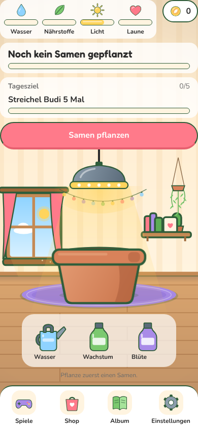 | 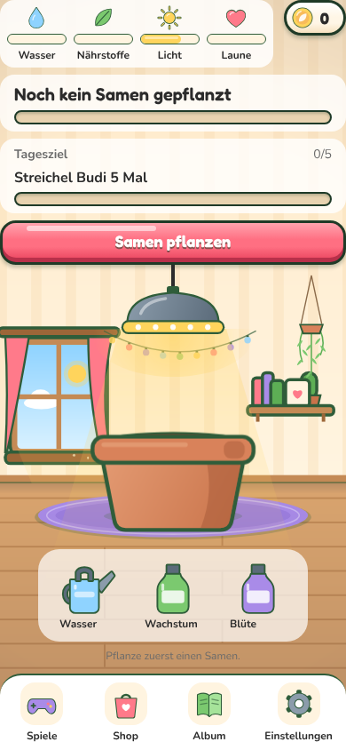 |
| Shop | 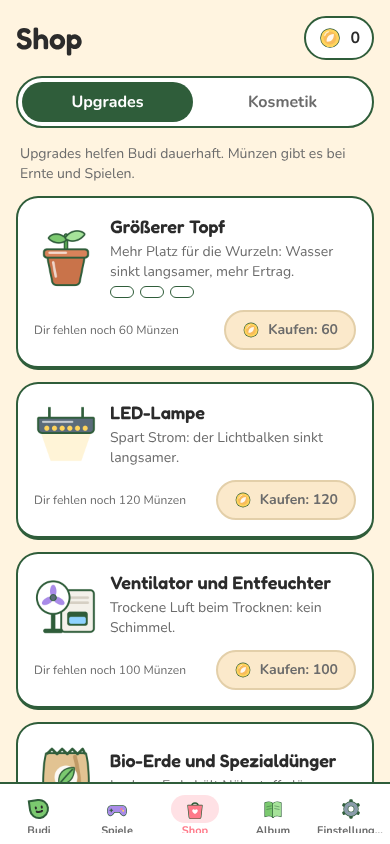 | 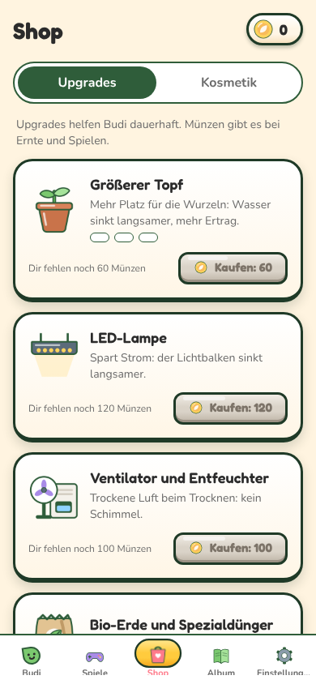 |
| Einstellungen | 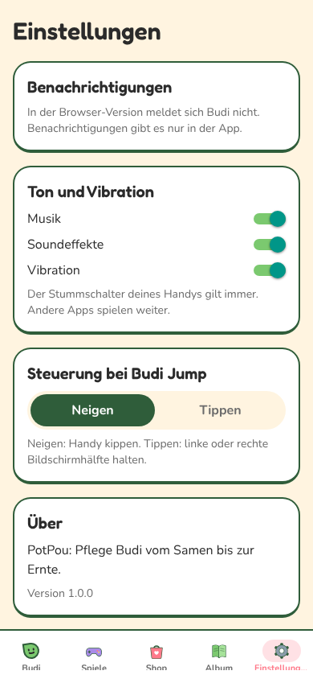 | 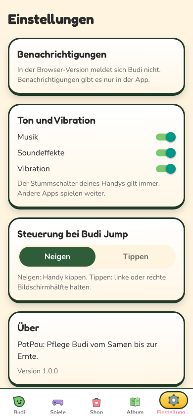 |

Galerie: 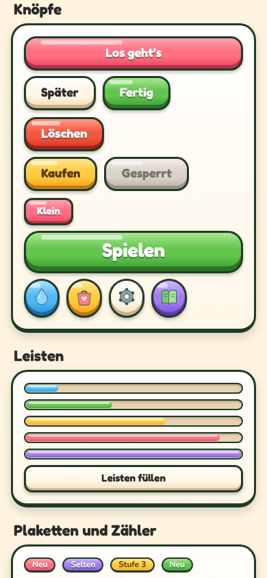 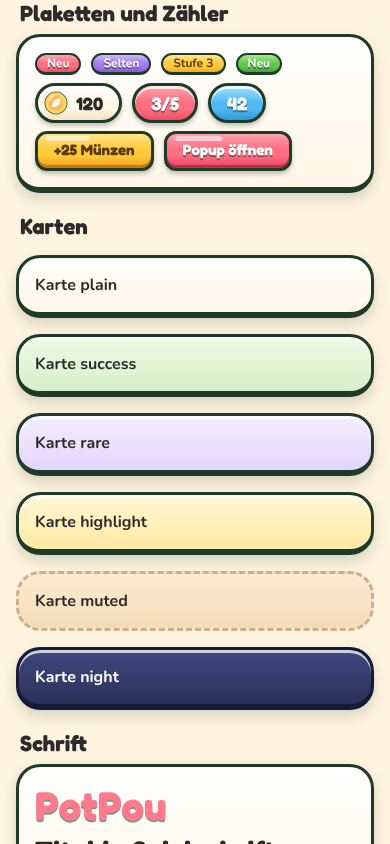 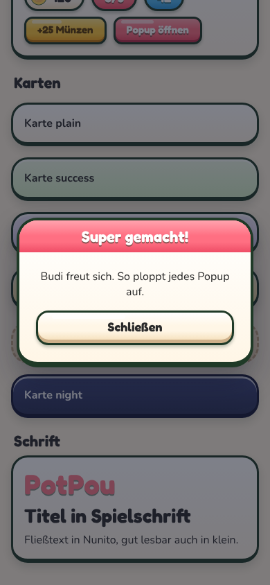

Rechner (1280 x 800): 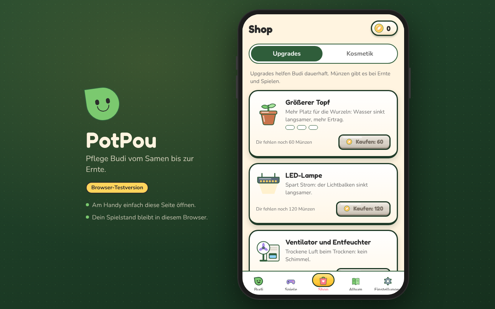 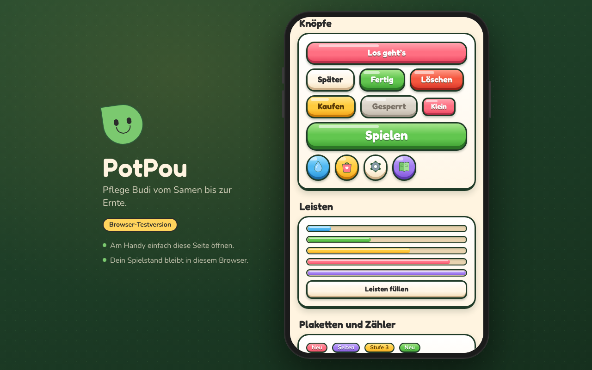

Geprüft mit Playwright bei 390 x 844 und 1280 x 800: keine Konsolenfehler oder -warnungen.

## Offen

- Keine neue Schriftdatei: Fredoka Bold ist schon rund und verspielt und wird bereits geladen. Eine dritte Schrift hätte `useAppFonts.ts` geändert (nicht meine Datei).

## Fehlende Assets

- Keine. Klick-Sound ist `s3_tap` aus `assets.ts` (über `cue('tap')`).

## Bekannte Bugs

- Keine bekannt.

## Handy-Test (3 bis 5 Punkte für den Chef)

1. Einstellungen > Debug-Menü > nach unten zu "Bausteine": Knöpfe antippen. Sie sinken ein, federn zurück, es klickt und vibriert kurz.
2. "Leisten füllen" tippen: die Leisten füllen sich weich mit Federung nach.
3. "+25 Münzen" tippen: die Münz-Pille zählt hoch und hüpft. "Popup öffnen": Popup ploppt auf.
4. Tabs wechseln: der aktive Tab sitzt auf einer goldenen Pille und hüpft hoch.
5. Shop und Album ansehen: Karten mit dicker Kontur und Kante, Knöpfe im neuen Look.

## Entscheidungen

- Drück-Federung (`usePressSpring`) läuft mit dem eingebauten `Animated` von React Native, nicht mit Reanimated: Knöpfe und Karten stecken in fast jedem Screen, und Tests, die Screens importieren (z. B. `debug/__tests__/releaseGate`), laden so keine Worklets. `lib/audio` wird erst beim ersten Tippen geladen, aus demselben Grund.
- Verläufe per CSS-Gradient statt Gradient-Paket (keine neue Abhängigkeit).
- Alte Props bleiben gültig: `Bar color`, `Badge color/light`, `Card tone`, `Button variant`. Neue Aufrufe sollen `tone` (ToneName) nutzen.
- Andere ART-Aufträge hängen eigene Abschnitte unten in `theme.ts` an und ändern den ART-1-Abschnitt nicht.

## Gefunden, nicht gemacht

- Der Tab "Einstellungen" wird bei 390 px Breite abgeschnitten ("Einstellung..."). Kürzeres Label in `strings.ts` (ART-5).
