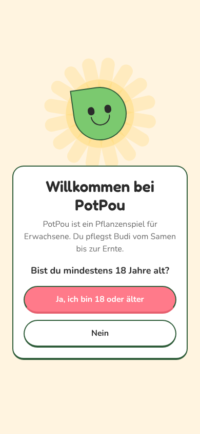
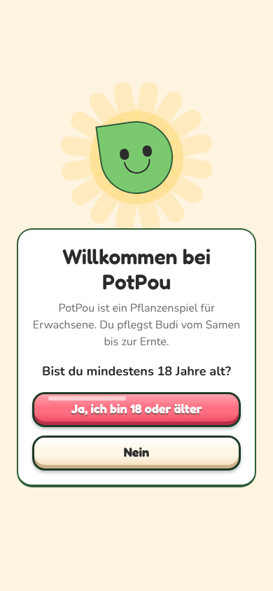

# ART-1: Design-System (Auftrag 46)

Stand: Teil 1 (Token-PR). Wird mit Teil 2 vervollständigt.

## Fertig in Teil 1

- `src/lib/theme.ts`, Abschnitt ART-1: `tones` (9 Farbtöne mit light/base/dark/edge/text), `outline`, `depth`, `shadows`, `gloss`, `gameRadii`, `typography`, `textShadow`, `springs`, `pressScale`.
- `Button` neu als 3D-Spielknopf: Verlauf, Glanzstreifen, dicke Kontur, Kante unten, sinkt beim Tippen ein, staucht und federt zurück. Klick und Vibration über `cue('tap')` (respektiert Einstellungen). API kompatibel, neu: Varianten `danger`, `gold`, Größe `lg`, `quiet`.
- `IconButton` (rund, nur Icon), `GameText` (Typo-Tokens mit Spielschrift-Schatten).
- Hilfen: `ui/game/GlossFill`, `ui/game/gradient` (CSS-Verlauf nativ über `experimental_backgroundImage`, im Web `backgroundImage`), `ui/game/usePressSpring`.

## Vorher / Nachher

| Vorher | Nachher |
| --- | --- |
|  |  |
