# ART-2: Icons, App-Icon, Splash und Item-Grafiken auf Spiele-Niveau

Branch: `claude/auftrag-47-art-2-icons-app-icon-splash-und-item-gra` · PR: #55 · Auftrag a47

## Icon-Blatt

Alle 41 Icons, ein Stil: dicke dunkle Kontur, Verlauf von hell oben nach dunkel unten, Glanzlicht oben, weicher Schlagschatten. Neu erzeugen: `node assets/render-art.cjs --sheet docs/progress/art2/icon-blatt.png`.

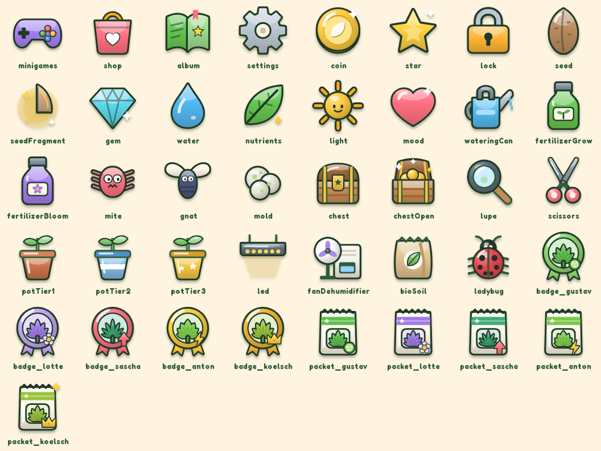

## Vorher und nachher

| Vorher Icons (WEB-4) |
| --- |
| 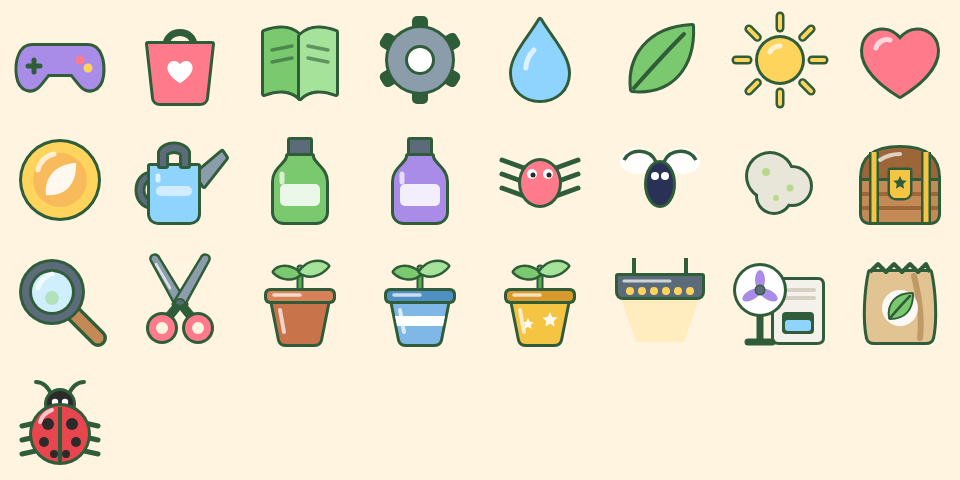 |

| Vorher App-Icon | Nachher App-Icon | Vorher Ladebild | Nachher Ladebild |
| --- | --- | --- | --- |
| 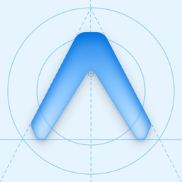 | 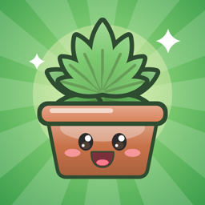 | 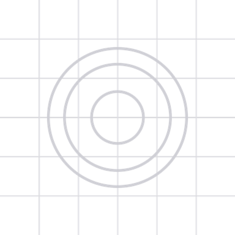 | 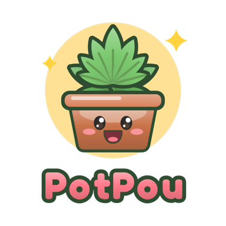 |

Android: Hintergrund, Vordergrund (bleibt im Sicherheitskreis), Monochrom für Themen-Icons, Favicon:

Im Spiel (Browser, 390 x 844). Vorher-Stand siehe `docs/progress/web4.md` (Shop, Zimmer):

| Zimmer | Shop | Album | Samenauswahl |
| --- | --- | --- | --- |
| 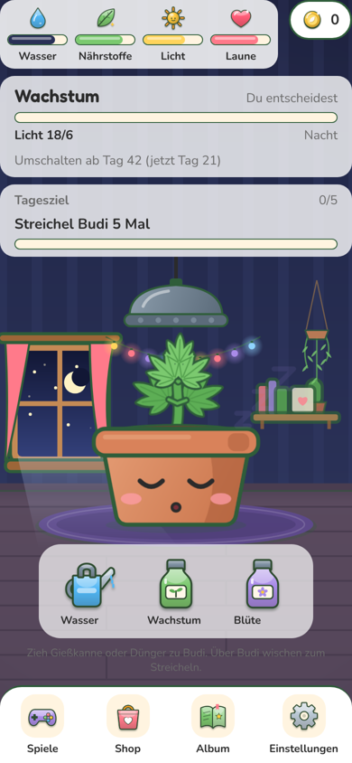 | 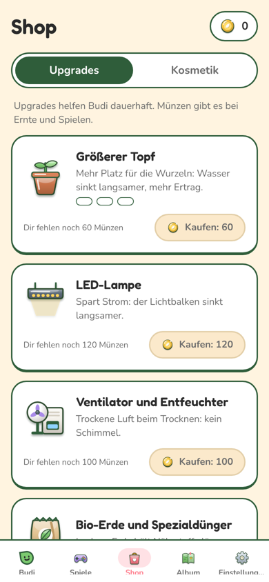 | 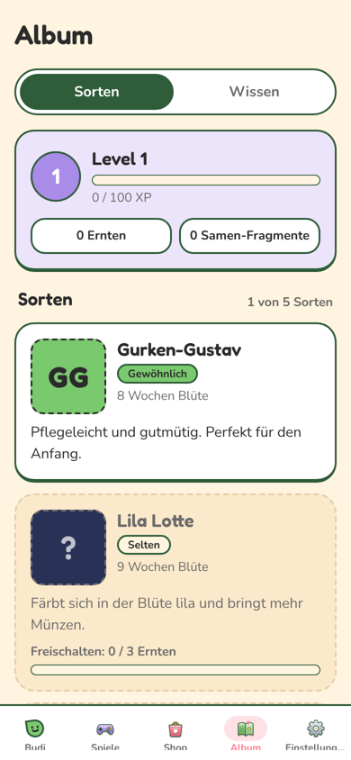 | 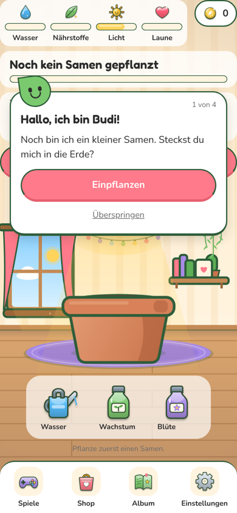 |

## Nachtrag a52: Keimling im App-Icon

Branch `claude/auftrag-52-keimling-icon`. Der Chef hat entschieden: Keimling statt Fächerblatt im App-Auftritt. Android-Vordergrund und Monochrom etwas kleiner, damit beide Blätter im Sicherheitskreis bleiben.

| Vorher App-Icon | Nachher App-Icon | Vorher Ladebild | Nachher Ladebild |
| --- | --- | --- | --- |
| 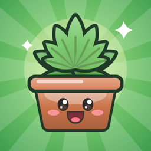 | 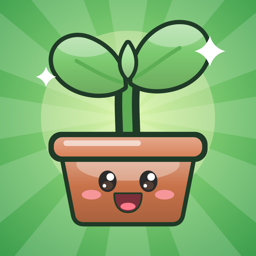 | 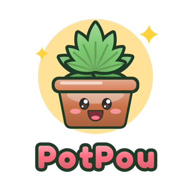 | 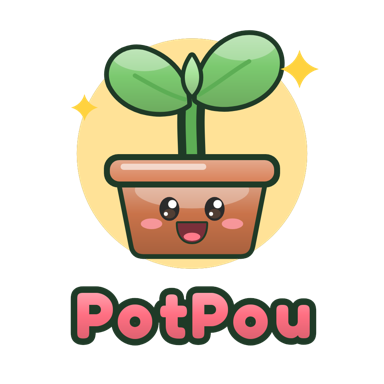 |

Android (Hintergrund, Vordergrund, Monochrom) und Favicon:

## Fertig

- `src/components/ui/icons/shapes.tsx`: Grundformen neu. `Shape` und `Dot` mit Kontur (7 Einheiten), Verlauf und automatischem Glanzlicht, `Line` (Strich mit Kontur), `Sparkle` (Funkeln), `IconFrame` (Schlagschatten für das ganze Icon).
- `tint.ts`: Farbmischung und Umriss eines Pfads (für Verläufe), mit Test. `iconPalette.ts`: Icon-Farben aus den ART-1-Tokens (`tones`, `outline`, `gloss`) in `theme.ts`.
- `hudIcons.tsx`: Tabs (Spiele, Shop, Album, Einstellungen), Münze, Stern, Schloss, Samen, Samen-Fragment (U10), Edelstein.
- `careIcons.tsx`: Wasser, Dünger, Licht, Laune, Gießkanne, Wachstums- und Blütendünger, Spinnmilbe, Trauermücke, Schimmel.
- `itemArt.tsx`: Kiste zu und offen (U13), Lupe, Schere, Töpfe Stufe 1 bis 3, LED, Ventilator, Bio-Erde, Marienkäfer, alle mit dem neuen Look.
- `strainArt.tsx`: je Sorte ein Abzeichen (Medaille mit Fächerblatt und Merkmal: Gurkenscheibe, Blüte, Pfeil, Blitz, Krone) und eine Samentüte als Porträt (U15).
- `appIconArt.tsx`: App-Icon (Budi-Topf mit Keimling vor grünem Strahlenkranz), Android-Ebenen, Favicon, Ladebild mit Schriftzug „PotPou“ (Fredoka). Eigene Zeichnung, hängt nicht an Budis Spielgrafik.
- `assets/render-art.cjs`: rendert alles nach `assets/images/` (256 px, scharf bis 85 pt bei 3x) und `assets/icon/`, plus Icon-Blatt mit `--sheet`.
- `src/lib/assets.ts`: `ui` (Münze, Balken, Navigation, Kiste, Stern, Schloss, Samen, Edelstein), `care`, `health` und neu `strainArt` (Porträt und Abzeichen je Sorte) zeigen auf echte Bilder. Damit fallen die Platzhalter-Wege in `AssetImage` für diese Stellen weg.
- `app.json` unverändert: Pfade bleiben, die Dateien darunter sind neu.

## Offen

- Sortenkarte (`src/components/album/StrainCard.tsx`, ART-5) zeigt noch die Initialen-Kachel „GG“. Bild liegt bereit: `strainArt[strain.id].portrait`; das Rätsel-Porträt kann `ui.ui_lock` nutzen. Ist an ART-5 gemeldet.
- Wolke beim Phasenwechsel (`src/components/room/phase/Puff.tsx`, ART-4) ist noch ein Platzhalter-Kreis. Gehört zum Zimmer.

## Fehlende Assets

- Keine in meinem Bereich.

## Bekannte Bugs

- Keine.

## Handy-Test (3 bis 5 Punkte für den Chef)

1. App installieren: Auf dem Home-Bildschirm Budi-Topf auf grünem Strahlenkranz, auf Android mit Themen-Icons einfarbig.
2. App starten: Ladebild mit Budi und Schriftzug „PotPou“.
3. Zimmer: Balken-Icons oben, Werkzeuge unten (Gießkanne, Dünger) und Navigation mit Kontur, Glanz und Schatten.
4. Shop: Münzen und Upgrade-Bilder im selben Stil. Debug: Schädlinge auslösen, Milbe und Mücke sehen gezeichnet aus.

## Entscheidungen

- Quelle aller Bilder bleibt die Skia-Zeichnung in `src/components/ui/icons/`. PNGs sind gerendert: nach Änderungen `node assets/render-art.cjs` laufen lassen (einzelne Datei: `node assets/render-art.cjs u9_coin`).
- PNG statt Leinwand für Icons in Listen und Leisten: im Browser kein WebGL-Kontext je Icon, auf dem Handy weniger Arbeit. Die Tab-Leiste zeichnet weiter live (`GameIcon`).
- App-Icon, Android-Ebenen, Favicon und Ladebild zeigen einen Keimling statt Fächerblatt (Chef-Entscheidung, Auftrag a52): unverfänglich für den Store-Review. Im Spiel bleibt Budi, wie er ist.

## Gefunden, nicht gemacht

- Debug „+1000 Münzen“ wirkte im Browser-Skript nicht (Münzen blieben 0). Nicht weiter untersucht.
