# ART-3: Budi als liebenswerte Spielfigur mit erstklassigen Animationen

Branch: `claude/auftrag-48-art-3-budi-als-liebenswerte-spielfigur-m` · PR: siehe Auftrag a48 · Kollege: Session a48

## Vorher und nachher

Reihe 1 alle Wachstumsphasen, Reihe 2 und 3 alle Mimiken, Reihe 4 Sorten Gustav (erntereif), Lotte, Sascha, Anton, Kölsch.

| Vorher | Nachher |
| --- | --- |
| 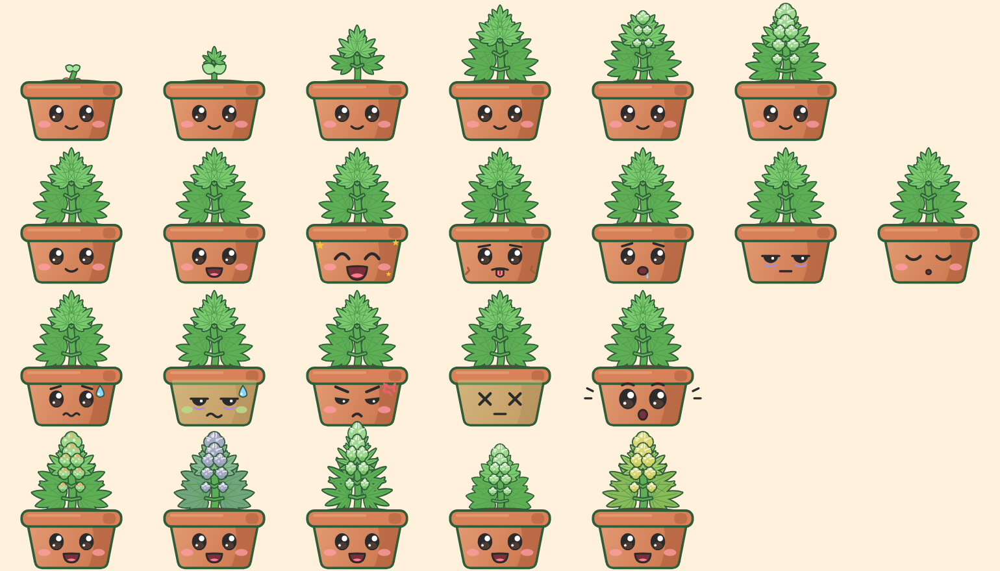 | 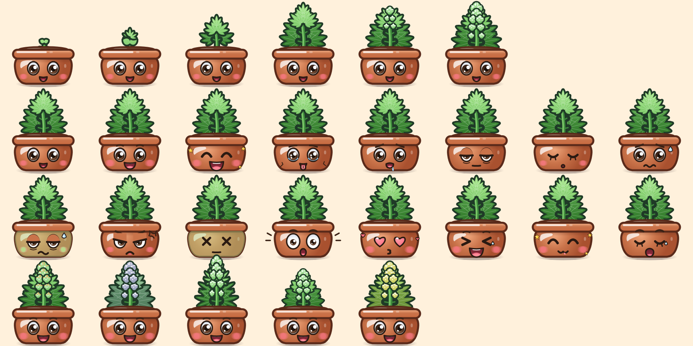 |

| Im Zimmer nachts (schläft) | Im Zimmer bei Tag |
| --- | --- |
| 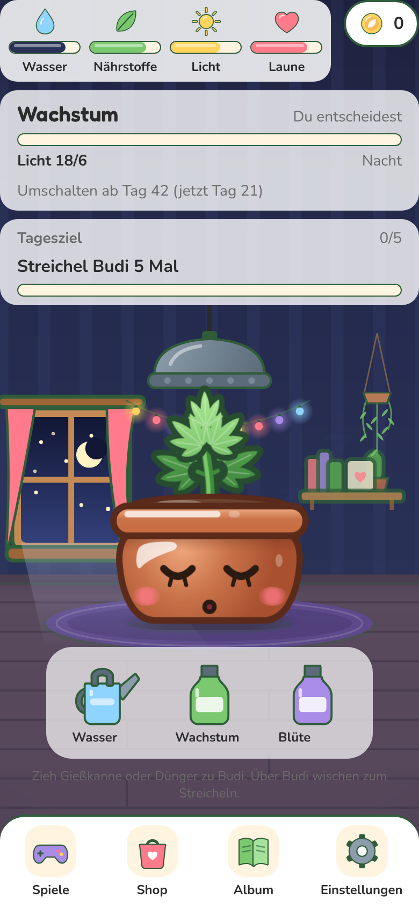 | 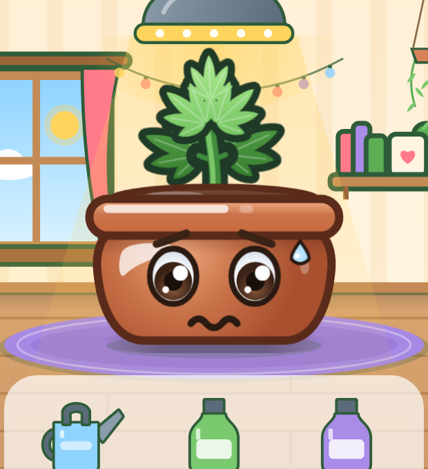 |

## Bildfolgen (Web-Export, Chromium, je Bild etwa 90 bis 120 ms)

| Animation | Folge |
| --- | --- |
| Streicheln: wohlig schaukeln, Pflanze schwingt nach | 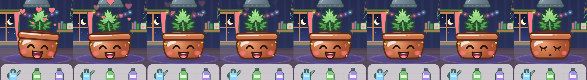 |
| Kitzeln (2 bis 3 Streichler kurz hintereinander): zappeln, kichern | 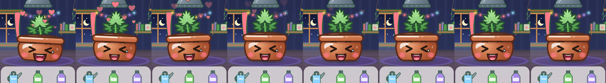 |
| Verliebt (ab 4 Streichlern): Herzaugen klopfen, anschmiegen, Hüpfer | 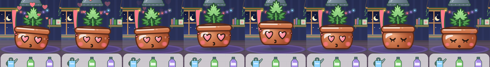 |
| Gießen: schlucken, strecken, Freude-Hüpfer mit Squash & Stretch | 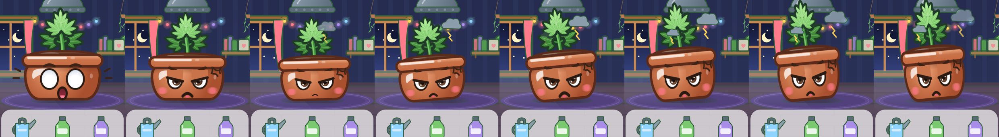 |
| Düngen: mampfen (Mund kaut, Körper wippt), kleiner Hüpfer | 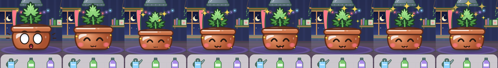 |
| Zu viel gegossen: schmollen, wegducken, Kopfschütteln | 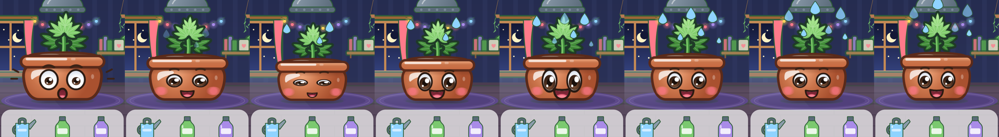 |
| Idle bei Tag (alle 1,5 s): atmen, blinzeln, umschauen, Kopf neigen | 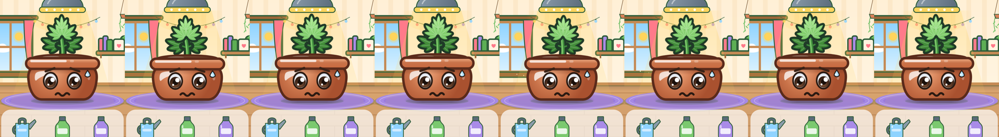 |

## Fertig

### Zeichnung (`src/components/budi/art/`)

- `PotArt.tsx`, `potShape.ts`: Topf als bauchiger Körper mit Radialverlauf, Glanzfleck oben links, Schatten unter dem Rand, Rand mit Verlauf und Glanzstreifen, dicke warmbraune Kontur. Rand und Bauch liegen dort, wo Accessoires und Schädlinge sie erwarten.
- `ShadowArt` (in `PotArt.tsx`): weicher Schlagschatten am Boden, eigene Ebene, wird beim Hüpfen kleiner und blasser.
- `PlantArt.tsx`: alle Blätter einer Lage als ein Pfad mit Verlauf (Spitzen hell, Ansatz satt), dicke Kontur aus den ART-1-Tokens, zarte helle Rippen, Stängel mit Lichtkante, Knospen mit Radialverlauf und Glanz, glänzende Samenschale. Ein Pfad statt Dutzender Formen ist auch schneller.
- `FaceEyes.tsx`: große Augen mit Augenweiß und Kontur, Iris mit Verlauf, Pupille, zwei Glanzpunkten. Die Iris liegt auf einer eigenen Ebene und schaut umher. Dazu Herzaugen, Kichern (> <), schwere Lider, Schmollblick, feuchte Augen bei Durst.
- `FaceMouth.tsx`: Münder als gefüllte Formen mit Verlauf, Zunge und Zähnen (Pou-artiges "D"-Lächeln statt Strich). Eigene Ebene: kaut, schluckt, gähnt, ploppt.
- `FaceExtras.tsx`: Brauen, Wangen mit weichem Verlauf, Tropfen, Funkeln, Herzchen.
- `faceSpec.ts`: Bauplan aller **16 Mimiken**: neutral, froh, sehr froh, durstig, hungrig, müde, schlafend, gestresst, krank, beleidigt, Koma, überrascht und neu verliebt, kichern, mampfen, gähnen. Getestet.
- `budiColors.ts`: Budis Zeichenfarben, abgeleitet aus Palette und ART-1-Tokens (`outline`, `tones`).
- `BudiCanvas.tsx`: stille Leinwand nur so groß wie ihre Ebene (Augen, Mund, Schatten, Topf). Wichtig für die Leistung im Browser, siehe unten.

### Leben (`src/components/budi/motion/`, `useBudiMotion.ts`, `budiMood.ts`)

**Animationen (15)**, alle mit Squash & Stretch und Nachfedern, alles als View-Transform im UI-Thread:

1. Atmen (im Schlaf langsamer und tiefer)
2. Wippen der Pflanze im Wind, dazu Nachfedern nach jedem Sprung (Follow-through)
3. Blinzeln in unregelmäßigen Abständen
4. Umschauen (Iris wandert, Körper neigt sich mit)
5. Kopf neugierig neigen
6. Freude-Hüpfer: ausholen, abspringen, landen, nachfedern; Schatten bleibt am Boden
7. Streicheln: schaukeln
8. Kitzeln: zappeln und kichern
9. Verliebt: Herzklopfen der Augen, anschmiegen, kleiner Hüpfer
10. Gießen: schlucken, strecken, Hüpfer
11. Düngen: mampfen, wippen, Hüpfer
12. Schmollen bei zu viel Pflege: ducken, wegdrehen, Kopfschütteln
13. Einschlafen (gähnen, einsacken, wegnicken) und Aufwachen, wenn das Licht angeht oder ihm etwas fehlt (strecken, gähnen, schütteln)
14. Mimikwechsel weich: Mund ploppt mit Overshoot auf, Augen zwinkern durch
15. Wachsen, wenn ein Werkzeug über ihm schwebt (wie bisher, jetzt mit Feder)

- `budiMood.ts` (rein, getestet): Streichel-Serie (Kitzeln ab 2, Verliebt ab 4 Streichlern binnen 1,5 s), welche Bewegung zu welcher Pflege, Einschlafen und Aufwachen, Idle-Gesten (Hüpfer nur, wenn es Budi gut geht).
- `budiLook.ts`: neue Mimiken in `faceFor` (getestet).
- Federn und Zeiten in `motion/constants.ts` (UI-Konstanten, kein Balancing).

### Leistung (Web-Export, Chromium, 390 x 844, 4-fache CPU-Drosselung, je 2 Läufe à 10 s)

| Szene | main Dichte 1 | ART-3 Dichte 1 | main Dichte 2 | ART-3 Dichte 2 |
| --- | --- | --- | --- | --- |
| Zimmer ohne Eingabe (Idle, Atmen, Blinzeln, Gesten) | 59,7 / 60 | **60 / 60** | 60 / 60 | **60 / 59,1** |
| Streicheln alle 1,2 s (Muster wie WEB-6) | 49,4 / 47,7 | **49,0 / 48,1** | 40,6 / 41,0 | **41,4 / 40,2** |
| Dauer-Streicheln (alle 0,3 s, Mimik wechselt ständig) | 44,9 / 45,8 | **46,6 / 46,5** | 40,0 / 41,8 | **41,0 / 42,6** |

Erste Fassung lag bei Dauer-Streicheln und Dichte 2 bei 33 fps: Jeder Mimikwechsel zeichnet vier Gesichtsebenen neu, und im Browser rechnet CanvasKit stille Leinwände auf der CPU (WEB-6). Mit `BudiCanvas` (Leinwand nur so groß wie die Ebene) ist es so schnell wie vorher. Budi selbst hält 60 fps; der Einbruch beim Streicheln kommt aus dem Rest des Zimmers (Leisten, Tagesziel, Effekte) und ist auf main genauso. Der Container hat keine Grafikkarte, Werte auf dem Handy sind besser.

- `bash scripts/check.sh` grün, Web- und Android-Export bauen, keine Konsolenfehler im Zimmer.

## Offen

- Die Reaktion auf das Licht ist das Aufwachen, wenn die Lampe angeht. Eine eigene Reaktion auf Tippen auf die Lampe gibt es nicht (gehört der Lampe, ART-4); gestörte Nachtruhe zeigt wie bisher Schmollen.
- "Kitzeln" ist mehrfaches schnelles Streicheln. Eine eigene Kitzel-Geste (z. B. Tippen mit zwei Fingern) bräuchte eine neue Geste in `room/care` (ART-4).

## Fehlende Assets

- Keine. Die Mimiken verliebt, kichern, mampfen, gähnen sind nur gezeichnet, nicht in `assets.ts`.

## Bekannte Bugs

- Keine bekannt.

## Handy-Test (3 bis 5 Punkte für den Chef)

1. Zimmer öffnen und 15 s nichts tun: Budi atmet, blinzelt, schaut umher, neigt den Kopf und hüpft ab und zu (nur wenn ihm nichts fehlt).
2. Einmal über Budi wischen: er schaukelt und lacht. Dreimal schnell hintereinander: er zappelt und kichert. Viermal: Herzaugen.
3. Gießkanne auf Budi ziehen: er schluckt, streckt sich und hüpft. Dünger: er mampft. Gleich nochmal gießen: er schmollt und schüttelt den Kopf.
4. Nachts schläft Budi (Zs). Wenn das Licht angeht, streckt er sich und gähnt.
5. Ehrlich sagen, ob etwas ruckelt oder zu viel wackelt.

## Entscheidungen

- Mimiken jenseits der Bilddateien heißen `ExtraFaceId` (`budiLook.ts`); `assets.ts` bleibt unverändert.
- Schnittstelle zum Zimmer unverändert (`Budi`-Props wie bisher).
- Topf-Kontur warmbraun, Pflanzen-Kontur `outline.color` aus ART-1: Kontur je Material wirkt satter als eine Farbe für alles.

## Gefunden, nicht gemacht

- Zimmer (ART-4): Beim Streicheln sinkt die Bildrate auch ohne Budi-Änderungen auf etwa 48 fps (Dichte 1). Lohnt eine Messung, welche Leiste oder welcher Effekt bei jeder Pflege neu zeichnet.
