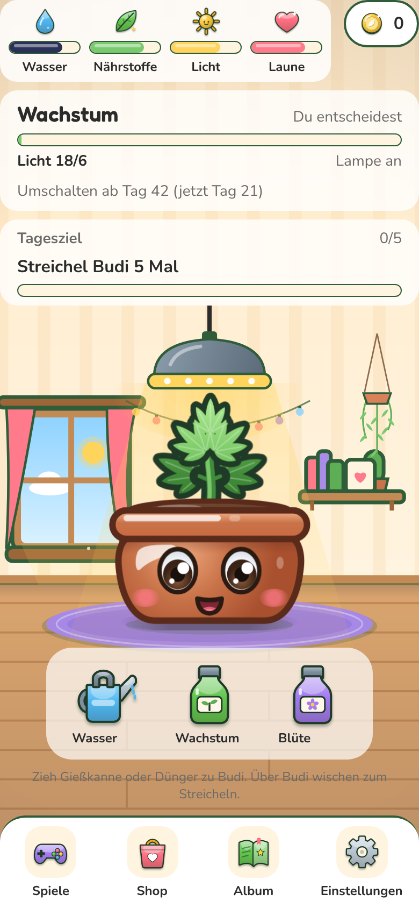
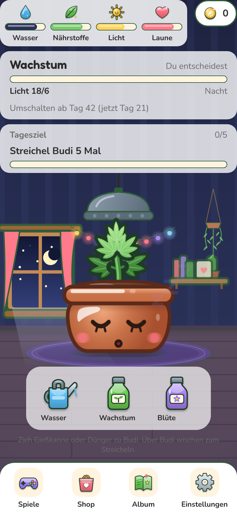
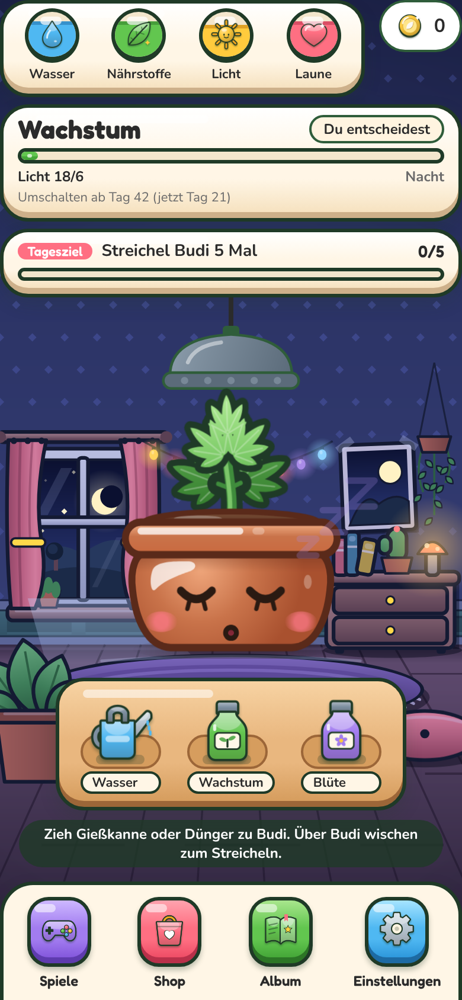

# ART-4: Zimmer als lebendige, gemütliche Spielwelt

Branch: `claude/auftrag-49-art-4-zimmer-als-lebendige-gemuetliche-s` · PR: #56 · Auftrag a49

## Vorher und nachher

| Vorher Tag | Nachher Tag | Vorher Nacht | Nachher Nacht |
| --- | --- | --- | --- |
|  |  |  |  |

Vorher = `main` mit ART-1, ART-2, ART-3, ART-5, ART-6 (Stand 5bd1152), nachher = dieser Branch mit demselben `main`. Chromium, 390 × 844, Spielstand mit Pflanze im Wachstum (Tag 21).

## fps bei 4-facher CPU-Drosselung

8 s mit Streicheln über Budi (wie `scripts/perf/measure.mjs`), Median aus 3 Läufen, Tag und Nacht getrennt.

| Szene | Dichte 1 vorher | nachher | Dichte 3 vorher | nachher |
| --- | --- | --- | --- | --- |
| Zimmer Tag | 59,1 | **57,8** | 48,8 | **46** |
| Zimmer Nacht | 59,6 | **58,9** | 55,3 | **47** |

So lesen: Der Container hat keine Grafikkarte, Chromium setzt dort alle Ebenen in Software zusammen. Dichte 1 zeigt die Rechenlast (JavaScript, Skia): bleibt nahe 60. Dichte 3 heißt 9-fache Software-Pixelarbeit je Frame; dort kostet das neue Zimmer 2 bis 8 fps (Werte streuen um ±4). Auf einem Handy macht das die Grafikkarte.

Was die Messung gelehrt hat (Schritte im Branch):

1. Erste Fassung mit Reanimated-Shared-Values für Wolken, Sterne, Staub, Vorhänge, Glühen und Wippen: Zimmer bei Dichte 1 von 45 auf 36 fps. Mit "Bewegung reduzieren" 60 fps, also lag es an den Dauer-Animationen.
2. Dauer-Animationen auf **CSS-Animationen von Reanimated 4** umgestellt (`animationName` im Style): im Browser echte CSS-Keyframes im Compositor, nativ im UI-Thread, kein JavaScript pro Frame.
3. Trace zeigte: fast die ganze Frame-Zeit ist "Commit" (Ebenen zusammensetzen), nicht Skript. Jede Skia-Leinwand ist im Browser eine eigene Ebene. Deshalb von 6 Zimmer-Leinwänden auf 2 große plus 3 kleine: Fensterkreuz, Vorhänge und Lichter-Schein liegen jetzt auf der Hintergrund-Leinwand, das Fenster ist ausgestanzt (`blendMode="clear"`), der Himmel darunter ist eine kleine eigene Leinwand. So ziehen Wolken hinter dem Fensterkreuz.
4. Vordergrund ohne bildschirmgroße Überblend-Ebene über Budi.
5. `CareStage` in Steuerung und Reaktion getrennt: Werkzeug-Fach und Werkzeuge rendern beim Streicheln nicht mehr neu (Hinweis aus art3.md).

## Fertig

### Zimmer (src/components/room/art/)

- **Ebenen mit Tiefe**: hinten Tapete mit Rauten, Holzverkleidung mit Feldern, Fenster mit Hügeln und Baum, Poster mit Klebeband, Efeu-Ampel, Lichterkette, Kommode mit Büchern, Kaktus und Pilz-Nachtlicht. Mitte: Holzdielen mit Fluchtpunkt, Lichtfleck vom Fenster, runder Teppich mit Fransen. Vorn (über Budi, `RoomForeground`): große Zimmerpflanze links, Sitzkissen rechts. Dicke Konturen, Verläufe, Glanzkanten (`roomShapes.tsx`), Vignette.
- **Farben je Tageszeit** in `roomPalette.ts` (gleiche Schlüssel für Tag und Nacht).
- **Wetter vor dem Fenster** (`weather.ts`, Test): klar, bewölkt oder Regen, einmal am Tag, reine Deko. Bei Regen schwächeres Licht und kein Staub.
- **Tag und Nacht mit Übergang** (`DayNightFade.tsx`): 1,4 s Überblendung, wenn die Lampe nach Lichtplan an- oder ausgeht. Nur während der Überblendung liegen zwei Bilder übereinander.
- **Bewegung** (`SkyLife.tsx`, `RoomAmbience.tsx`): ziehende Wolken, Regen, funkelnde Sterne, Sternschnuppe alle 10 s, Staub im Sonnenstrahl. Alles aus bei "Bewegung reduzieren".
- `RoomScene` und `RoomForegroundScene` sind `memo`: kein Neuzeichnen bei Uhr-Ticks (WEB-6).
- `roomLayout.ts`: Kommode, Poster, Verkleidung, Ampel. Tests für kleine und große Bildschirme.

### HUD und Werkzeuge (src/components/room/, room/hud/)

- Leisten als Sticker-Karten mit ART-1-Tokens (`HudPanel`: Kontur, Kante unten, Verlauf mit Glanz, Schatten).
- **Bedürfnisse als runde Plaketten** (`NeedBadge`): füllen sich von unten, federn beim Auffüllen, wackeln mit rotem Ausrufezeichen unter der Unbehagen-Schwelle, schneller bei kritisch (`needLevel.ts`, Schwellen aus `config.ts`, Test).
- Phase und Tagesziel kompakter, dicke federnde Balken (`HudBar`), Restzeit als Pille.
- **Werkzeug-Fach aus Holz** mit Mulden: Werkzeuge wippen, stauchen beim Aufnehmen und strecken sich, schwingen beim Ziehen mit der Geschwindigkeit, kippen über Budi zum Gießen, rucken beim Ausgießen und federn mit Überschwingen zurück (`springs` von ART-1).
- **Leuchtring unter Budi**, solange ein Werkzeug über ihm schwebt (`HoverGlow`).
- Hinweis unter dem Fach als dunkle Pille (lesbar auf Holz und Nacht).
- **Navigation** als bunte 3D-Kacheln mit `usePressSpring` (sinken ein, federn zurück).
- Puff-Wolke beim Phasenwechsel gezeichnet statt Platzhalter-Kreis (Hinweis ART-2).

## Offen

- Vorhänge wehen nicht mehr (lagen in der ersten Fassung auf eigenen Leinwänden, kostete 1 bis 3 fps). Die Lichterkette pulsiert aus demselben Grund nicht.
- Dichte 3 im Container 2 bis 8 fps unter `main` (siehe oben). Echte Messung auf einem Handy fehlt.
- `CoinChip` (oben rechts) gehört ART-1 und hat noch den alten Look.

## Fehlende Assets

- Keine. H1/H2 (Zimmer-Bilder) bleiben leer; liegt dort eine Datei, gewinnt sie wie bisher.

## Bekannte Bugs

- Wechselt die Lampe während einer laufenden Überblendung zurück, springt das Bild ohne Überblendung.

## Handy-Test (3 bis 5 Punkte für den Chef)

1. Zimmer öffnen: Wolken ziehen hinter dem Fensterkreuz, im Sonnenstrahl schweben Staubkörnchen. Zimmerpflanze links unten liegt vor Budi.
2. Gießkanne zu Budi ziehen: Sie staucht beim Anfassen, schwingt beim Ziehen mit, über Budi leuchtet ein gelber Ring, loslassen gießt, sie federt zurück ins Fach.
3. Debug > Zeitraffer, warten bis die Lampe ausgeht: Zimmer blendet weich in die Nacht, Sterne funkeln, Lichterkette und Nachtlicht leuchten.
4. Ein Bedürfnis unter 30 fallen lassen: Plakette wackelt mit rotem "!".
5. Ein paar Tage hintereinander schauen: Mal Sonne, mal Wolken, mal Regen.

## Entscheidungen

- Dauer-Animationen im Zimmer nur als CSS-Animationen von Reanimated 4 (`animationName` im Style), nicht mit Shared Values pro Frame. Gilt als Muster auch für andere Screens.
- So wenige Skia-Leinwände wie möglich; Teile, die sich nicht bewegen, gehören auf die Hintergrund-Leinwand.
- `useCareControls()` für alles, was nur Ziel, Schwebe-Zustand und `react` braucht; `useCareStage()` nur für Budi.
- Eigene Zimmer-Farben in `room/art/roomPalette.ts` und `room/hud/hudStyle.ts`, `theme.ts` nicht angefasst.

## Gefunden, nicht gemacht

- Die Lampe ist bei Tag die teuerste Ebene im Zimmer (Lichtkegel als 300 × 300 Leinwand über dem Bild). Als Verlauf auf der Hintergrund-Leinwand wäre er günstiger, braucht aber die Lage der Lampe im Layout.
- `lightPhase.puff` in `strings.ts` wird nicht mehr gebraucht (geteilte Datei, nicht entfernt).
