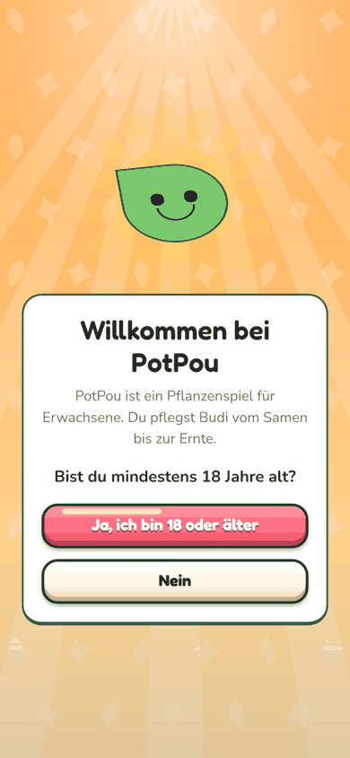
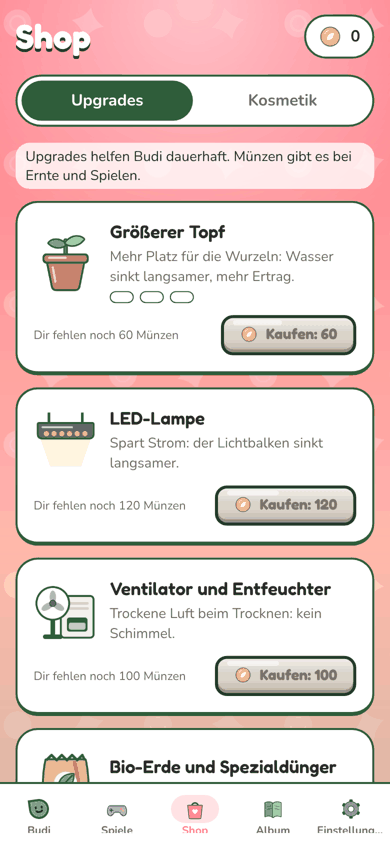
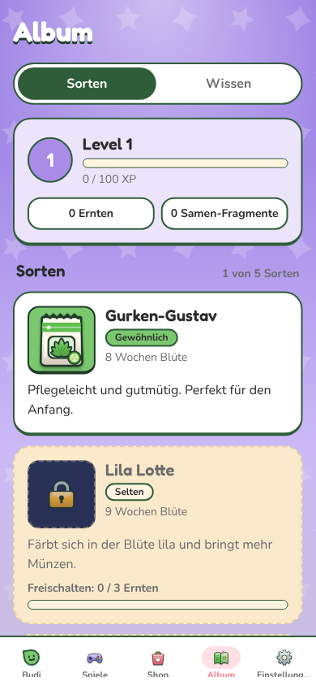
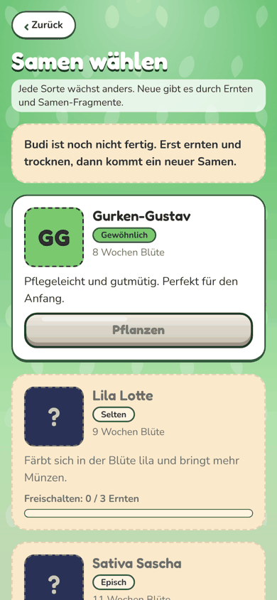
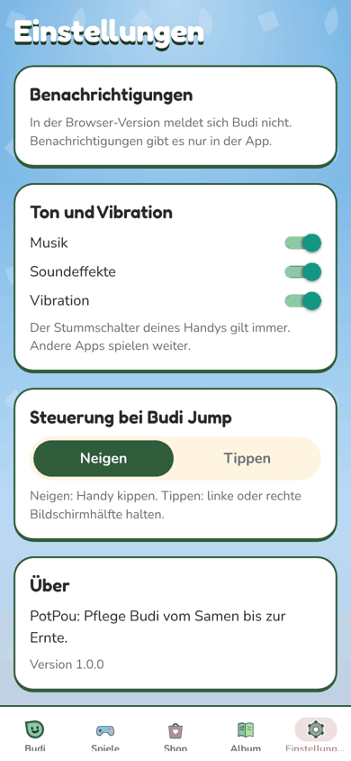
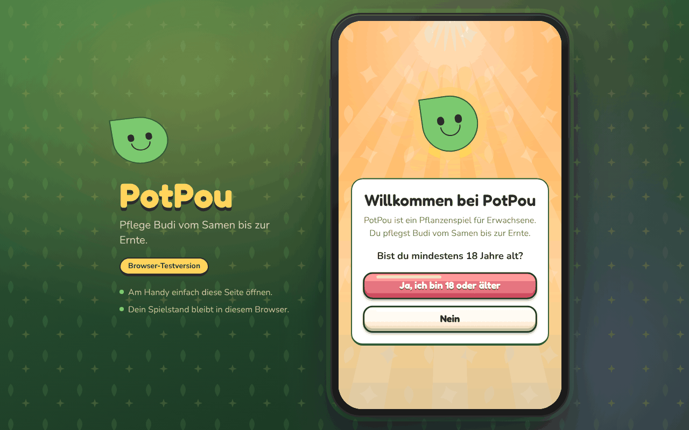
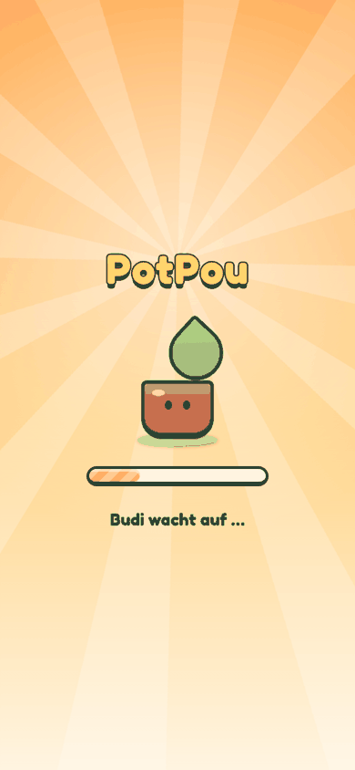
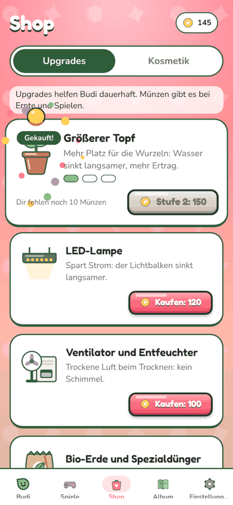
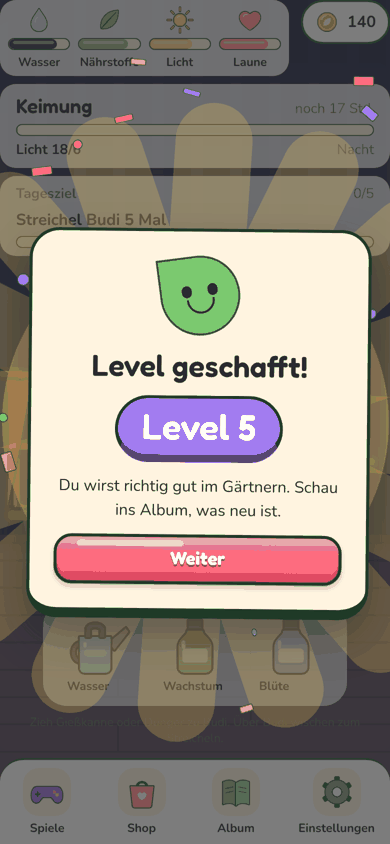
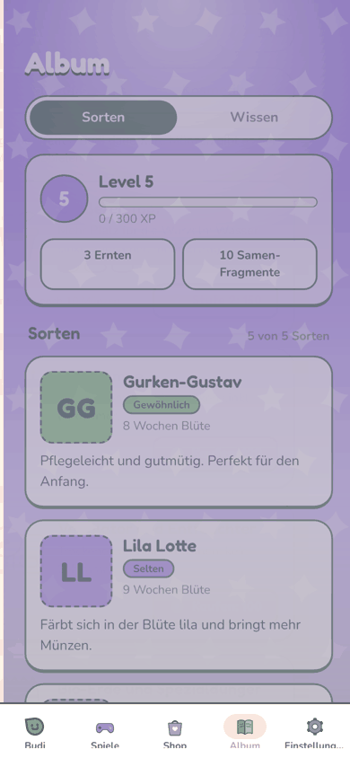

# ART-5: Screens, Übergänge und Belohnungs-Effekte wie im Top-Handyspiel

Branch: `claude/auftrag-50-art-5-screens-uebergaenge-und-belohnungs` · PR: siehe Auftrag a50 · Kollege: Session a50

## Vorher und nachher

Vorher = Stand nach WEB-5 (Bilder in `web5/`), nachher = dieser Branch mit `main` inkl. ART-1 (#54). 390 x 844 und 1280 x 800.

| Screen | Vorher | Nachher |
| --- | --- | --- |
| Altersfrage |  |  |
| Shop |  |  |
| Album |  |  |
| Samenwahl |  |  |
| Ernte |  |  |
| Einstellungen |  |  |
| Rechner |  |  |
| Ladebildschirm |  |  |

| Kauf (Funken, Münze steigt, Karte ploppt) | Level-Aufstieg (neu) | Übergang (Abdunkeln, Einfedern) |
| --- | --- | --- |
|  |  |  |

## Fertig

- **Spiel-Hintergrund je Screen** (`src/components/frame/ScreenBackdrop.tsx`, Daten in `backdrops.ts`): satter Verlauf, Licht von oben, Muster aus Spielzeichen, weicher Schatten unten. Altersfrage orange mit Strahlen, Shop koralle mit Münzen, Album lila mit Sternen, Samenwahl grün mit Samen, Ernte gold mit Strahlen, Einstellungen blau. Eine stille Skia-Leinwand, zeichnet nur bei neuer Größe.
- **GameScreen** (`frame/GameScreen.tsx`, `GameTitle.tsx`, `BackdropNote.tsx`): Rahmen für alle Screens außer Zimmer und Minigames. Weißer Titel mit dunkler Kante (ART-1-Typografie), Untertitel und Hinweise als helle Pille, damit sie auf jedem Verlauf lesbar sind. Genutzt in `app/album.tsx`, `settings.tsx`, `seed-select.tsx`, `harvest.tsx`, `shop/ShopScreen.tsx`, `onboarding/AgeGate.tsx`.
- **Übergänge**: Tabs wischen (`animation: 'shift'` in `app/_layout.tsx`), jeder Screen dunkelt beim Öffnen kurz ab und federt mit Überschwingen herein (`frame/ScreenEnter.tsx`, bei jedem Fokus).
- **Belohnungs-Bausteine** (`src/components/feedback/`): `Confetti`, `CoinRain` (Münzen fallen, landen mit Squash und hüpfen), `useCameraShake`, `usePop`, `Bouncy` (Squash & Stretch in Ruhe), `GoldCoin` (Münze mit Kontur, Kante, Glanz). Zeitpläne rein in `rewardFx.ts`, getestet. Bei "Bewegung reduzieren" aus.
- **Ernte**: Kiste springt auf, Kamera wackelt, Konfetti, nach dem Hochzählen Münzregen. Neue Sorte als eigene Karte mit Strahlen und Funken (`harvest/NewStrainBanner.tsx`).
- **Kauf** (Upgrades und Kosmetik): Karte ploppt, Funken spritzen, Münze steigt aus dem Bild (`shop/PurchaseBurst.tsx`).
- **Feiern im Zimmer** (`feedback/CelebrationLayer.tsx`, `CelebrationCard.tsx`): Phase, Tageskiste und neu **Level-Aufstieg** (`useLevelUps.ts`, hört auf die Erfahrung im Spielstand, nicht beim Laden). Abdunkeln, große kreisende Strahlen, Konfetti, Karte federt herein und wackelt, Budi hüpft, Kiste mit Münzregen.
- **Sortenkarten** (`album/StrainCard.tsx`): Porträts von ART-2 statt Buchstaben-Kachel, gesperrte Sorten mit Schloss-Grafik.
- **Rahmen am Rechner** (`frame/AppFrame.web.tsx`, `FrameBrand.tsx`): Verlauf mit Lampenlicht, Farbflecken und Blattmuster, Gehäuse mit dicker Kontur und Glanz, gelber Titel in Spielschrift, hüpfender Budi.
- **Ladebildschirm** (`public/index.html`): orange Verlauf mit kreisenden Strahlen, "PotPou" in Fredoka mit Kontur, Topf hüpft mit Squash & Stretch und Schatten, dicker gestreifter Ladebalken. Skripte und Preload unverändert.
- Prüfung: `bash scripts/check.sh` grün (676 Tests), Web- und Android-Export bauen. 390 x 844 und 1280 x 800 ohne Konsolenfehler (nur die bekannten Dokument-404 bei Direktaufruf am lokalen Server, siehe WEB-6).

## Offen

- **Spiele-Auswahl**: gehört ART-6 (Jakob hat sie übernommen). `GameScreen backdrop="games"` steht bereit.
- Ernte-Abschluss mit Konfetti und Münzregen nicht per Bildschirmfoto belegt (der Weg dahin braucht Lupe und Schere von Hand). Logik und Typen geprüft, bitte im Handy-Test anschauen.
- Karten, Leisten und Modals von ART-1 kommen noch; die Screens übernehmen sie automatisch, sobald `ui/Card` umgestellt ist.

## Fehlende Assets

- Keine.

## Bekannte Bugs

- Beim allerersten Öffnen eines Tabs steht für einen Moment nur der Grundton, bis der Screen montiert ist. Danach wischt er sauber.

## Handy-Test (3 bis 5 Punkte für den Chef)

1. Seite im privaten Fenster öffnen: oranger Ladebildschirm mit hüpfendem Topf, dann Altersfrage mit hüpfendem Budi auf warmem Verlauf.
2. Zwischen Shop, Album und Einstellungen wechseln: jeder Screen hat eigene Farbe und Muster, wischt herein und federt.
3. Debug: +100 Münzen, im Shop "Größerer Topf" kaufen: Karte ploppt, Funken, Münze steigt.
4. Debug: "Alle Sorten freischalten", zurück zu Budi: Level-Feier mit Konfetti und Wackeln.
5. Eine Ernte zu Ende spielen: Kiste antippen, Kamera wackelt, Konfetti, Münzen zählen hoch und regnen herab.

## Entscheidungen

- Eigener Rahmen `GameScreen` statt `ui/Screen` (mit Mia, ART-1, abgesprochen), damit Hintergründe nicht in ART-1-Dateien landen.
- Farben der Hintergründe stehen in `frame/backdrops.ts` (nur Grafik, kein Spielwert).

## Gefunden, nicht gemacht

- Das Fakten-Popup im Zimmer (`facts/FactUnlockPopup.tsx`) liegt über den Feiern; wenn beides gleichzeitig kommt, sieht man die Feier erst nach dem Schließen. Reihenfolge so gelassen.
