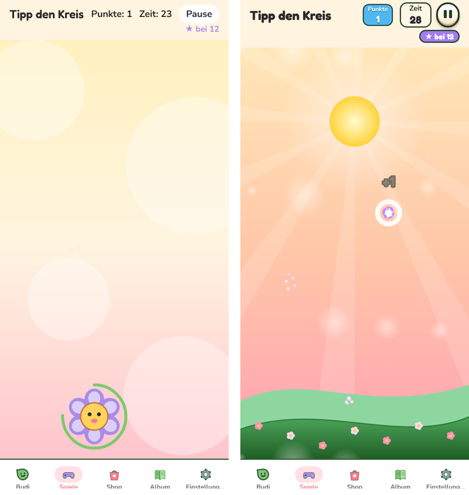
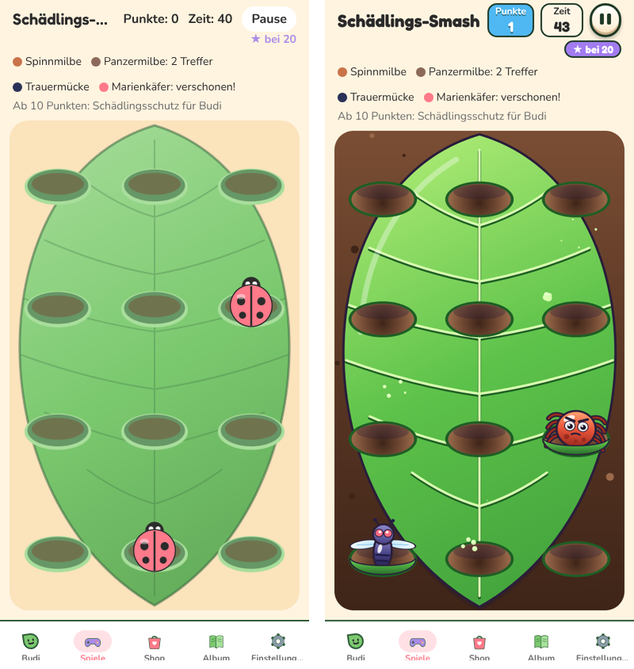
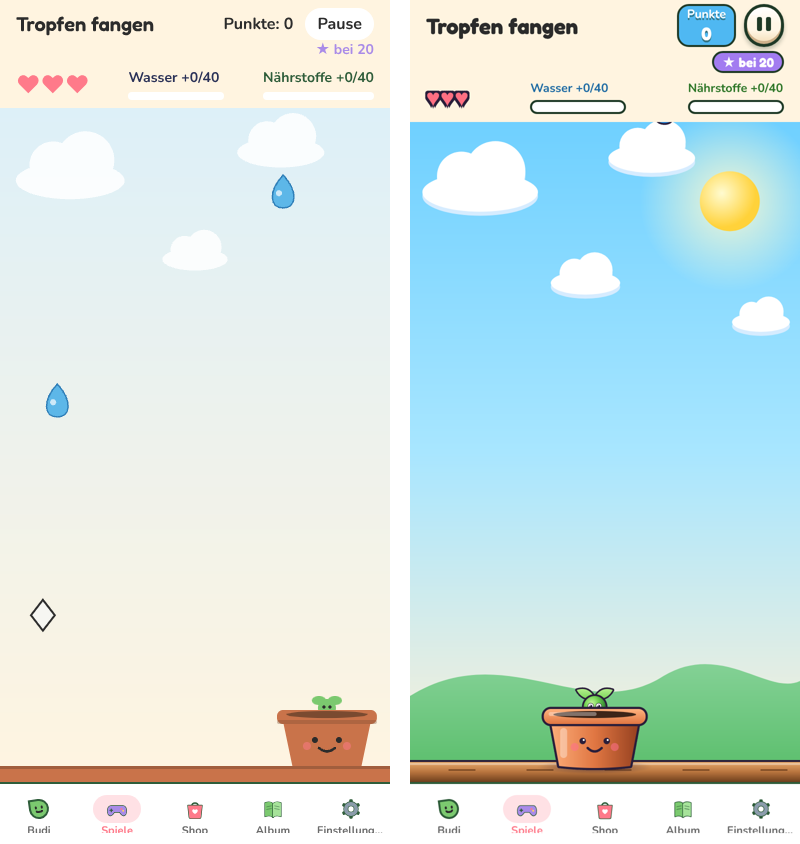
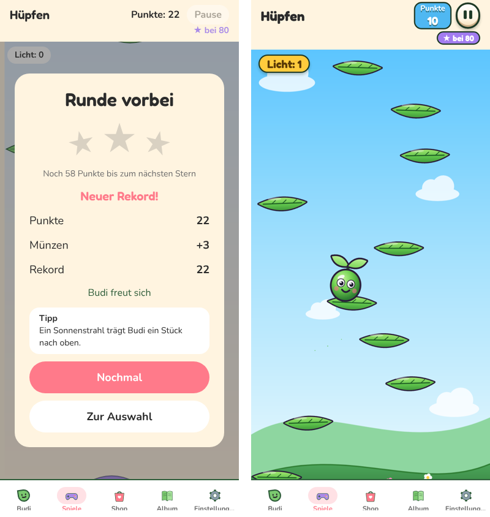
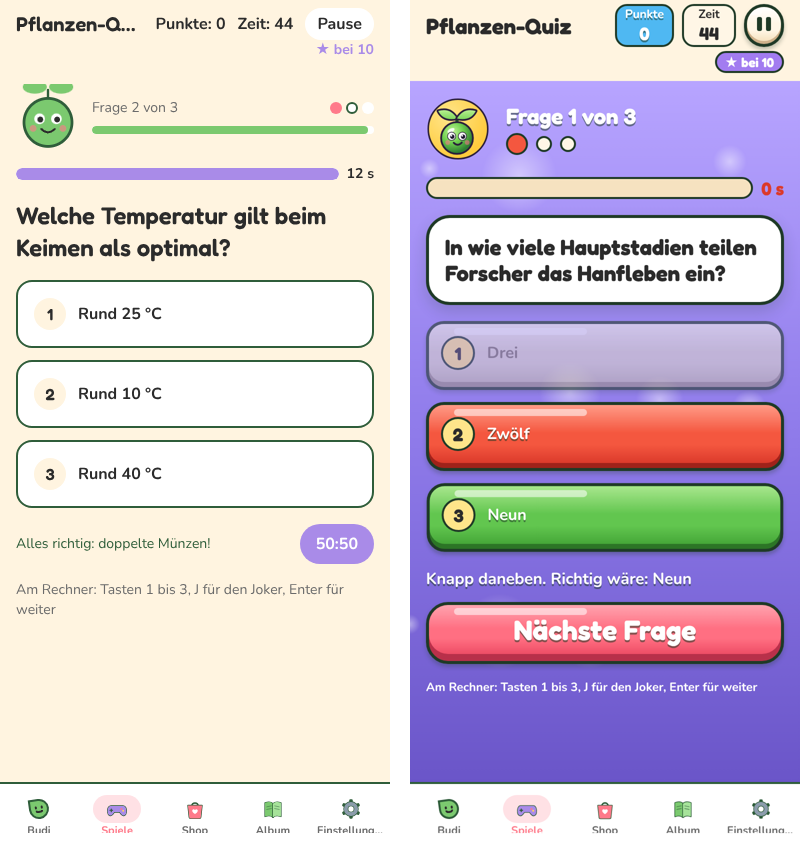
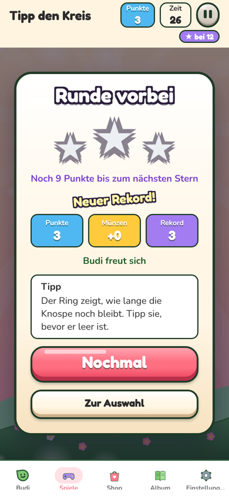
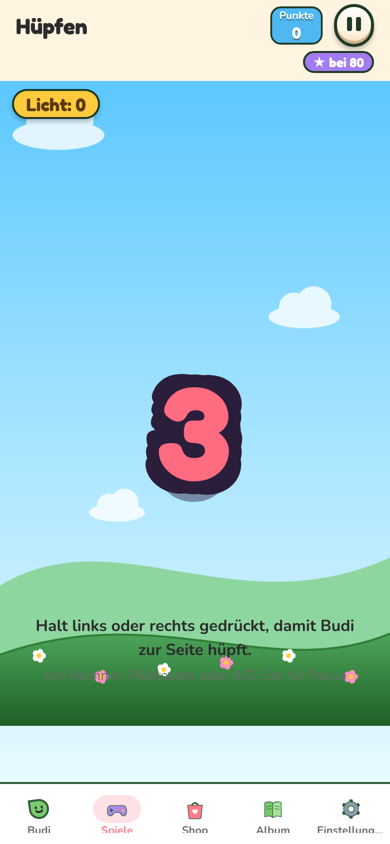

# ART-6: Minigames, Grafik und Animation auf Spiele-Niveau, flüssig (Auftrag 51)

Branch: `claude/auftrag-51-art-6-minigames-grafik-und-animation-auf` · PR: siehe Auftrag a51 · Kollege: Session a51

## fps vorher und nachher

Gemessen wie WEB-6 (`scripts/perf/measure.mjs --fps`, Playwright, Chromium, 390 x 844, **4-fache CPU-Drosselung**, 8 s mit Eingaben). Vorher = `main` auf 0854b3f+WEB-6 (b9520f3), nachher = dieser Branch. Container ohne Grafikkarte (WebGL in Software), Dichte 1 zeigt die reine Rechenlast, Dichte 2 zusätzlich die Pixelarbeit.

| Spiel | Dichte 1 vorher | nachher | Dichte 2 vorher | nachher |
| --- | --- | --- | --- | --- |
| Tipp den Kreis | 28,1 | **50,9** | 10,5 | **50,4** |
| Schädlinge | 11,5 | **49,8** | 6,4 | **52,1** |
| Tropfen | 33,0 | **57,2** | 14,4 | **54,1** |
| Budi Jump | 16,6 | **52,4** | 8,6 | **37,3** |
| Quiz | 56,2 | **55,0** | 54,8 | **49,7** |

Die verbleibenden Ausreißer sind einzelne lange Frames beim Start (stille Bilder werden einmal gerechnet, 200 bis 700 ms, während des Countdowns) und der erste Ton. Im Spiel selbst laufen die Frames nahe 60. Budi Jump bei Dichte 2 ist durch die Parallaxe-Ebenen pixellastig (Software-Compositing im Container), auf einem Handy mit GPU nicht zu erwarten.

## Wie (Technik)

- **Eine Picture pro Frame statt hunderter Skia-Knoten** (`framework/art/useScene.ts`): Jedes Spiel zeichnet seine bewegte Szene in einem Worklet in eine einzige `SkPicture`. Skia muss pro Frame nur noch einen Knoten abspielen, kein React, kein Szenengraph. Die alte Picture wird freigegeben (sonst WASM-Leck im Web).
- **Sprites** (`framework/art/kit.ts`): Figuren werden einmal je Laufzeit mit Kontur, Verlauf, Glanz und Schatten als Picture aufgenommen und pro Frame nur verschoben, skaliert, gedreht (`stamp`).
- **Stille Hintergründe** (`framework/art/Stage.tsx`): Blatt, Himmel, Hügel liegen in einer eigenen stillen Leinwand (im Web auf der CPU, WEB-6), `memo`, damit Punkte und Popups sie nicht neu zeichnen lassen.
- **Parallaxe** (`framework/art/Drift.tsx`, `jump/JumpLayers.tsx`): stille Kacheln in Feldgröße, nur als View verschoben (keine Leinwand über 4096 px, auch nicht bei Pixeldichte 3).
- **Kamera-Wackeln** als View-Transform der ganzen Bühne (`fx/useShake.ts`), mit Hauch Zoom gegen freie Ränder.

## Fertig

- **Gemeinsamer Look**: Palette `framework/art/palette.ts` (Licht-, Grund-, Schattenton je Fläche, dunkle Kontur). Effekte `framework/art/drawFx.ts`: Partikel mit Glanzpunkt, drehende Funkel-Sterne, Schockwellen-Ringe, weißer Blitz.
- **Zeitlupe bei Kombos** (`useMinigameSession.slowMo`, `fxLogic.consumeSlowMo`): alle 5 Treffer in Folge 420 ms auf 35 % Tempo, dazu Blitz, großer Ring, Funken. Effekte laufen mit (`useFx(session.timeScale)`). Jump: beim Sonnenstrahl.
- **Tipp den Kreis**: Abendhimmel mit Sonnenstrahlen, Hügel mit Blüten, Lichtkugeln ziehen nach oben. Knospe mit Kontur und Gesicht blüht mit Überschwingen auf, atmet, dreht sich, zittert am Ende; Zeit-Ring mit Kontur läuft grün, gelb, rot.
- **Schädlinge**: Erde mit Steinchen, Blatt mit Glanzkante und Adern, Löcher mit Tiefe. Milbe, Panzermilbe, Mücke (Flügelschlag), Marienkäfer als Figuren; tauchen mit Überschwingen aus dem Loch auf, atmen, tauchen vor dem Ende wieder ab, Treffer quetscht platt auf einen Klecks.
- **Tropfen**: Himmel mit Sonne, Hügel, Fensterbrett aus Holz, Wolken ziehen. Tropfen glänzen und pendeln, Salz ist ein grimmiger Kristall, Dünger dreht sich, Topf mit Budi-Spross und Schatten federt beim Fang. Regenstriche im Schauer, pulsierende Schutzblase.
- **Budi Jump**: Tag, Abend, Nacht (mit Mond und Sternen) blenden mit der Höhe, Wolken auf halber Geschwindigkeit, Startwiese sinkt weg. Blätter je Typ mit Kontur und Glanz, wiegen sich; Lichtkugeln pulsieren; Sonne mit Gesicht dreht; Budi schaut in Laufrichtung, neigt sich, staucht und streckt.
- **Quiz**: lila Bühne mit Lichtkugeln, Budi-Kopf, Fortschrittspunkte, Leiste mit Glanz (rot und pulsierend am Ende), Fragekarte, Antworten als 3D-Knöpfe (`quiz/QuizAnswer.tsx`), Joker als Gold-Knopf.
- **Rahmen**: Countdown mit Kontur-Zahl, Drehung, Ring (`CountdownOverlay.tsx`), „Los!“ fliegt weg. Ergebnis: Karte federt auf, Sterne knallen nacheinander mit Funken und Ton, Punkte und Münzen zählen hoch, „Neuer Rekord!“ wackelt (`GameOverOverlay.tsx`, `ResultStars.tsx`, `countUp.ts`). Kopfzeile mit Pillen, Punkte springen auf, Zeit wird rot (`ScoreHud.tsx`). Kombo-Abzeichen wird heißer (Koralle, Gold, Lila). Popups und Banner mit Kontur-Schrift (`StrokeText.tsx`). Knöpfe aus dem Design-System (ART-1 `Button`).
- **Auswahl**: Karten als 3D-Knöpfe, Bilder aus denselben Sprites (`MinigameCard.tsx`, `MinigameIcon.tsx`).
- Werte in `config.ts`, Abschnitt `MINIGAME_ART`. Tests: `framework/__tests__/artLogic.test.ts` (Ringe, Blitz, Zeitlupe, Kombo-Stufe, Kurven, Hochzählen, Auftauchen, Ringfarbe, Himmel).

## Vorher / Nachher

| Spiel | links vorher, rechts nachher |
| --- | --- |
| Tipp den Kreis |  |
| Schädlinge |  |
| Tropfen |  |
| Budi Jump |  |
| Quiz |  |
| Ergebnis |  |
| Countdown |  |

## Offen

- Kein Test auf einem echten Handy (Container ohne Gerät). Native Grafik nutzt dieselben Skia-APIs (Picture, PictureRecorder, Shader); Android-Export baut.

## Fehlende Assets

- Keine. Alles Skia-Formen.

## Bekannte Bugs

- Erste Runde nach dem Laden: ein langer Frame (bis 0,7 s) im Countdown, während die stillen Bilder und Sprites gerechnet werden.
- Wackeln zoomt die Bühne kurz um wenige Prozent; Tipps während des Wackelns landen ein paar Punkte daneben (Wackeln dauert 0,1 bis 0,3 s).

## Handy-Test (3 bis 5 Punkte für den Chef)

1. Schädlinge: Tiere ploppen aus den Löchern, atmen, Mücken flattern. 5 Treffer in Folge: kurzer weißer Blitz und Zeitlupe.
2. Tropfen: Wolken ziehen, Topf federt beim Fangen, Salz hat ein grimmiges Gesicht.
3. Budi Jump: höher springen, der Himmel wird abends rosa, nachts dunkel mit Mond. Budi schaut in die Richtung, in die er hüpft.
4. Nach jeder Runde: Sterne knallen nacheinander mit Funken auf, Punkte zählen hoch.
5. Ehrlich sagen, ob irgendein Spiel ruckelt.

## Entscheidungen

- Eigene Palette in `framework/art/palette.ts` statt `theme.ts` (gehört ART-1). Rahmen-UI nutzt ART-1-Tokens (`tones`, `outline`, `springs`, `Button`, `GameText`, `GlossFill`).
- Zeitlupe hält die Spielzeit an wie das kurze Anhalten (`hitStop`): pro Stufe gewinnt man 273 ms Rundenzeit. Punkte, Münzformel, `MINIGAME_REWARDS` und Regeln unverändert.
- Gelöscht: `CritterSlot.tsx`, `SmashLeaf.tsx`, `TapScene.tsx`, `DropsCanvas.tsx`, `JumpScene.tsx`, `JumpBoosts.tsx`, `fx/FxLayer.tsx` (ersetzt durch Szenen-Worklets). `JumpBudi.tsx` bleibt, `facts/QuizHeader.tsx` nutzt ihn.

## Gefunden, nicht gemacht

- `facts/QuizHeader.tsx`, `facts/QuizOption.tsx` und `facts/FactQuizGame.tsx` werden vom Minigame-Quiz nicht mehr benutzt (P17). Können weg.
- `scripts/perf/measure.mjs` kann nur alle Szenen messen; ein Filter je Szene wäre praktisch (ich habe lokal eine Kopie benutzt, `scripts/` nicht angefasst).
