# PWEB: Web-Version für den ersten Test

Branch: `claude/auftrag-36-pweb-web-version-fuer-den-ersten-test` · PR: siehe Auftrag a36 · Kollege: Session a36

**URL: https://neinkob12.github.io/pou-/**

## Einmalig für den Chef

GitHub Pages einschalten: Repo **Settings > Pages > Build and deployment > Source: GitHub Actions**. Danach baut jeder Push auf `main` die Web-Version neu (Workflow "Pages", ca. 3 Minuten). Den ersten Lauf kannst du unter **Actions > Pages > Run workflow** auch von Hand starten.

## Fertig

- Web-Support: `react-native-web` (~0.21.4) und `@expo/metro-runtime` (~58.0.14) installiert (SDK-58-Versionen, `react-dom` war schon da). `app.json`: `web.output: single`, `experiments.baseUrl: /pou-`.
- `npx expo export --platform web` baut fehlerfrei nach `dist/`.
- Skia im Web: `src/lib/skiaWeb.web.ts` lädt CanvasKit (WebAssembly), `app/_layout.tsx` wartet darauf wie auf die Fonts. Die `.wasm`-Datei bündelt Metro als Asset (`metro.config.js`: `wasm` in `assetExts`), sie liegt damit automatisch unter `/pou-/`. Nativ liefert `src/lib/skiaWeb.ts` sofort `true`.
- Speicher: MMKV 4 hat eine eingebaute Web-Variante auf `localStorage`. Kein eigener Code nötig, der Spielstand bleibt nach Neuladen und nach Browser-Neustart erhalten (geprüft: Altersfrage, Pflanze, 56 Münzen nach Ernte).
- Stillgelegt im Web (je eine `.web`-Datei, nativ unverändert):
  - Benachrichtigungen: `src/hooks/useNotificationScheduler.web.ts` (leer), `src/components/settings/NotificationsSection.web.tsx` (nur Hinweis, Text in `strings.ts` unter `webVersion`).
  - Consent/Werbung: `src/components/onboarding/consentHook.web.ts` (sofort erledigt). P29 füllt nur die native Datei.
  - Sensoren: Budi Jump startet im Web mit Tippen statt Neigen (`useJumpInput.ts`, eine Zeile).
  - Haptik: `expo-haptics` ist im Web ein No-op, Aufrufe fangen Fehler schon ab. Keine Änderung nötig.
- Debug-Menü und Zeitraffer sind im Web immer da (`src/lib/devTools.ts`: `__DEV__ || web`), damit du Phasen und Ernte testen kannst. Nativ gilt weiter nur `__DEV__`.
- `.github/workflows/pages.yml`: Bei Push auf `main` bauen und auf Pages veröffentlichen. Kopiert `index.html` als `404.html` und je Route (`shop.html`, `minigames/smash.html` ...), damit Direktlinks und Neuladen auf Unterseiten gehen. `ci.yml` unverändert.

### Bugfix nativ (betrifft auch Android/iOS)

- Ursache: expo-router 58 macht aus `href: null` (in `app/_layout.tsx` für `debug`, `harvest`, `seed-select`, `onboarding`) intern `hidden: true`. Der Tab-Navigator (`useVisibleTabsWithRedirect`, plattformunabhängiger JS-Code) leitet einen fokussierten versteckten Tab sofort auf den Start-Tab um.
- Folge: Diese vier Screens waren nicht erreichbar. Beim Erststart schickte die Onboarding-Weiche zur Altersfrage, der Router sofort zurück: Endlosschleife, App hängt (React-Fehler #185).
- Fix: `src/lib/hiddenTab.ts` (`HIDDEN_TAB_OPTIONS`: kein Tab-Knopf, keine Tab-Leiste, Route bleibt erreichbar), eine Zeile in `app/_layout.tsx`, Test `src/lib/__tests__/hiddenTab.test.ts`. Mit der Leiterin abgestimmt.

## Im Browser geprüft (Playwright, Chromium, 390 x 844)

Keine Fehler in der Konsole auf Startseite, Tabs, Spielen, Debug und Ernte. Ausnahme: Ruft man eine Unterseite direkt auf (lokal ohne die Routen-Kopien), meldet der Browser einmal "404" für das Dokument selbst; die App lädt trotzdem. Auf Pages verhindern das die Routen-Kopien.

| Schritt | Bild |
| --- | --- |
| Erststart: Altersfrage | 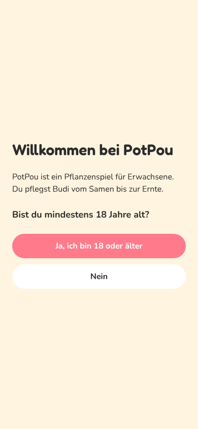 |
| Zimmer mit Tutorial, Samen gepflanzt | 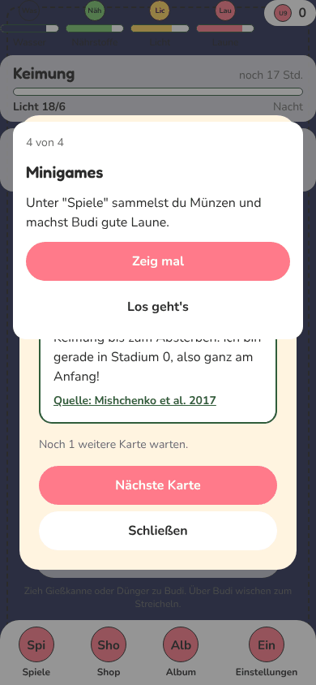 |
| Tab Spiele | 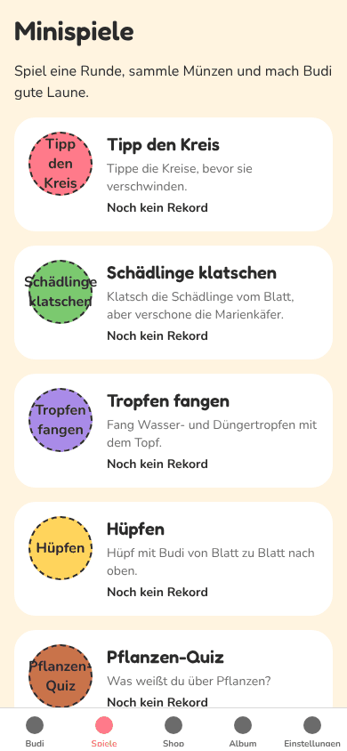 |
| Tab Shop | 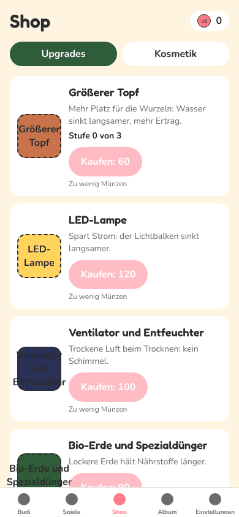 |
| Tab Album | 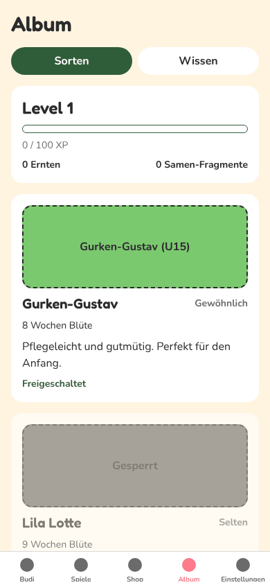 |
| Tab Einstellungen (Web-Hinweis bei Benachrichtigungen) | 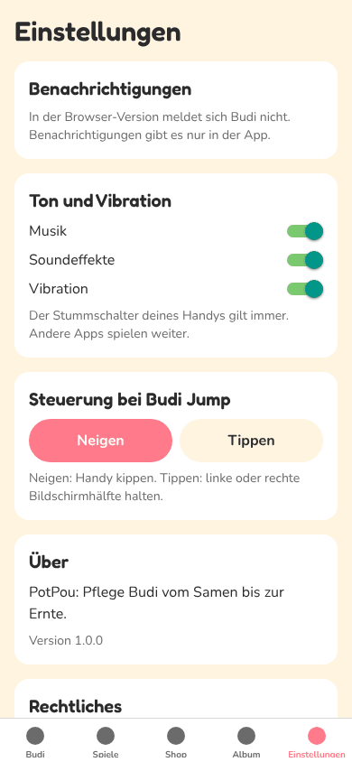 |
| Skia: Schädlinge klatschen | 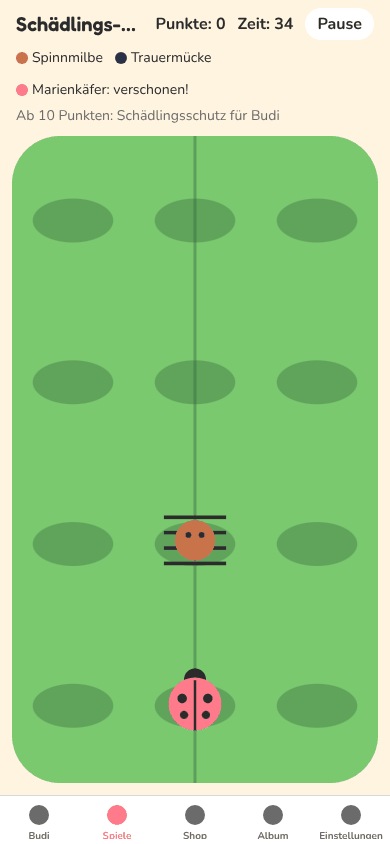 |
| Skia: Hüpfen | 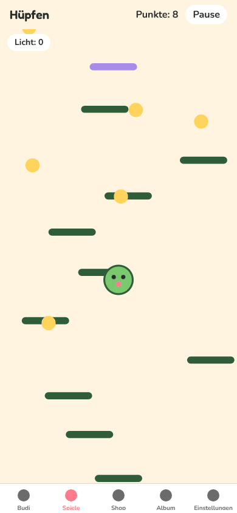 |
| Skia: Tropfen fangen | 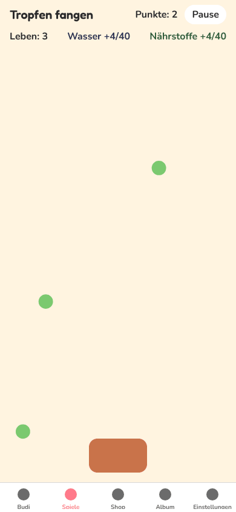 |
| Debug-Menü mit Zeitraffer | 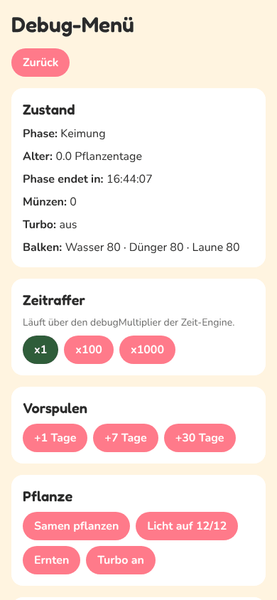 |
| Nach Vorspulen: erntebereit | 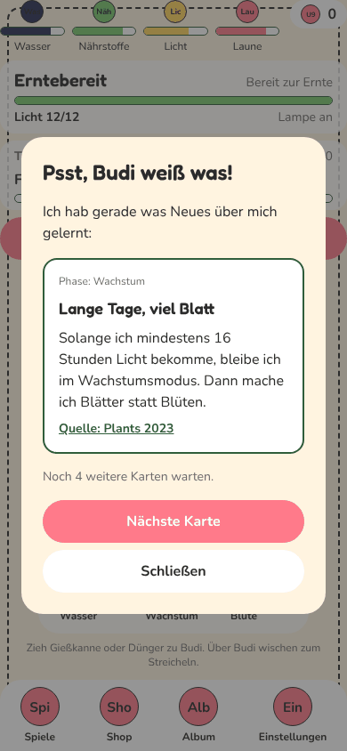 |
| Ernte: Schere (Wischgeste mit der Maus) | 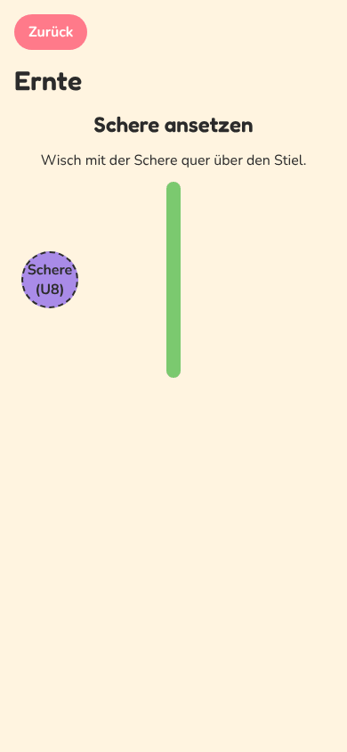 |
| Ernte fertig | 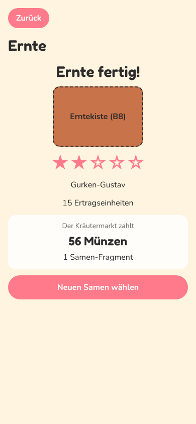 |
| Nach Neuladen: Münzen und Stand erhalten | 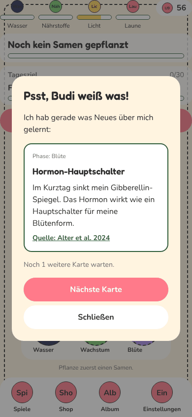 |

## Was im Web nicht geht

- Keine Benachrichtigungen (Hinweis in den Einstellungen).
- Kein Neigen bei Budi Jump, nur Tippen links/rechts.
- Keine Vibration.
- Werbung und Käufe (P28/P29) gibt es noch nicht. Wer sie baut, braucht für das Web je eine `.web.ts`-Datei, die nichts tut.
- Sounds: `expo-audio` spielt im Browser erst nach der ersten Berührung (Browser-Regel). Im Test ohne Fehler.
- Der Spielstand liegt nur in diesem Browser. Anderes Gerät oder privates Fenster: neuer Spielstand.
- Die Seite ist ein Testbau: Debug-Menü sichtbar, nicht für Spieler gedacht.

## Offen

- Pages muss der Chef einmal einschalten (oben). Ohne das schlägt nur der Deploy-Schritt fehl, die CI bleibt grün.
- Erster echter Pages-Lauf erst nach dem Merge prüfbar.

## Fehlende Assets

- Keine neuen. Es gelten die Platzhalter der anderen Aufträge.

## Bekannte Bugs

- Im lokalen Dev-Server (`npx expo start --web`) meldet NativeWind "Cannot manually set color scheme". Im Export (Pages) tritt das nicht auf.
- Die Tutorial-Schritte merkt sich die App nur im Speicher (wie nativ): Nach Neuladen geht das Tutorial bei Schritt 2 weiter.

## Handy-Test (3 bis 5 Punkte für den Chef)

1. Pages einschalten, nach dem nächsten Merge https://neinkob12.github.io/pou-/ auf dem Handy öffnen: Altersfrage erscheint, "Ja" führt ins Zimmer mit Tutorial.
2. Samen pflanzen, Tabs durchtippen, ein Spiel (Schädlinge klatschen) spielen: Münzen kommen an.
3. Einstellungen > Debug-Menü öffnen > x1000 und Vorspulen bis "Erntebereit", dann Ernten bis "Ernte fertig".
4. Seite neu laden: Münzen und Spielstand sind noch da.
5. Auf dem Handy-Build (sobald es einen gibt): Erststart bis zur Altersfrage und Ernte öffnen. Das prüft den nativen Bugfix.

## Entscheidungen

- `web.output: single` statt `static`: kein Server-Rendering, damit Skia und MMKV nicht in Node laufen müssen.
- CanvasKit als Metro-Asset statt Kopie in `public/`: keine 8-MB-Binärdatei im Repo, und `npx expo export` allein reicht.
- Debug-Werkzeuge im Web an, weil es ein Testbau ist. Soll die Web-Version später an Spieler gehen, `src/lib/devTools.ts` zurück auf `__DEV__`.

## Gefunden, nicht gemacht

- Der Text "Nur im Entwicklungs-Build sichtbar." im Debug-Abschnitt stimmt im Web nicht ganz (Text gehört P09).
- Im Spiel-Tab und in den Minigames ist die Tab-Leiste sichtbar, im Zimmer nicht. Wohl gewollt (eigene BottomNav im Zimmer), nur zur Info.
