# Redesign "Spiel-Look 2": aufgeräumtes Zimmer, Tab-Leiste, echte Animationen

Branch: `claude/redesign-spiel-look` · PR: siehe unten · Auftrag: direkt vom Chef ("Optik wie ein richtig gutes Game, aufgeräumter, bessere Animationen, übersichtlichere UI"). Kein Brett-Auftrag, deshalb ohne Nummer.

## Was die Recherche gesagt hat (und was daraus wurde)

| Regel aus guten Casual-Games | Umsetzung |
| --- | --- |
| Unordnung ist Fehler Nummer 1. Zeig nur, was gerade zählt. | Zimmer-HUD von vier Kästen (ca. 1/3 des Bildschirms) auf zwei schmale Zeilen. Details erst beim Antippen (Phase, Tagesziel, Bedürfnis-Werte). |
| Status mit Aktionen zusammenlegen, Navigation vereinfachen (Pet-Games) | Eine Tab-Leiste für alle Screens statt eigener Navigation im Zimmer. |
| Hauptaktionen unten in Daumenreichweite, Infos oben | Oben Status, Mitte Budi (größer), unten Dock mit Werkzeugen bzw. großem Knopf "Samen pflanzen" / "Ernten". |
| Klare Hierarchie über Größe, Farbe, Kontrast | Nur was man anfassen kann, hat die dicke Kontur und 3D-Kante. Karten und HUD sind ruhige helle Flächen. |
| Gleich aussehende Bedienelemente (Finch) | Eine Tab-Leiste, ein Segment-Schalter, grüne Kaufknöpfe überall. |
| Feedback 50 bis 200 ms, Federn statt linear, Squash & Stretch mit Volumenerhalt, Feiern länger | Neue Auftritte, Kachel-Gleiten, Plus-Zahlen, Antippen-Federn; alles mit Federn, bei "Bewegung reduzieren" aus. |

Quellen: [HUD-Fehler aus Sicht eines UI-Art-Directors](https://bootcamp.uxdesign.cc/7-obvious-beginner-mistakes-with-your-games-hud-from-a-ui-ux-art-director-d852e255184a), [Clash Royale UX-Analyse](https://discover.therookies.co/2020/02/24/game-design-ux-best-practices-detailed-breakdown-of-clash-royale/), [Beste Mobile-Game-UIs 2026](https://pixune.com/blog/best-examples-mobile-game-ui-design/), [Design-Kritik Finch](https://ixd.prattsi.org/2026/02/design-critique-finch-self-care-pet-ios-app/), [Devlog My Boo: Navigation im Pet-Game](https://gallae.itch.io/doomscroll/devlog/1116999/devlog-ui-assets-direction-and-navigation-functionality), [Game Feel und Juice](https://gamedeveloper.com/design/squeezing-more-juice-out-of-your-game-design-), [Daumen-Zonen](https://app.uxcel.com/courses/design-accessibility/designing-for-motor-disabilities-143/understanding-thumb-friendly-zones-on-mobile-4245).

## Vorher / nachher (390 × 844)

| | Vorher | Nachher |
| --- | --- | --- |
| Zimmer leer | 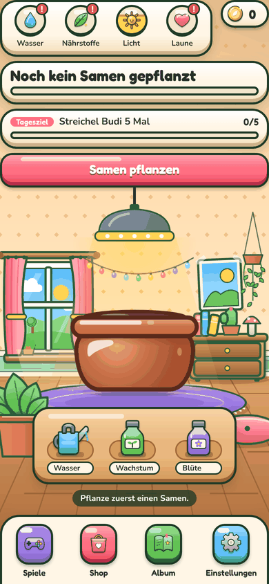 | 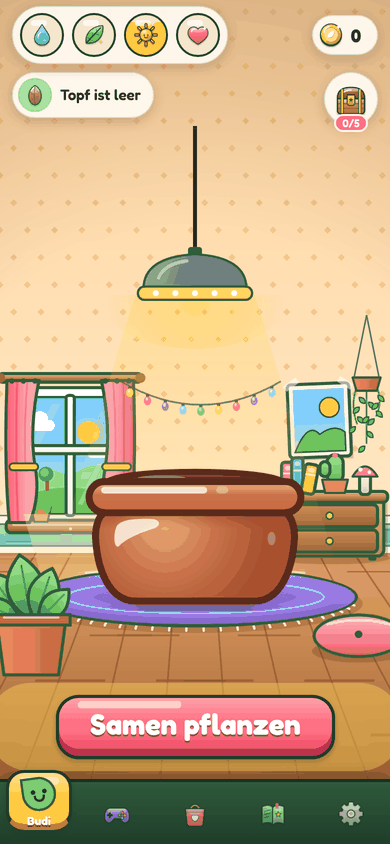 |
| Zimmer mit Budi | 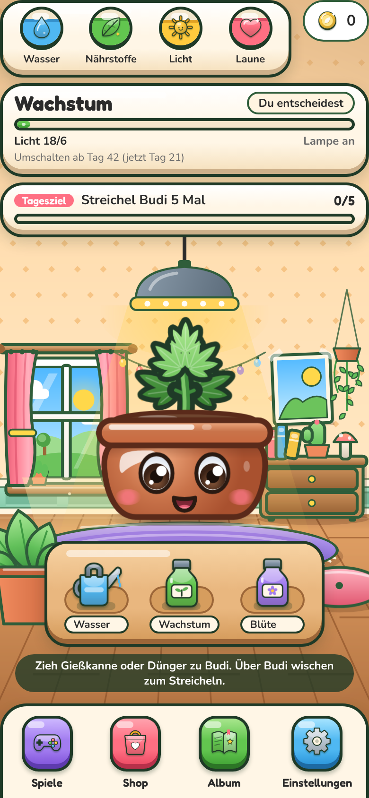 | 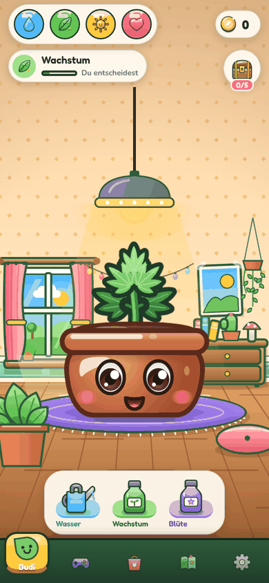 |
| Spiele | 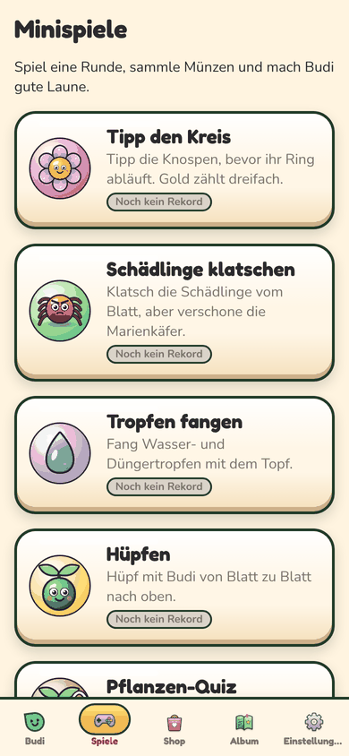 | 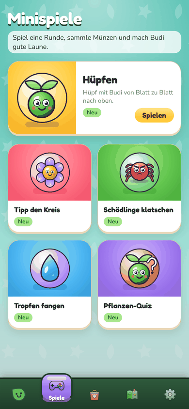 |
| Shop | 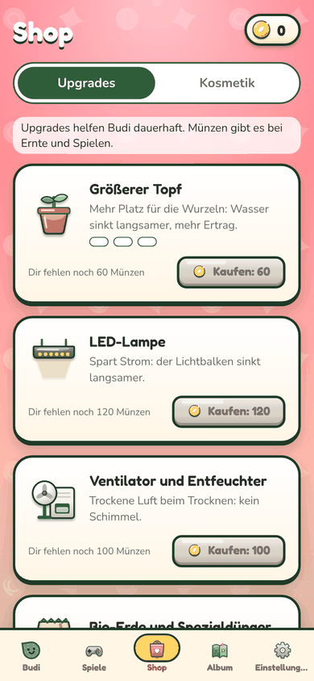 | 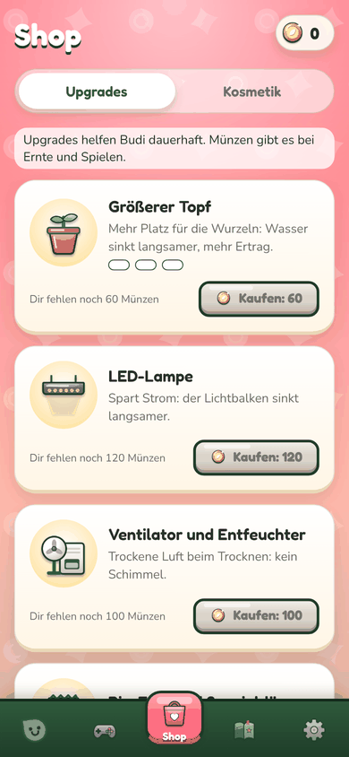 |
| Album | 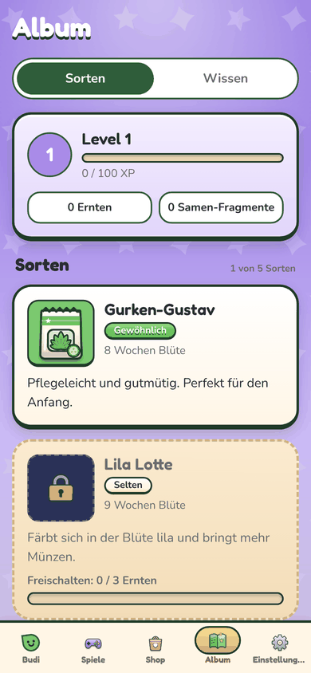 | 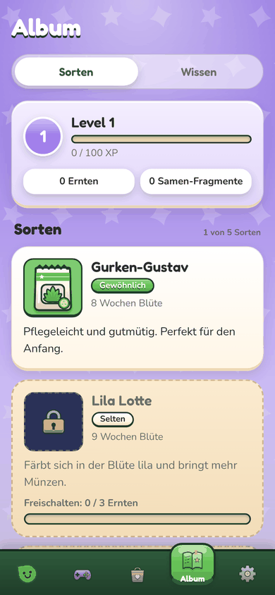 |

Weitere: Nacht 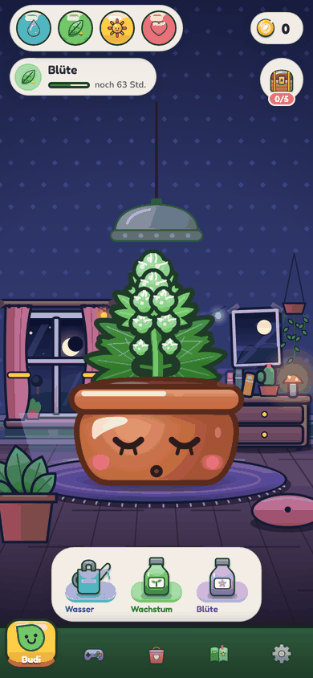, erntebereit 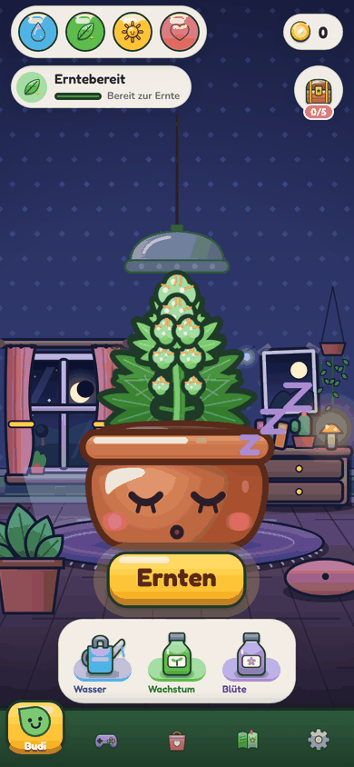, Gießkanne über Budi 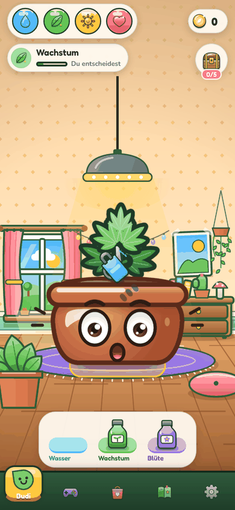, Phasen-Popup 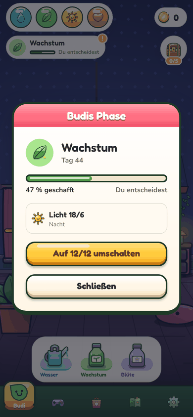, kleines Handy 375 × 667 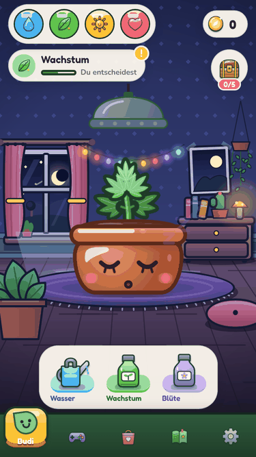.

## Fertig

- **Tab-Leiste** (`src/components/ui/tabbar/`): dunkelgrüne Leiste auf allen Screens, auch im Zimmer. Der aktive Tab sitzt auf einer farbigen Kachel, die aus der Leiste ragt und beim Wechsel mit Federung hinübergleitet; das Icon springt hoch, der Name erscheint. Inaktive Tabs nur als Icon (keine abgeschnittenen Namen mehr). Eingehängt in `app/_layout.tsx` über `tabBar`, die alte Zimmer-Navigation `room/BottomNav.tsx` ist weg. Tab "Einstellungen" heißt "Optionen" (Screen-Titel bleibt).
- **Zimmer** (`src/components/room/`):
  - Oben links die vier Bedürfnisse als Kugeln auf einer Glas-Pille (`NeedBars.tsx`, `hud/NeedBadge.tsx`): Flüssigkeit mit laufender Welle, federt beim Auffüllen, "+20" steigt auf (`hud/GainPop.tsx`), wackelt mit "!" wenn knapp. Antippen zeigt "Wasser 80 %". Ohne Pflanze leer und ohne Alarm.
  - Phase als Chip (`PhaseHeader.tsx`): Name, dünner Balken, Restzeit. Antippen öffnet `phase/PhaseSheet.tsx` mit Fortschritt, Tag, Lichtplan und dem Schalter auf 12/12. Ist Umschalten erlaubt, pulsiert ein goldener Punkt am Chip.
  - Tagesziel als runder Knopf rechts (`DailyGoal.tsx`): Kiste mit Zähler, Antippen zeigt das Ziel als Sprechblase; erfüllt: goldener Lichthof, Kiste wackelt, Antippen öffnet sie.
  - Budi größer je nach Bildschirmhöhe (`hud/budiStageSize.ts`, 220 bis 330 statt fest 260) und weiter oben; die Lampe hängt jetzt direkt über der Pflanze (Kabel füllt den Raum), ihr Licht atmet leise.
  - Dock unten (`RoomDock.tsx`, `ActionTray.tsx`): Werkzeuge auf heller Glas-Leiste, Sockel in der Farbe des Bedürfnisses. Der Bedien-Hinweis steht nur 5 s; Sonderfälle (Koma, keine Pflege) bleiben stehen. Ohne Pflanze, beim Trocknen und danach ersetzt ein großer Knopf die Werkzeuge; erntebereit schwebt ein goldener "Ernten"-Knopf darüber (`harvest/HarvestEntry.tsx`).
  - Zustand ("Budi hat Durst") als Sprechblase direkt neben Budi statt als Pille über ihm.
  - Budi antippen: er federt wie Gummi und plappert. Nur Spaß, keine Pflege, zählt für kein Ziel. Aus bei Schädlingen und im Koma.
  - Auftritt bei jedem Öffnen: HUD gleitet von oben herein, Dock von unten, gestaffelt (`frame/FocusEnter.tsx`, Logik in `frame/focusEnterPose.ts`).
  - Boden und Teppich passend zum neuen Aufbau (`art/roomLayout.ts`: Teppich 182 statt 262 Punkte über dem Rand).
- **Fehler behoben (seit P10 auf `main`)**: Beim Ziehen blieben Gießkanne und Dünger optisch im Fach stehen. Eine Zeitkurve steckte in einem Text und machte die ganze Transformation ungültig (`care/CareTool.tsx`). Jetzt folgen sie dem Finger und kippen über Budi.
- **Spiele** (`minigames/framework/MinigameSelect.tsx`, `MinigameCard.tsx`, `hubLook.ts`): Spiel-Hintergrund wie die anderen Screens, oben groß das Spiel des heutigen Tagesziels (mit Abzeichen, sonst "Hüpfen"), darunter Kacheln im Raster mit großer Figur auf farbiger Bühne, Name und Rekord. `MinigameIcon` kann jetzt jede Größe scharf zeichnen.
- **Karten ruhiger** (`ui/Card.tsx`): keine dicke dunkle Kontur mehr, sondern feine Kante, helle Unterkante und weicher Schatten. Knöpfe behalten den 3D-Look und führen dadurch.
- **Shop**: Bilder auf runder, warm beleuchteter Bühne (`shop/ItemStage.tsx`), Kaufknöpfe grün, Beschreibung höchstens zwei Zeilen. Kosmetik: Knopf in eigener Zeile (vorher überlappte er den Namen).
- **Schalter**: Album/Shop-Tabs als Glas-Schiene mit gleitender weißer Pille (`album/AlbumTabs.tsx`), gleicher Look bei "Steuerung bei Budi Jump". Münz-Pille als Glas (`ui/Chip.tsx`, Ton "cream"). Album-Level ohne dicke Konturen.
- **Tokens** in `src/lib/theme.ts`, eigener Abschnitt "Spiel-Look 2": `chrome` (Leiste, Glas, Karten) und `motion` (Auftritt, Tab-Feder, Staffelung). Texte in `strings.ts` unter `roomHud` und `gamesHub`, Tutorial-Text "Balken" zu "Kugel".
- Tests neu: `frame/__tests__/focusEnterPose.test.ts`, `room/hud/__tests__/budiStageSize.test.ts`, `minigames/framework/__tests__/hubLook.test.ts`. `bash scripts/check.sh` grün (101 Suites, 730 Tests).
- Geprüft im Web-Export mit Playwright: 390 × 844, 375 × 667 und 1280 × 800 (Rahmen), Tag und Nacht, leer, Sämling, Wachstum mit Schalter, Blüte, erntebereit, Ziehen, Antippen, alle Tabs. Keine Konsolenfehler.

## Offen

- Kein Test auf einem echten Handy. Alles ist im Browser geprüft; Gesten (Ziehen, Antippen neben Wischen) bitte am Gerät prüfen.
- Die Minigames selbst (Spielszenen, HUD im Spiel) sind unverändert; sie hatten mit ART-6 und WEB-7 schon einen eigenen Look.

## Fehlende Assets

- Keine neuen. Tab-Icons und Kiste nutzen die PNGs aus `assets.ts` (U12, U13, U11).

## Bekannte Bugs

- Keine bekannt.

## Handy-Test (3 bis 5 Punkte für den Chef)

1. Zimmer öffnen: oben zwei schmale Zeilen, Budi groß in der Mitte, unten die Werkzeuge. Die Leisten gleiten beim Öffnen herein.
2. Gießkanne zu Budi ziehen: sie folgt dem Finger, kippt über Budi, an der Wasser-Kugel steigt "+N" auf. Budi kurz antippen: er federt und plappert, Werte ändern sich nicht.
3. Phasen-Chip antippen: Popup mit Fortschritt und Lichtplan. Ab Tag 42 im Wachstum pulsiert ein goldener Punkt, im Popup "Auf 12/12 umschalten".
4. Tabs wechseln: die farbige Kachel gleitet zum neuen Tab, nur dort steht der Name. Gleiche Leiste im Zimmer und überall sonst.
5. Spiele-Tab: oben groß das Spiel des Tagesziels (sonst "Hüpfen"), darunter Kacheln. Shop: grüne Kaufknöpfe, Kosmetik-Namen nicht mehr überdeckt.

## Entscheidungen

- Eine Tab-Leiste für alles. Die eigene Zimmer-Navigation fällt weg, `app/index.tsx` blendet die Leiste nicht mehr aus.
- Behälter flach und hell, Knöpfe 3D: wer neue Karten baut, nimmt `Card` oder die `chrome`-Tokens, nicht `outline.color` als Rahmen.
- Dauer-Animationen (Welle, Lichtatmen) als CSS-Animation von Reanimated 4 wie in ART-4: kein JavaScript pro Frame.
- Geteilte Dateien angefasst, weil der Chef den Umbau direkt beauftragt hat: `app/_layout.tsx`, `app/index.tsx`, `RoomScreen.tsx`, `theme.ts` (eigener Abschnitt), `strings.ts` (eigene Objekte, `tabs.settings`, ein Tutorial-Satz).

## Gefunden, nicht gemacht

- Schalter in den Einstellungen nutzen im Browser den Standard-Daumen (türkis). Nativ passt er.
- Die Tapete im Zimmer ist recht unruhig (Rautenmuster). Ein ruhigeres Muster oder weniger Deko würde Budi noch mehr hervorheben; das ist Zeichenarbeit in `room/art/`.
