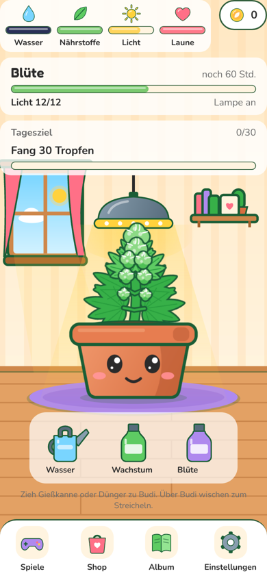
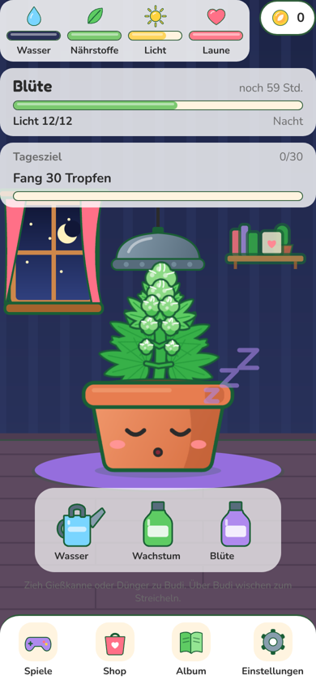
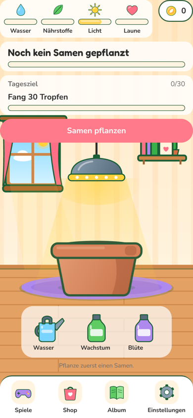

# WEB-1: Web-Version, Grafik von Budi und Zimmer

Branch: `claude/auftrag-39-web-1-web-version-grafik-von-budi-und-zi` · PR: #46 · Kollege: Session a39

Drei Teile als eigene Commits (Budi, Zimmer, Balken und Knöpfe). Geplant waren drei PRs, aber der Auftrag hat nur einen Branch und #46 war beim Push von Teil 2 noch nicht gemergt, also liegen alle drei in #46.

## Vorher und nachher

| Vorher | Nachher Tag | Nachher Nacht |
| --- | --- | --- |
|  |  |  |

| Ohne Samen | Alle Phasen, Gesichter, Ernte |
| --- | --- |
|  |  |

Zwischenstand nach Teil 1, Zimmer noch Platzhalter: Blüte nachts schlafend, Gießkanne schwebt (überrascht), gestresst, beleidigt, erntereif mit bernsteinfarbenen Härchen.

## Fertig

### Teil 1: Budi als Vektorgrafik (Skia)

- `src/components/budi/art/`: Budi wird gezeichnet statt aus Platzhalter-PNGs zusammengesetzt. Stil nach DESIGN_GUIDE D2 und D4 (Flat Vector Kawaii, dunkelgrüne Kontur, Gesicht auf dem Topf).
  - `geometry.ts`: Blattformen (Fieder- und Fächerblätter) als SVG-Pfade und der Bauplan der Pflanze je Phase (B1 bis B6). Reines TypeScript, getestet.
  - `PlantArt.tsx`: Pflanze je Phase. Keimling mit Samenschale, Sämling mit Keimblättern, Wachstum klein und groß, Blüte früh und voll. Hintere Blätter dunkler (Tiefe), Knospen mit Glanz und Härchen.
  - `PotArt.tsx`: Terrakotta-Topf mit Verlauf, Rand und Erde.
  - `FaceArt.tsx`: alle 12 Gesichter (B10) plus Blinzeln: neutral, glücklich, sehr glücklich, durstig, hungrig, müde, schlafend, gestresst, krank, beleidigt, Koma, überrascht.
  - `HarvestArt.tsx`: Trocknen an der Leine (B7) und Erntekiste (B8).
  - `palette.ts`, `color.ts`: Sortenfarben (Lotte lavendel, Kölsch golden) und Reife (Härchen bernstein in "erntereif"). Getestet.
  - `CareFx.tsx`: Herzen beim Streicheln, Tropfen beim Gießen, Funkeln beim Düngen. Ersetzt `JoyBurst` in `BudiStage` (Datei bleibt, wird nicht mehr benutzt).
  - `SleepZ.tsx`: Zs steigen auf, wenn Budi schläft.
- Schlafen: In der Dunkelphase des Lichtplans schläft Budi, solange ihm nichts fehlt (`faceFor(..., asleep)` in `budiLook.ts`, getestet). Durst, Hunger, Pflege oder ein Werkzeug über ihm wecken ihn. Reine Darstellung, keine Spielregel.
- Animation (`useBudiMotion.ts`): Atmen (im Schlaf langsamer und tiefer), Wippen der Pflanze, Blinzeln, ab und zu ein Blick zur Seite, Squash-and-Stretch nach Pflege, Wackeln beim Streicheln, Kopfschütteln bei falscher Pflege, Wachsen beim Schweben eines Werkzeugs.
- Farben der Zeichnung: eigener Abschnitt `artColors` in `src/lib/theme.ts`.

### Teil 2: Zimmer

- `src/components/room/art/RoomArt.tsx`: Wand mit Verlauf und Tapetenstreifen, Fußleiste, Fenster mit Vorhängen (Tag: Sonne, Wolke, Sonnenlicht auf dem Boden; Nacht: Mond, Sterne), Regal mit Büchern, Mini-Kaktus und Bilderrahmen, Holzboden, Teppich mit Schatten unter Budi.
- `roomLayout.ts`: Lage der Möbel. Der Boden hängt am unteren Rand (dort steht Budi), Fenster und Regal am oberen. Getestet für 320 x 568 bis 430 x 932.
- `RoomBackground.tsx`: zeichnet das Zimmer; liegt später ein Bild H1/H2 in `assets.ts`, gewinnt das Bild.
- `Lamp.tsx` mit `art/LampArt.tsx`: Pendel-Pflanzenlampe, LEDs leuchten bei Tag, weicher Lichtkegel nach unten. Tippfläche mindestens 44 hoch.
- `useBudiLook` liest die Zeit im gleichen Takt wie das Zimmer (`usePlantClock`): Budi wacht auf, wenn die Lampe angeht, auch im Zeitraffer.

### Teil 3: Balken, Icons, Knöpfe

- `src/components/ui/icons/`: 15 gezeichnete Icons im Budi-Stil (Wasser, Nährstoffe, Licht, Laune, Münze, Gießkanne, zwei Dünger, Spiele, Shop, Album, Einstellungen, Spinnmilbe, Trauermücke, Schimmel).
- `AssetImage` hat die Option `icon`: fehlt die Bilddatei, kommt das gezeichnete Icon statt des Platzhalters. Benutzt in Balken, Münze, Werkzeugen, Navigation, Schädlingen und Schimmel.
- `ArtCanvas` liegt jetzt in `src/components/ui/` (gemeinsam für Budi, Zimmer, Icons).
- Balken (`Bar`, `AnimatedBar`): 12 hoch, cremefarbene Spur, runde Füllung mit Glanzkante.
- `Button`: Kontur und Kante unten, sinkt beim Drücken ein, mindestens 48 hoch.
- Balkenleiste als Karte, Münz-Pille mit Kontur (44 hoch), Navigation mit Icon-Kacheln (48 x 48).

### Leistung im Browser (Chromium, 390 x 844, 4-fache CPU-Drosselung, 15 s gemessen)

- Budi wach bei Tag: 58,6 fps; Budi schläft: 59 bis 59,6 fps. Ausreißer sind einzelne Frames mit 33 ms.
- Keine Leinwand zeichnet laufend: Pflanze, Topf, Gesicht, Zimmer und Icons rendern einmal und geben im Browser ihren WebGL-Kontext sofort frei (Chrome erlaubt 16). Atmen, Wippen, Blinzeln und Blick laufen als View-Transform. Erste Fassung hat beim Blinzeln die Leinwand neu gezeichnet: 34 lange Frames in 15 s, jetzt 6 bis 15.
- Keine Konsolenfehler im Zimmer, Shop und Spiele-Tab.

## Offen

- Accessoires (Hüte, Brille) sind weiter Platzhalter-PNGs auf Budi.
- Die Tab-Leiste auf Shop, Spiele, Album, Einstellungen hat noch Punkt-Icons (`TabIcon`, gesetzt in `app/_layout.tsx`). Die Icons dafür gibt es jetzt (`GameIcon`), einhängen ist eine Zeile je Tab.
- Shop-Karten, Ernte-Screens und Minispiele nutzen noch Platzhalter. Ernte und Minispiele gehören WEB-3 und WEB-2, daher nicht angefasst.

## Fehlende Assets

- Keine neuen. Die Budi-PNGs in `assets/budi/` (B1 bis B12, U01) werden im Zimmer nicht mehr gezeigt, `assets.ts` bleibt unverändert.

## Bekannte Bugs

- Die gezogene Gießkanne ist über Budi kaum zu sehen (liegt hinter Budi). Gehört zu `CareTool` (P10), nicht geändert.

## Handy-Test (3 bis 5 Punkte für den Chef)

1. Seite öffnen, Samen pflanzen: Kleiner Keimling mit Samenschale im Topf, Budi blinzelt.
2. Debug-Menü, +7 Tage mehrmals: Die Pflanze wächst sichtbar je Phase, in der Blüte kommen Knospen.
3. Über Budi wischen: Herzen steigen auf, Budi wackelt und lacht.
4. Gießkanne über Budi halten: Er schaut überrascht und wird größer. Loslassen: Tropfen steigen auf.
5. Nachts (Lichtplan): Budi schläft mit Zs und atmet langsam, das Fenster zeigt Mond und Sterne. Bei Tag leuchtet die Lampe mit Lichtkegel.

## Entscheidungen

- Budi ist Code statt Bild: keine Lizenzfragen, scharf auf jeder Bildschirmgröße. Wer später echte Grafik liefert, ersetzt `art/*` oder schaltet in `Budi.tsx` zurück auf Bild-Ebenen.
- Skia statt SVG, weil Skia schon installiert ist (keine neue Bibliothek).

## Gefunden, nicht gemacht

- Nichts.
