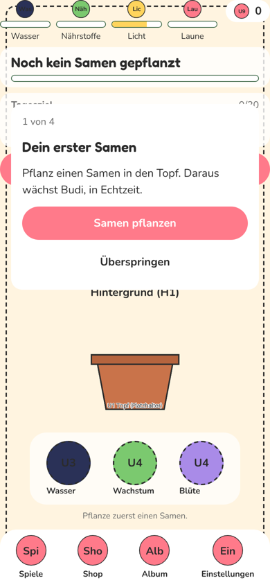
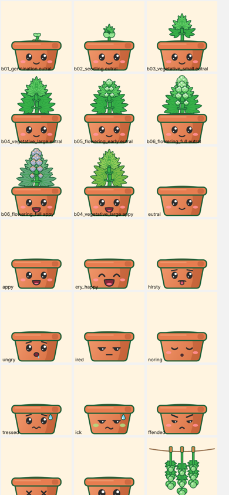
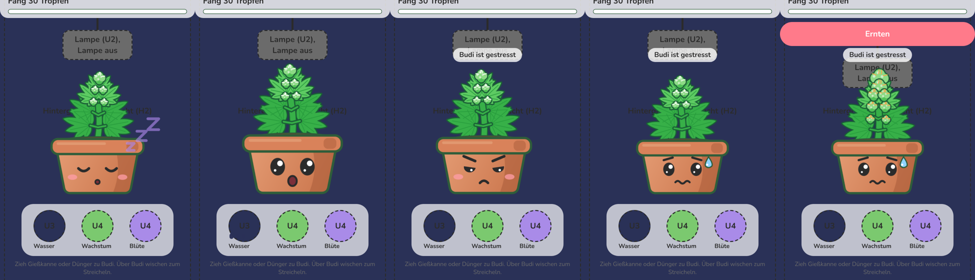

# WEB-1: Web-Version, Grafik von Budi und Zimmer

Branch: `claude/auftrag-39-web-1-web-version-grafik-von-budi-und-zi` · PRs: Teil 1 Budi (dieser), Teil 2 Zimmer, Teil 3 Balken und Knöpfe · Kollege: Session a39

Gearbeitet in kleinen PRs, damit jeder Stand gleich auf Pages sichtbar ist.

## Vorher und nachher

| Vorher | Nachher (Budi, Teil 1) |
| --- | --- |
|  |  |

Budi im Zimmer (Browser, 390 x 844): Blüte nachts schlafend, Gießkanne schwebt (überrascht), gestresst, beleidigt, erntereif mit bernsteinfarbenen Härchen.

## Fertig

### Teil 1: Budi als Vektorgrafik (Skia)

- `src/components/budi/art/`: Budi wird gezeichnet statt aus Platzhalter-PNGs zusammengesetzt. Stil nach DESIGN_GUIDE D2 und D4 (Flat Vector Kawaii, dunkelgrüne Kontur, Gesicht auf dem Topf).
  - `geometry.ts`: Blattformen (Fieder- und Fächerblätter) als SVG-Pfade und der Bauplan der Pflanze je Phase (B1 bis B6). Reines TypeScript, getestet.
  - `PlantArt.tsx`: Pflanze je Phase. Keimling mit Samenschale, Sämling mit Keimblättern, Wachstum klein und groß, Blüte früh und voll. Hintere Blätter dunkler (Tiefe), Knospen mit Glanz und Härchen.
  - `PotArt.tsx`: Terrakotta-Topf mit Verlauf, Rand und Erde.
  - `FaceArt.tsx`: alle 12 Gesichter (B10) plus Blinzeln: neutral, glücklich, sehr glücklich, durstig, hungrig, müde, schlafend, gestresst, krank, beleidigt, Koma, überrascht.
  - `HarvestArt.tsx`: Trocknen an der Leine (B7) und Erntekiste (B8).
  - `palette.ts`, `color.ts`: Sortenfarben (Lotte lavendel, Kölsch golden) und Reife (Härchen bernstein in "erntereif"). Getestet.
  - `CareFx.tsx`: Herzen beim Streicheln, Tropfen beim Gießen, Funkeln beim Düngen. Ersetzt `JoyBurst` in `BudiStage` (Datei bleibt, wird nicht mehr benutzt).
  - `SleepZ.tsx`: Zs steigen auf, wenn Budi schläft.
- Schlafen: In der Dunkelphase des Lichtplans schläft Budi, solange ihm nichts fehlt (`faceFor(..., asleep)` in `budiLook.ts`, getestet). Durst, Hunger, Pflege oder ein Werkzeug über ihm wecken ihn. Reine Darstellung, keine Spielregel.
- Animation (`useBudiMotion.ts`): Atmen (im Schlaf langsamer und tiefer), Wippen der Pflanze, Blinzeln, ab und zu ein Blick zur Seite, Squash-and-Stretch nach Pflege, Wackeln beim Streicheln, Kopfschütteln bei falscher Pflege, Wachsen beim Schweben eines Werkzeugs.
- Farben der Zeichnung: eigener Abschnitt `artColors` in `src/lib/theme.ts`.

### Leistung im Browser

- Zwei Leinwände je Budi: Die Pflanze wird einmal gerendert und wippt per View-Transform. Topf und Gesicht zeichnen nur neu, wenn Budi blinzelt oder schaut (Timer statt Dauer-Animation).
- Statische Leinwände (`ArtCanvas still`) geben im Browser ihren WebGL-Kontext sofort wieder frei. Chrome erlaubt nur 16 gleichzeitig, mit Minispielen und Shop wäre das sonst knapp.

## Offen

- Teil 2: Zimmer (Hintergrund mit Tiefe, Fenster mit Tag und Nacht, Regal, Lampe).
- Teil 3: Balken, Icons und Knöpfe einheitlich.
- Accessoires (Hüte, Brille) sind weiter Platzhalter-PNGs auf Budi.

## Fehlende Assets

- Keine neuen. Die Budi-PNGs in `assets/budi/` (B1 bis B12, U01) werden im Zimmer nicht mehr gezeigt, `assets.ts` bleibt unverändert.

## Bekannte Bugs

- Die gezogene Gießkanne ist über Budi kaum zu sehen (liegt hinter Budi). Gehört zu `CareTool` (P10), nicht geändert.

## Handy-Test (3 bis 5 Punkte für den Chef)

1. Seite öffnen, Samen pflanzen: Kleiner Keimling mit Samenschale im Topf, Budi blinzelt.
2. Debug-Menü, +7 Tage mehrmals: Die Pflanze wächst sichtbar je Phase, in der Blüte kommen Knospen.
3. Über Budi wischen: Herzen steigen auf, Budi wackelt und lacht.
4. Gießkanne über Budi halten: Er schaut überrascht und wird größer. Loslassen: Tropfen steigen auf.
5. Nachts (Lichtplan): Budi schläft mit Zs und atmet langsam.

## Entscheidungen

- Budi ist Code statt Bild: keine Lizenzfragen, scharf auf jeder Bildschirmgröße. Wer später echte Grafik liefert, ersetzt `art/*` oder schaltet in `Budi.tsx` zurück auf Bild-Ebenen.
- Skia statt SVG, weil Skia schon installiert ist (keine neue Bibliothek).

## Gefunden, nicht gemacht

- Nichts.
