# WEB-2: Web-Version, Minigames die Spaß machen

Branch: `claude/auftrag-40-web-2-web-version-minigames-die-spass-ma` · PR: siehe Auftrag a40 · Kollege: Session a40

## Vorher (im Browser gespielt, 390 x 844 und 1280 x 800)

- **Tipp den Kreis und Schädlinge klatschen reagierten im Browser gar nicht.** 72 Klicks auf alle Löcher: 0 Punkte, mit Maus und mit Touch. Ursache: `onTouchStart` an `View` kommt in react-native-web bei der Maus nicht an.
- Budi Jump am Rechner unspielbar: Die Welt skaliert auf die volle Breite (1280), Budi fällt nach 2 Sekunden. Tippen links/rechts rechnete mit der Seitenkoordinate statt mit dem Spielfeld.
- Tropfen fangen am Rechner: Topf winzig auf 1280 Breite, nur Ziehen mit der Maus, keine Tastatur.
- Überall Platzhalter (Kreise, Pillen, Rechtecke), kein Treffer-Feedback, Countdown ohne Bewegung, Ergebnis ohne Sterne.

## Fertig

- **Effekt-Baukasten** `src/components/minigames/framework/fx/`: Partikel (`fxLogic.ts`, eine Skia-Pfad-Zeichnung je Farbe), Kamera-Wackeln (`useShake.ts`), kurzes Anhalten der Spielzeit (`session.hitStop`, in `useMinigameSession.ts`), Punkte-Popups (`PopupLayer.tsx`), Kombo-Zähler (`ComboBadge.tsx`).
- **Eingabe** `framework/input/`: `usePointerInput` (Gesture Handler, Finger und Maus gleich, sofort beim Aufsetzen), `useKeyboard.web.ts` (Pfeiltasten, A/D, Tastendrücke; nativ leer), `keys.ts`.
- **Rahmen**: Countdown springt je Zahl auf, danach „Los!“ (`CountdownOverlay.tsx`). Ergebnis mit drei Sternen, „Noch N Punkte bis zum nächsten Stern“, Rekord und einem Tipp je Spiel fürs Nochmal (`GameOverOverlay.tsx`, `ResultStars.tsx`, `stars.ts`). Spielfeld höchstens 520 breit (`MINIGAME_FEEL.playfieldMaxWidth`). Esc oder P pausiert, Enter startet nach dem Ergebnis neu. Auswahl-Karten zeigen die Spielfigur statt Platzhalter (`MinigameIcon.tsx`).
- **Tipp den Kreis**: Knospe mit Blütenblättern und Gesicht, Ring zeigt die Restzeit (wird rot), warmer Hintergrund. Treffer: Blütenblatt-Partikel, Anhalten, Wackeln, „+1“, Kombo. Tempo zieht zum Ende an (`TAP_CIRCLE.lifetimeEndMs`, `lifetimeAt`).
- **Schädlinge klatschen**: großes Blatt mit Adern (`SmashLeaf.tsx`), Tiere mit Augen, zappelnden Beinen, flatternden Flügeln, Auftauchen mit Überschwingen, Treffer quetscht platt (`CritterSlot.tsx`). Spritzer, Anhalten, Wackeln, Popups, Kombo mit Multiplikator. Marienkäfer: starkes Wackeln, roter Abzug.
- **Tropfen fangen**: Himmel mit Wolken, Regal, Wasser als Tropfen, Dünger als Kugel, Salz als Kristall, Topf mit Gesicht und Budi-Spross federt beim Fang (`DropsCanvas.tsx`, `dropsFeel.ts`). Spritzer im Topf und am Boden, „Salz!“ mit Wackeln, Herzen statt Zahl, Balken-Zuwachs als Balken, Kombo für Fänge in Folge. Pfeiltasten und A/D am Rechner.
- **Budi Jump**: Himmel wird mit der Höhe vom Tag zur Nacht, Sterne ab dem Abend (`jumpFeel.ts`). Blätter als Blattformen (normal grün, brechend braun mit Riss, Feder lavendel mit Spirale), Lichtpunkte pulsieren. Budi als Spross mit Gesicht staucht beim Landen und streckt sich im Steigen (`JumpBudi.tsx`). Blattstücke bei Landung, Funken an Feder und Licht, „+1 Licht“. Pfeiltasten und A/D; Tippen links/rechts jetzt relativ zum Spielfeld (`useJumpInput.ts`).
- **Quiz**: Budi im Kopf, Fortschrittspunkte (grün/koralle), Zeitbalken, nummerierte Antworten, richtig federt auf, falsch wackelt, „+10“-Popup, Ton (`QuizHeader.tsx`, `QuizOption.tsx`, `FactQuizGame.tsx`). Tasten 1 bis 3, Enter für weiter.
- **Sound** über die vorhandene Audio-Grundlage (P23/P30): Treffer `hit`/`catch`, Fehler `ouch`/`fail`, Licht `collect`, Sprung `jump`, Musik und Münzen über `useMinigameAudio` jetzt auch bei Tipp den Kreis und Quiz. Keine neuen Cues, keine neuen Dateien.
- Werte in `src/game/config.ts`, Abschnitt `MINIGAME_FEEL` (im Minigames-Abschnitt), Farben in `src/lib/theme.ts` als eigener Abschnitt `gameColors`, Texte in `src/content/strings.ts` als `minigameFeel`.
- Tests: `fxLogic`, `stars`, `keys`, `tapPacing`, `dropsFeel`, `jumpFeel`, Schwierigkeits-Bots.

## Schwierigkeit, mit Bot gemessen

`src/components/minigames/difficulty/bots.ts` spielt die echten Spielregeln mit einer Reaktionszeit (±20 % Streuung), Mittel über 20 Startwerte. Test: `difficulty/__tests__/difficulty.test.ts` (gemütlich 1 Stern, geübt 2, sehr schnell 3). Punkte (Sterne):

| Spiel | langsam | | | | schnell |
| --- | --- | --- | --- | --- | --- |
| Tipp den Kreis | 1100 ms: 15 (1) | 900 ms: 29 (1) | 700 ms: 42 (2) | 500 ms: 59 (3) | 350 ms: 83 (3) |
| Schädlinge | 1100 ms: 22 (1) | 900 ms: 42 (1) | 750 ms: 58 (2) | 500 ms: 74 (3) | 350 ms: 75 (3) |
| Tropfen | 900 ms: 36 (1) | 700 ms: 48 (2) | 500 ms: 59 (2) | 350 ms: 69 (2) | 250 ms: 114 (3) |
| Budi Jump | 800 ms: 85 (1) | 600 ms: 135 (1) | 450 ms: 320 (2) | 300 ms: 449 (2) | 200 ms: 900 (3) |

Sterne-Grenzen (`MINIGAME_FEEL.stars`): Tipp 15/35/50, Smash 20/50/70, Tropfen 20/45/80, Jump 80/250/600, Quiz 10/20/60 (1, 2 oder 3 richtig, alles richtig ist doppelt). Tipp den Kreis bei 1300 ms: nur noch 6 Punkte, weil die Knospen gegen Ende kürzer stehen.

Im Browser (Playwright, Bild-Bot): Tipp 50 Punkte (Touch 390 und Maus 1280), Smash 54 bis 108, Tropfen 19 bis 32 mit Tastatur, Quiz 60 mit Tasten. Keine Fehler in der Konsole.

## Bilder

| | |
| --- | --- |
| Auswahl mit Spielfiguren | 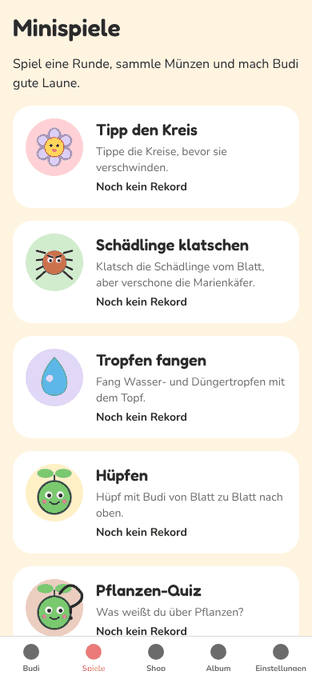 |
| Tipp den Kreis: Treffer mit Partikeln, „+1“, Kombo | 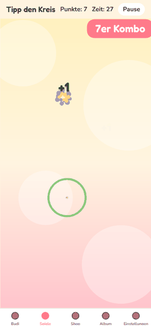 |
| Ergebnis mit Sternen, Rekord und Tipp | 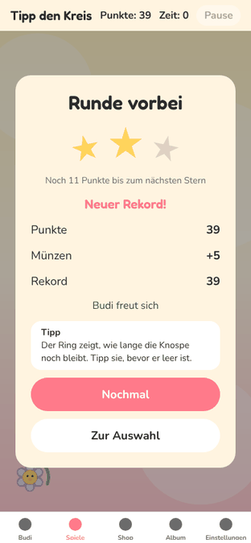 |
| Schädlinge: Spritzer und Kombo | 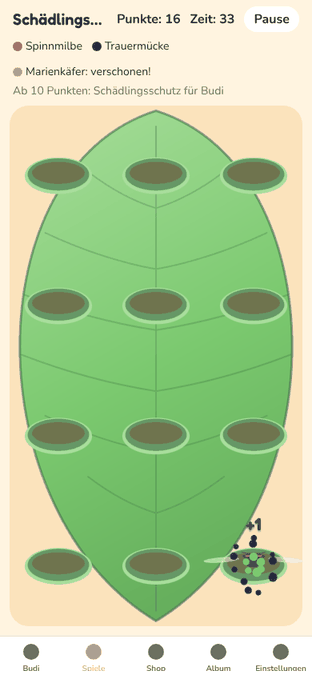 |
| Schädlinge am Rechner (520 breit) | 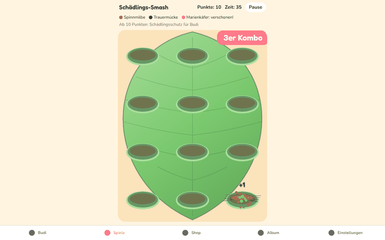 |
| Schädlinge: Ergebnis | 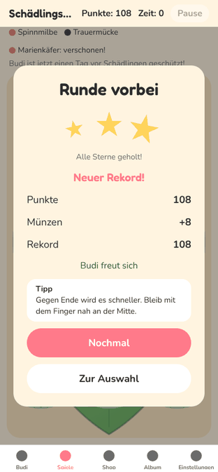 |
| Tropfen: Countdown mit Hinweis | 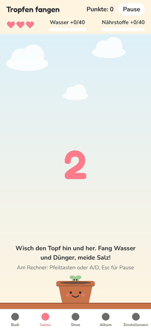 |
| Tropfen am Rechner mit Tastatur | 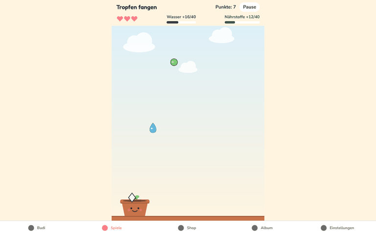 |
| Tropfen: Ergebnis | 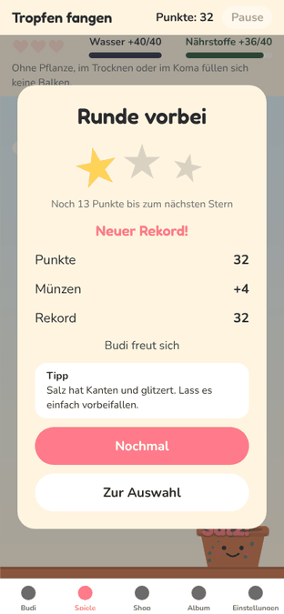 |
| Budi Jump | 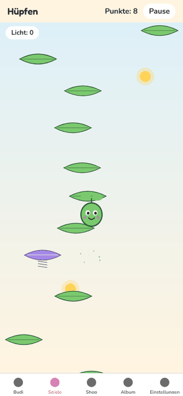 |
| Budi Jump am Rechner | 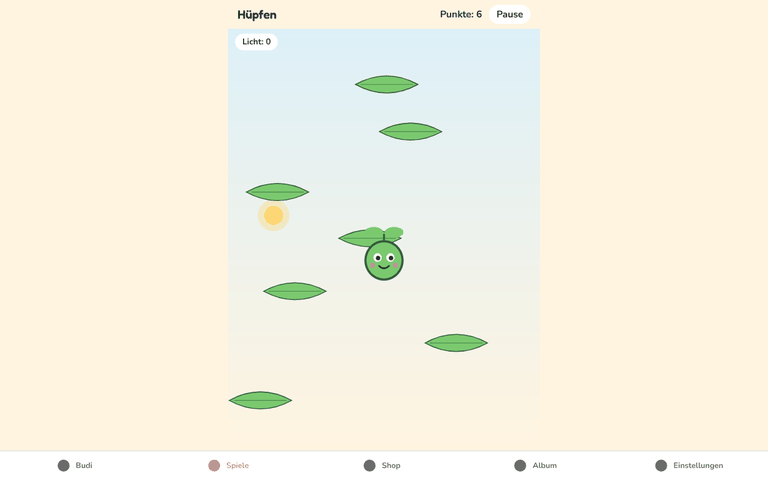 |
| Quiz: Antwort | 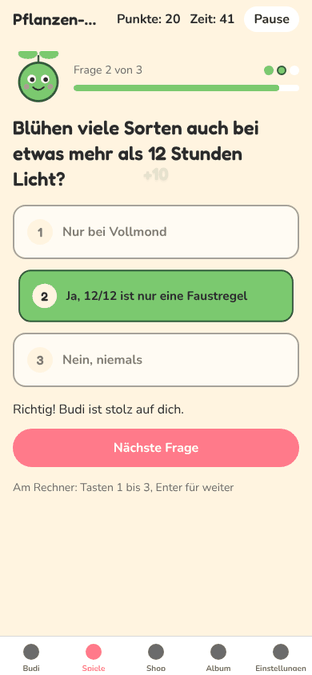 |
| Quiz: Ergebnis | 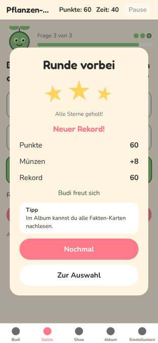 |
| Auswahl am Rechner | 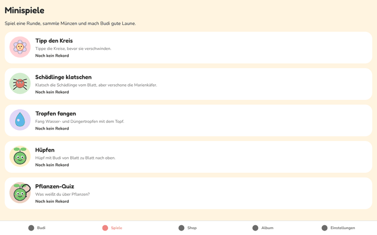 |

## Offen

- Ein Auftrag, ein PR: Der Rahmen (Effekte, Eingabe, Sterne) hängt an allen fünf Spielen, deshalb kein PR je Spiel. Die Commits sind je Spiel getrennt.
- Kein eigener Sound für Kombo, Countdown und Sterne: dafür bräuchte es neue Dateien in `assets/sounds/` (Chef).

## Fehlende Assets

- Keine. Alle Figuren und Hintergründe sind Skia-Formen. Die Asset-IDs M1 bis M11 und B11 aus `docs/ASSETS.md` sind damit nicht mehr nötig, könnten die Skia-Grafik aber später ersetzen.

## Bekannte Bugs

- Partikel liegen im Bildschirm, nicht in der Welt: bei Budi Jump bleiben sie beim Hochscrollen kurz stehen. Fällt kaum auf (0,5 s).
- Während „Los!“ kurz eingeblendet ist, kann es Budi bei Jump überdecken (650 ms, Berührungen gehen durch).

## Handy-Test (3 bis 5 Punkte für den Chef)

1. https://neinkob12.github.io/pou/ > Spiele: Karten zeigen Knospe, Milbe, Tropfen, Budi. Tipp den Kreis: Knospe antippen, Blütenblätter fliegen, „+1“ steigt auf, ab 3 schnellen Treffern Kombo-Anzeige.
2. Schädlinge klatschen: Milben und Mücken antippen, sie werden platt gedrückt und spritzen; Marienkäfer antippen, das Bild wackelt stark und zeigt „-3“.
3. Tropfen fangen: Topf wischen, Topf federt beim Fang, Salz lässt das Bild wackeln und nimmt ein Herz. Am Rechner mit Pfeiltasten.
4. Budi Jump: links/rechts gedrückt halten (am Rechner Pfeiltasten). Weiter oben wird der Himmel abends lila und nachts dunkel mit Sternen.
5. Nach jeder Runde: Sterne poppen nacheinander auf, darunter ein Tipp; „Nochmal“ (am Rechner Enter) startet neu.

## Entscheidungen

- Spielregeln und Münzformel unverändert (`coinsForScore`, `MINIGAME_REWARDS`). Einzige Regeländerung im Minigame: Tipp den Kreis wird zum Ende schneller (`TAP_CIRCLE.lifetimeEndMs`).
- Kombo bei Tipp den Kreis und Tropfen ist nur Anzeige, sie gibt keine Extrapunkte, damit die Münzen gleich bleiben. Smash hatte schon einen Multiplikator.
- Kurzes Anhalten nur bei Tipp und Smash. Tropfen und Jump laufen mit Bildzeit, dort würde Anhalten die Physik verschieben.
- Worklets im Web werden nicht vorgezogen (Funktionsdeklarationen werden zu Konstanten): Helfer stehen vor ihrer Nutzung, sonst „Cannot access before initialization“ beim Laden.

## Gefunden, nicht gemacht

- `MINIGAME_REWARDS.typicalScores` (smash 30, drops 28, jump 100) passen nicht mehr zu den gemessenen Werten. Weil Tipp und Smash im Browser vorher gar nicht gingen, gab es dort keine echten Werte. Münzen sind weiter bei 8 je Runde gedeckelt. Für P32 (Balancing).
- Kartentext „Tippe die Kreise, bevor sie verschwinden.“ (`minigameCards.tap`, P08) passt nicht mehr ganz zur Knospe.
- Die Tab-Leiste ist in den Minigames sichtbar und nimmt am Handy Platz weg.
