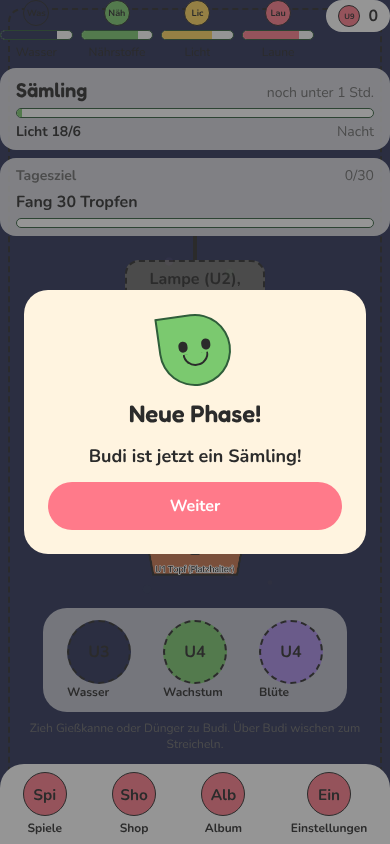
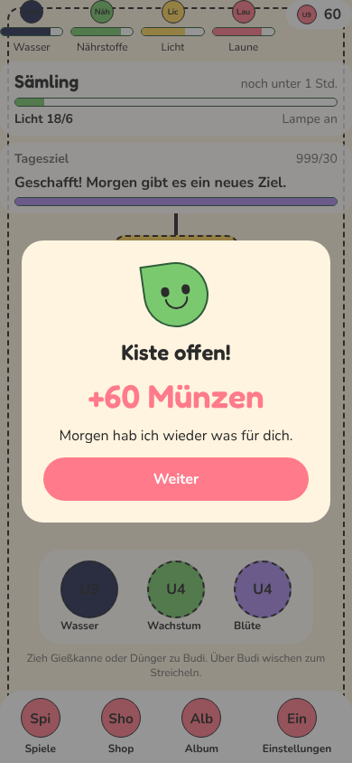
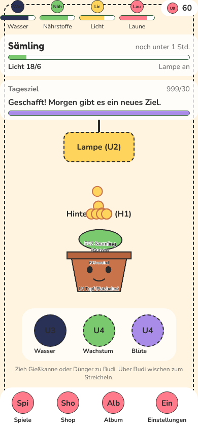

# WEB-3 (Zimmer-Teil): Feier bei Phasenwechsel und Tageskiste, Münz-Flug

Branch: `claude/auftrag-41-web-3-zimmer-feier` · Auftrag a41 · kleiner eigener PR auf Wunsch des CvD (zuerst mergen, WEB-1 baut darauf auf). Hauptnotiz: `docs/progress/web3.md` (PR #45).

## Fertig

- Neues Ereignis `dailyChestOpened` in `src/game/events.ts` (nur ergänzt).
- Feier-Ebene `src/components/feedback/CelebrationLayer.tsx`, eine Zeile in `RoomScreen.tsx`: Budi-Kopf, Funken, Text. Phasenwechsel nach der Puff-Wolke; Tageskiste mit hochzählenden Münzen (Münz-Sound), beim Schließen fliegen Münzen im Bogen in den Zähler (`CoinFly.tsx`).
- Warteschlange `celebrationQueue.ts` (rein, Test): mehrere Phasenwechsel auf einmal zeigen nur den letzten, Kiste und Phase stapeln sich nicht.
- Freigegebene Mini-Änderungen in `room/` (Entscheidung CvD, keine Optik geändert):
  - `room/phase/PhaseChangePopup.tsx`: altes Modal raus, Puff bleibt.
  - `room/DailyGoal.tsx`: altes Kisten-Modal raus, sendet `dailyChestOpened`.
  - `room/CoinDisplay.tsx`: Hülle `CoinAnchor` als Ziel für den Münz-Flug.
- Bausteine `celebration.ts`, `Sparkles`, `CountUpText`, `useCountUp`, `BudiAvatar` sind identisch mit PR #45, damit beide PRs ohne Konflikt zusammenlaufen.

| Phasenwechsel | Tageskiste | Münz-Flug |
| --- | --- | --- |
|  |  |  |

## Offen

- Der Münzstand springt beim Öffnen der Kiste sofort hoch (Store), der Flug ist Darstellung. Mit PR #45 zählt der Zähler zusätzlich sichtbar hoch.

## Fehlende Assets

- Keine neuen. Münzen im Flug sind gelbe Kreise.

## Bekannte Bugs

- Debug "Vorspulen" löst keinen Phasenwechsel aus (verschiebt den Pflanzzeitpunkt, `usePhaseWatcher` sieht eine neue Pflanze). Zum Testen Zeitraffer x1000 nutzen. Bestand, nicht geändert.

## Handy-Test (3 bis 5 Punkte für den Chef)

1. Debug > Zeitraffer x1000, zurück ins Zimmer, ca. 1 Minute warten: Puff, dann "Neue Phase!" mit Budi und Funken, "Weiter" schließt.
2. Tagesziel schaffen, "Kiste" antippen: "+60 Münzen" zählt hoch, "Weiter": Münzen fliegen oben rechts in den Zähler.

## Entscheidungen

- Feiern als Overlay im Zimmer statt RN-Modal: kein doppeltes Abdunkeln, Münz-Flug kann bis zum Zähler fliegen.
