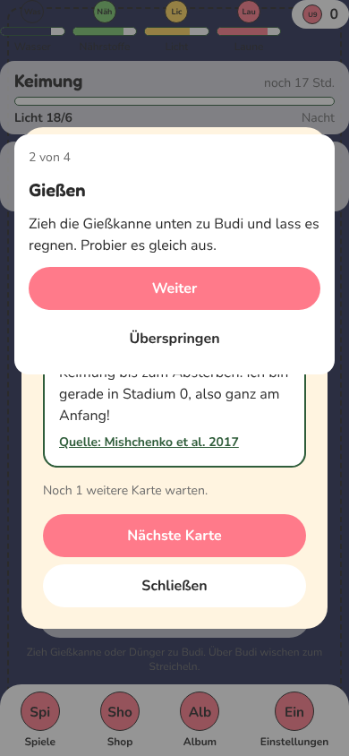
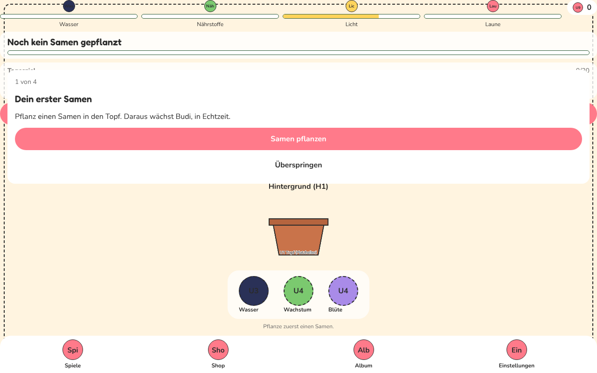
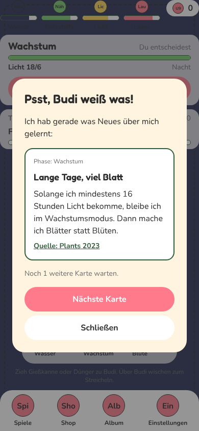
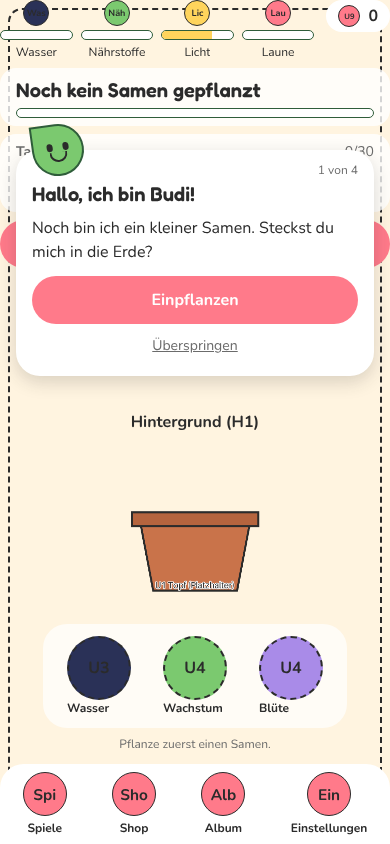
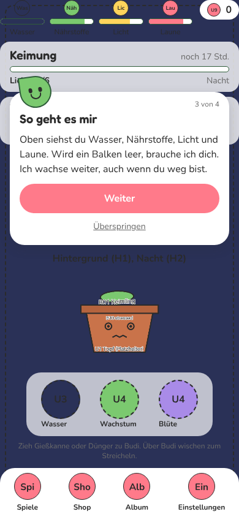
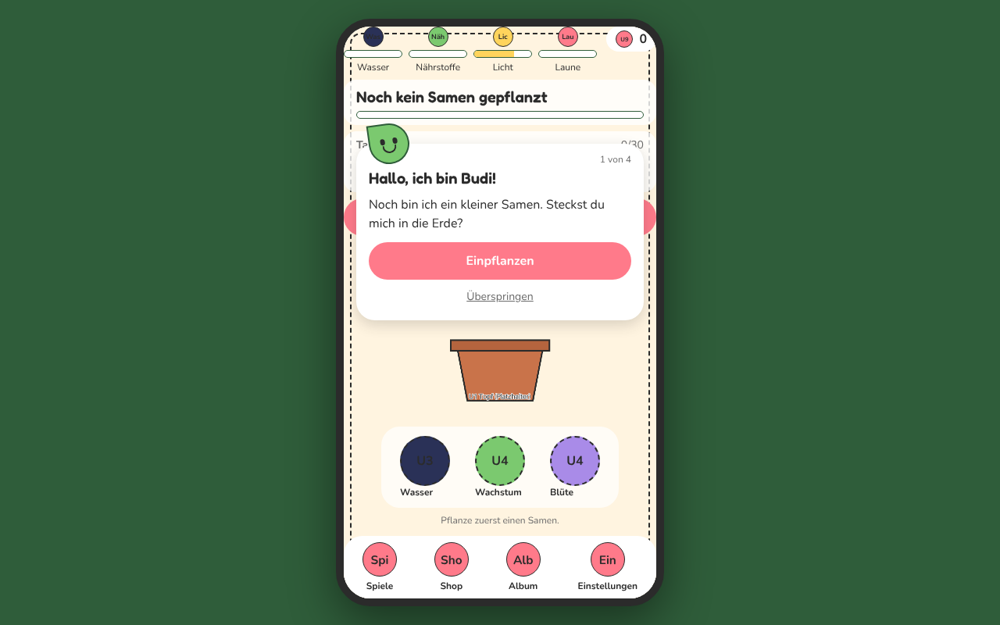
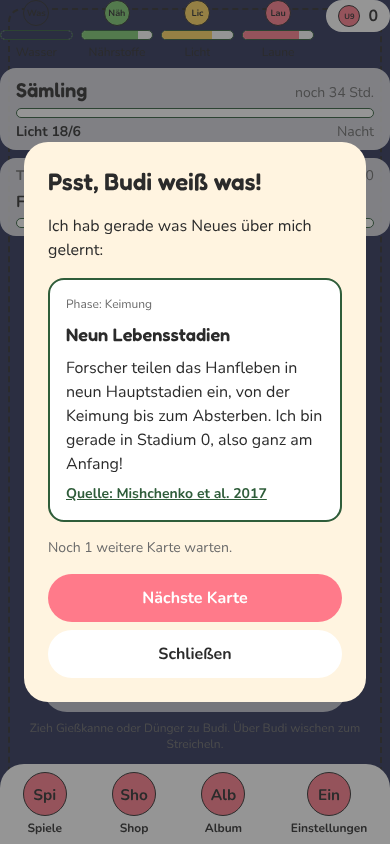

# WEB-3: Web-Version, Spielablauf, Belohnungen und Feedback

Branch: `claude/auftrag-41-web-3-web-version-spielablauf-belohnunge` · Auftrag a41 · mehrere kleine PRs nacheinander

## Befunde aus dem Durchspielen (Playwright, Chromium, 390 x 844, Export unter /pou/)

| # | Stelle | Befund | Stand |
| --- | --- | --- | --- |
| 1 | Erststart | Altersfrage bis Samen geht schnell (ca. 6 s), aber trocken: kein Budi, nur Text | PR 1: Budi begrüßt |
| 2 | Tutorial | Tutorial-Karte und Fakten-Popup ("Psst, Budi weiß was") liegen direkt nach dem Pflanzen übereinander, beide mit Knöpfen | PR 1: Fakten erst nach dem Tutorial |
| 3 | Tutorial | Karte verdeckt das Tagesziel und den "Samen pflanzen"-Knopf im Zimmer, es gibt zwei gleich aussehende Knöpfe | PR 1: Budi-Sprechblase, eigener Knopftext "Einpflanzen" |
| 4 | Am Rechner | Alles über die volle Breite gezogen (Knöpfe 1200 px breit) | PR 1: Handy-Rahmen |
| 5 | Phasenwechsel | Phasen-Modal und Fakten-Overlay erscheinen gleichzeitig, das Zimmer ist doppelt abgedunkelt | offen, liegt in `room/phase/` (WEB-1), Rückfrage beim CvD |
| 6 | Tageskiste | Kiste ist ein Platzhalter-Kasten, Belohnung nur als Text-Modal | offen, liegt in `room/DailyGoal.tsx` (WEB-1), Rückfrage beim CvD |
| 7 | Ernte | Ergebnis erscheint auf einen Schlag, Sterne und Münzen ohne Inszenierung | nächster PR |
| 8 | Shop, Album | Karten funktional, aber flach; gesperrte Sorten nur blasser | nächster PR |
| 9 | Zimmer | Erster Start nachts (je nach Uhrzeit) ist sehr dunkel. Spielregel, nicht geändert | zur Info |
| 10 | Tabs | Wechsel ohne Übergang | PR 1: Überblenden |

Vorher:

| Tutorial und Fakt übereinander | Rechner | Phasenwechsel: Popups gestapelt |
| --- | --- | --- |
|  |  |  |

## Fertig

### PR 1: Rahmen, Erststart, Popup-Reihenfolge

- Am Rechner (ab 600 px Fensterbreite) steht das Spiel zentriert in einem Handy-Rahmen (420 px breit) vor dunkelgrünem Grund. `src/components/frame/frameLayout.ts` (rein, mit Test), `AppFrame.web.tsx`, nativ `AppFrame.tsx` ohne Wirkung. Eingehängt in `app/_layout.tsx`.
- Tabs blenden beim Wechsel über (`animation: 'fade'` in `app/_layout.tsx`).
- Tutorial als Sprechblase von Budi (`src/components/feedback/SpeechBubble.tsx`, `BudiAvatar.tsx`): springt je Schritt federnd herein, Budi spricht dazu (`budiSpeak`, im Browser hörbar nach dem ersten Klick). Texte in Budis Stimme (`strings.ts`, `onboarding.tutorial.steps`). "Überspringen" als dezenter Link.
- Altersfrage mit Budi-Kopf, der hereinspringt.
- Fakten-Popup wartet, bis das Tutorial durch ist (`FactUnlockPopup.tsx`). Die Karten gehen nicht verloren, sie kommen danach.
- `ui/Modal.tsx`: Karte höchstens `max-w-md` breit, damit Modals am Rechner nicht gestreckt sind.
- Erststart bis zum ersten Samen: ca. 8 s im Skript (Laden 3,5 s, Altersfrage, ein Tipp auf "Einpflanzen").

| Budi begrüßt | Tutorial Schritt 3 | Rechner | Fakt nach dem Tutorial |
| --- | --- | --- | --- |
|  |  |  |  |

## Offen

- Phasenwechsel und Tageskiste inszenieren: brauchen Änderungen in `src/components/room/` (WEB-1). Rückfrage beim CvD läuft.
- Ernte-Feier, Shop und Album, Toasts und Münz-Flug: folgende PRs.

## Fehlende Assets

- Keine neuen. Budis Kopf in der Sprechblase ist aus Formen gezeichnet (`BudiAvatar`), unabhängig von den Budi-Ebenen.

## Bekannte Bugs

- Keine neuen. Keine Konsolenfehler oder -warnungen im Durchlauf (Start, Tabs, Debug, Phasenwechsel).

## Handy-Test (3 bis 5 Punkte für den Chef)

1. Am Rechner https://neinkob12.github.io/pou/ öffnen: Spiel steht zentriert im Handy-Rahmen.
2. Privates Fenster am Handy: Altersfrage mit Budi-Kopf, "Ja", Budi sagt "Hallo, ich bin Budi!", "Einpflanzen" tippen. Unter 30 Sekunden.
3. Durch das Tutorial tippen: Erst danach kommt "Psst, Budi weiß was".
4. Tabs wechseln: kurzes Überblenden statt hartem Schnitt.

## Entscheidungen

- Rahmen nur im Web und erst ab 600 px Breite. Handy und Tablet hochkant bleiben randlos.
- Bausteine für Rückmeldung liegen in `src/components/feedback/`, damit WEB-1 und WEB-2 sie auch nutzen können.

## Gefunden, nicht gemacht

- Im Zimmer stehen "Samen pflanzen" (HarvestEntry) und der Tutorial-Knopf übereinander; jetzt unterscheidbar, aber das Zimmer-Layout gehört WEB-1.
