# WEB-4: Optik A, Budi, Zimmer, Erntekiste und Icons

Branch: `claude/auftrag-42-web-4-optik-a-budi-zimmer-erntekiste-und` · PR: #50 · Auftrag a42

## Rundgang vorher (Playwright, Chromium, 390 x 844, Export unter /pou/)

| # | Stelle | Befund | Stand |
| --- | --- | --- | --- |
| 1 | Ernte-Abschluss | Erntekiste war ein Platzhalter-Kasten „Erntekiste (B8)“ | gezeichnet, mit Stern-Schleife |
| 2 | Trocknen | „Trockenraum (H3)“ und „Zweige an der Leine (B7)“ als Platzhalter | gezeichnet |
| 3 | Ernte | Lupe und Schere als Platzhalter-Kürzel | gezeichnet |
| 4 | Shop | Upgrades als Initialen-Kacheln (GT, LL, VE, BE) | gezeichnet |
| 5 | Kosmetik | Sonnenbrille, Kappe, Strohhut, Krone als Platzhalter-PNG mit Text | gezeichnet |
| 6 | Zimmer | Tageskiste als gelber Kasten „Kiste“ | gezeichnete Schatzkiste, wackelt |
| 7 | Zimmer | Fenster und Regal lagen hinter den Leisten oben, kaum sichtbar | hängen tiefer |
| 8 | Zimmer nachts | sehr dunkel, Teppich knallig lila | Lichterkette, Mondlicht, ruhiger Teppich |
| 9 | Budi | Gesichter klein und ähnlich, Sorten kaum unterscheidbar | größere Augen, Merkmal je Stimmung, Blattform je Sorte |

## Vorher und nachher

| Vorher Blüte (Nacht) | Nachher Blüte (Nacht) | Nachher Tag |
| --- | --- | --- |
| 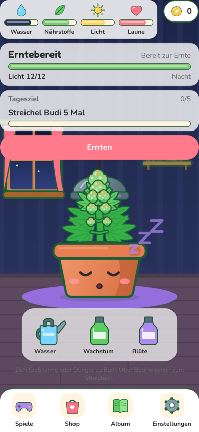 | 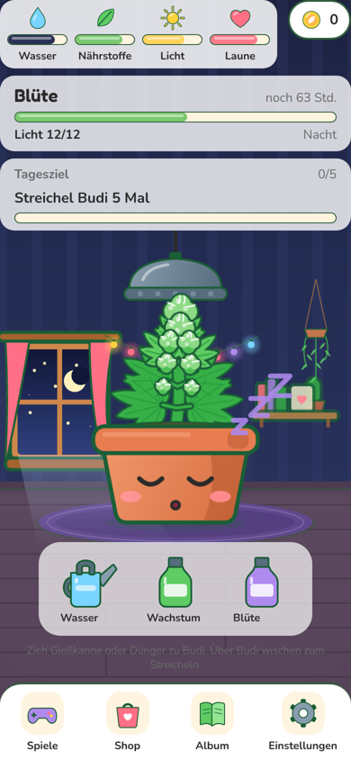 | 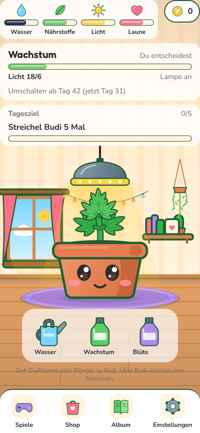 |

| Vorher Trockenraum | Nachher Trockenraum | Vorher Erntekiste | Nachher Erntekiste |
| --- | --- | --- | --- |
| 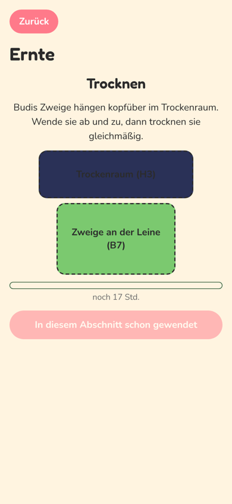 | 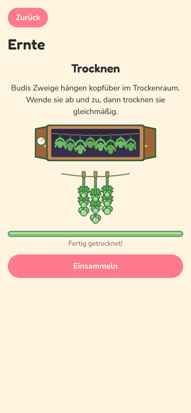 | 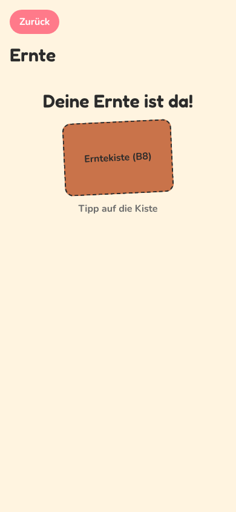 | 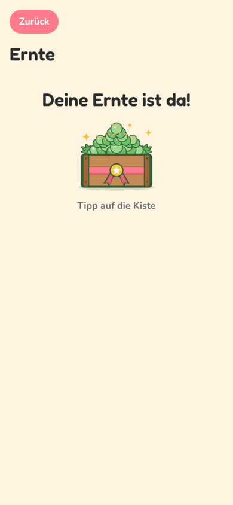 |

| Vorher Shop | Nachher Shop | Vorher Kosmetik | Nachher Kosmetik |
| --- | --- | --- | --- |
| 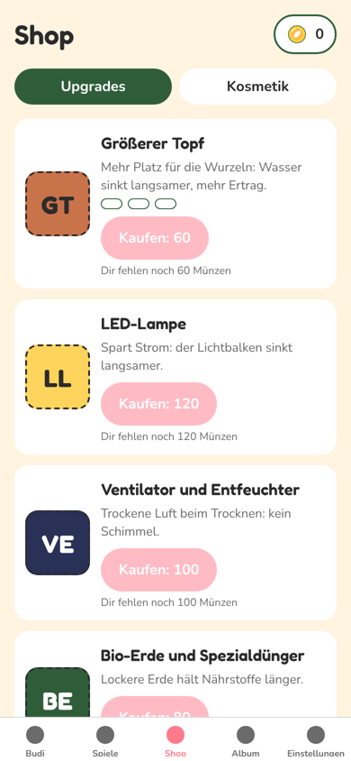 | 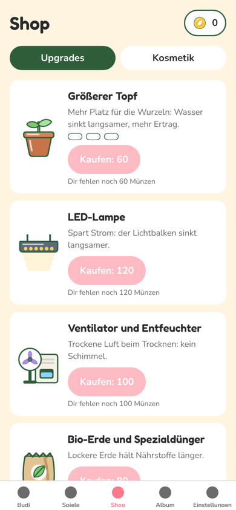 | 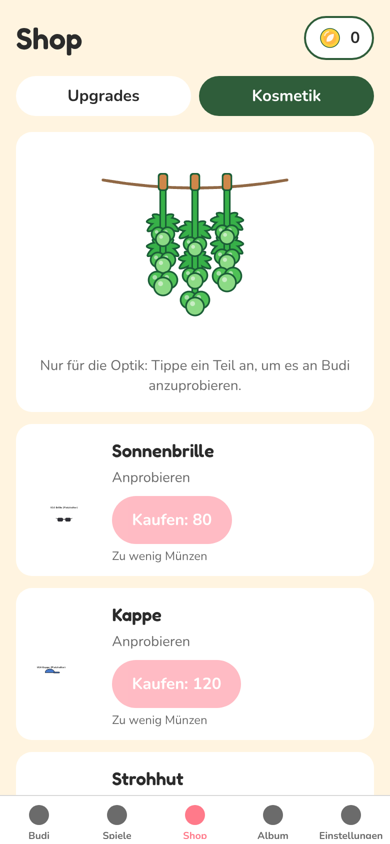 | 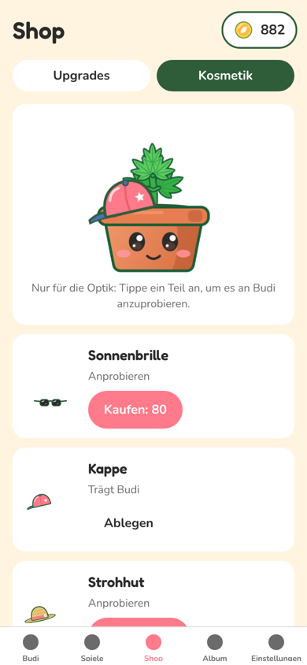 |

| Nachher Keimling (Tag) | Erntereif | Trocknen | Brille nachts |
| --- | --- | --- | --- |
| 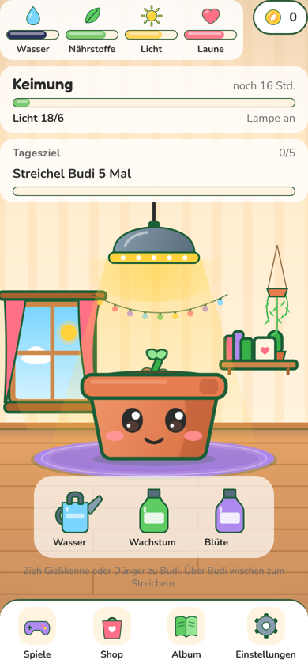 | 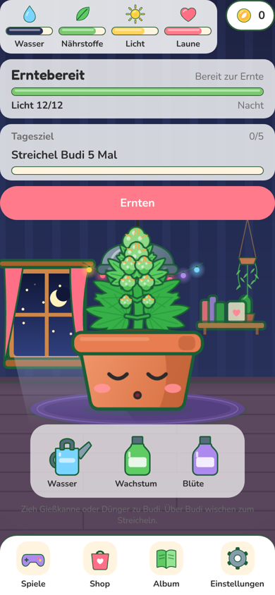 | 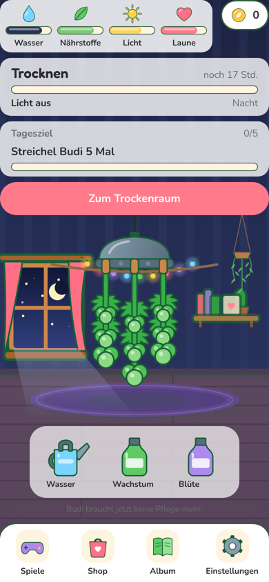 | 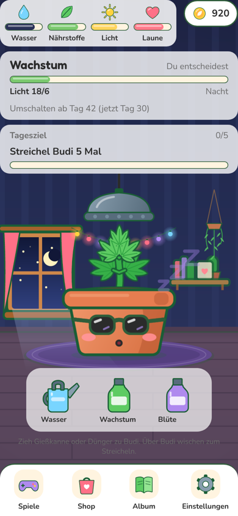 |

Budi vorher und nachher (Reihe 1 Phasen, Reihe 2 und 3 alle 12 Gesichter, Reihe 4 Sorten Gustav, Lotte, Sascha, Anton, Kölsch):

| Vorher | Nachher |
| --- | --- |
| 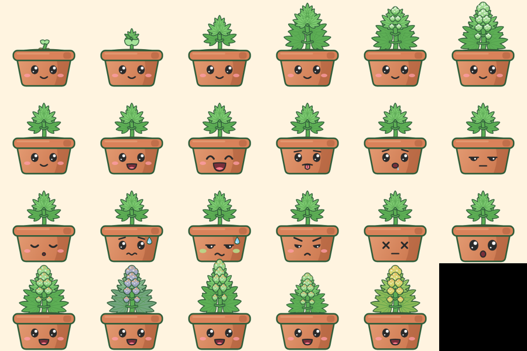 | 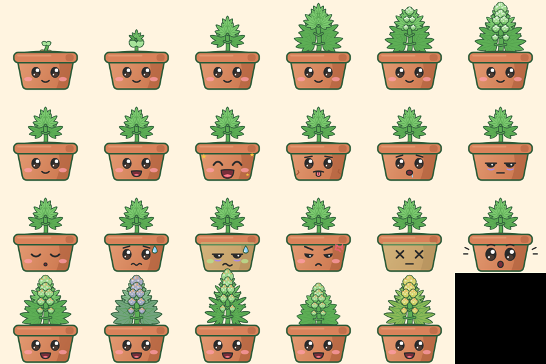 |

Zimmer ohne Leisten (Tag, Nacht) und alle neuen Gegenstände:

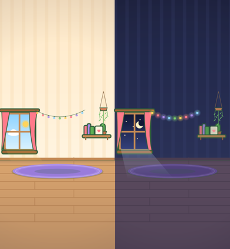

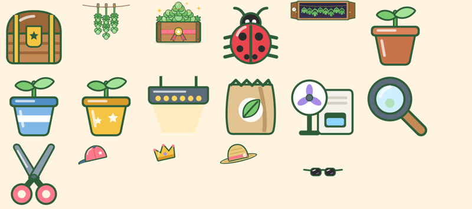

## Fertig

### Teil 1: Platzhalter weg

- `src/components/ui/icons/itemArt.tsx`: neue Icons im Budi-Stil: Tageskiste, Lupe, Schere, Topf Stufe 1 bis 3, LED, Ventilator mit Entfeuchter, Bio-Erde, Marienkäfer (Nützlinge). Gemeinsame Formen in `shapes.tsx`, Stern in `starPath.ts` (Test).
- `src/components/budi/art/HarvestArt.tsx`: Erntekiste B8 neu, mit Blättern, Härchen, Latten, Eckpfosten und Stern-Schleife (docs/ASSETS.md).
- `src/components/budi/art/DryingRoomArt.tsx`: Trockenraum H3 (offener Schrank, Leine, Hygrometer).
- `src/components/budi/art/AccessoryArt.tsx`: Sonnenbrille, Kappe, Strohhut, Krone auf der Budi-Leinwand. Hüte sitzen schräg auf dem Topfrand, damit die Pflanze frei bleibt.
- `assets/render-art.cjs`: rendert diese Zeichnungen ohne Browser (CanvasKit) als PNG nach `assets/images/` und `assets/budi/u16_*.png`. Aufruf: `node assets/render-art.cjs`. So bekommen Ernte-Screen, Shop und Accessoire-Slot echte Bilder über `assets.ts`, ohne dass ich deren Komponenten anfasse.
- `src/lib/assets.ts`: Einträge in den Abschnitten Ernte und Shop-Upgrades, Kommentar bei Kosmetik.
- `src/components/room/DailyChest.tsx`: Tageskiste als gezeichnete Schatzkiste mit Schein, wackelt alle 1,4 s. Ersetzt den Platzhalter in `DailyGoal.tsx`.

### Teil 2: Budi

- `FaceArt.tsx`: Augen größer, mit warmer Iris. Je Stimmung ein eigenes Merkmal: sehr glücklich mit goldenem Funkeln, durstig mit trockenem Topf, müde mit Augenringen, krank blass mit Augenringen, beleidigt mit Zornfalte, Koma blass, überrascht mit hochgezogenen Brauen und Schreck-Strichen.
- Sorten klar unterscheidbar (`budiLook.ts`, `STRAIN_STYLES.leafWidth`, `geometry.ts` `fanLeaf`): Sascha schmale gefingerte Blätter, Anton breite Blätter, Lotte etwas breiter und lila in der Blüte, Kölsch goldgrün und schmaler. Tests in `budiLook.test.ts` und `art.test.ts`.
- `CareFx.tsx`: Teilchen steigen in zwei Wellen mit seitlichem Schwingen auf. Neu: Grummel-Wolke mit Blitz bei zu viel Pflege (Rückmeldung „warning“). Logik in `careFxKind.ts` (Test).

### Teil 3: Zimmer

- `roomLayout.ts`: Fenster und Regal hängen am Boden statt am oberen Rand, damit die Leisten sie nicht verdecken (Test). Neu: Lage der Lichterkette.
- `RoomDecor.tsx`: Lichterkette (nachts mit Schein), Hängepflanze über dem Regal, Mondlicht aus dem Fenster, Tiefe durch Schatten an der Wandkante, dunkleren Boden vorn und leichte Vignette.
- `RoomArt.tsx`: Nacht-Teppich gedeckt statt knallig, Teppich mit Rand.
- `RoomAmbience.tsx`: bei Tag schweben Staubkörnchen im Sonnenlicht, nachts funkeln Sterne im Fenster. Kleine Reanimated-Views, kein Neuzeichnen der Leinwand, im Browser kein zusätzlicher WebGL-Kontext.
- Farben im eigenen Abschnitt `artColors` in `src/lib/theme.ts`.

### Prüfung

- `bash scripts/check.sh` grün (Typen, Lint, Tests, Inhalts-Check).
- Web-Export (`npx expo export --platform web`) und Android-Export (`npx expo export --platform android`) bauen.
- Browser 390 x 844: Start, Zimmer bei Tag und Nacht, alle Phasen, Trocknen, Ernte bis Kiste, Shop, Kosmetik, Album ohne Konsolenfehler oder -warnungen (gemessen ohne Playwrights Fake-Uhr; mit Fake-Uhr meldet Reanimated Fehler aus der Uhr-Attrappe selbst).

## Offen

- Tab-Leiste auf Shop, Spiele, Album, Einstellungen hat noch Punkt-Icons (`app/_layout.tsx`, gehört WEB-5). Die Icons gibt es (`GameIcon`).
- Topf-Skins (U16: gestreift, gold, Köln-Dom) sind im Spiel noch nicht vorgesehen, daher nicht gezeichnet.

## Fehlende Assets

- Keine. Alle Bilder in `assets.ts` für Ernte, Shop-Upgrades und Accessoires sind jetzt gezeichnet. Echte Grafik kann die PNGs unter gleichem Namen ersetzen.

## Bekannte Bugs

- Keine neuen. In der vollen Blüte ragt die Pflanze über die Lampe (Lampe liegt dahinter). Lage der Lampe kommt aus dem Layout von `RoomScreen`, nicht geändert.

## Handy-Test (3 bis 5 Punkte für den Chef)

1. Zimmer bei Tag: Fenster mit Sonne, Lichterkette, Hängepflanze; im Lichtstrahl schweben kleine Staubkörnchen.
2. Nachts (Lichtplan): Lichterkette leuchtet bunt, Mondlicht fällt auf den Boden, Sterne im Fenster funkeln.
3. Debug, +1000 Münzen, Shop > Kosmetik: Kappe kaufen und anziehen, Budi trägt sie schräg auf dem Topfrand. Upgrades zeigen gezeichnete Bilder.
4. Debug: Sorten freischalten, Sascha und Anton pflanzen und +30 Tage: schmale gegen breite Blätter.
5. Tagesziel schaffen: Die Schatzkiste wackelt. Ernte bis zum Ende: Holzkiste mit Stern-Schleife statt „(B8)“.

## Entscheidungen

- Gezeichnete Grafik, die ein Bild-Slot in fremden Komponenten braucht (Ernte, Shop, Accessoires), wird als PNG gerendert und über `assets.ts` eingehängt. Quelle bleibt die Skia-Zeichnung; nach Änderungen `node assets/render-art.cjs` laufen lassen.
- Zimmer-Animationen als Views statt Leinwand, damit der Browser flüssig bleibt (WEB-1, Leistung).

## Gefunden, nicht gemacht

- Ernte-Ergebnis: „Der Kräutermarkt zahlt 0 Münzen“ beim ersten Durchlauf mit Debug-Vorspulen. Gehört zur Ernte-Logik, nicht angefasst.
- Streicheln per Maus im Browser-Skript zählt nicht fürs Tagesziel (Geste erwartet Touch). Mit echtem Finger ungeprüft.
