# WEB-5: Optik B, Screens, Menüs und Oberfläche

Branch: `claude/auftrag-43-web-5-optik-b-screens-menues-und-oberfla` · PR: #51 · Kollege: Session a43

## Befunde vorher (Playwright, Chromium, 390 x 844 und 1280 x 800, Export unter /pou/)

| # | Stelle | Befund |
| --- | --- | --- |
| 1 | Alle Knöpfe | Keine Kontur und kein Einsinken im Web. Ursache: NativeWind verwirft bei `Pressable` mit `className` die Style-Funktion. Gesperrte Knöpfe waren blassrosa und wirkten kaputt. |
| 2 | Tab-Leiste | Graue Punkte statt Icons, passt nicht zur Zimmer-Navigation |
| 3 | Karten | Flach und weiß ohne Kontur, das Zimmer hat dagegen Kontur und Kante (Stilbruch) |
| 4 | Köpfe | "Zurück" als koralle Pille über dem Titel, im Debug-Menü darunter, Abstände je Screen anders |
| 5 | Ernte | Kein Fortschritt zwischen Lupe, Schere, Trocknen; leerer Topf nur ein Satz Text |
| 6 | Album, Samenwahl | Riesige gestrichelte Platzhalter-Porträts, Karten sehr lang |
| 7 | Altersfrage | Text linksbündig im Leeren, kaum Gewicht |
| 8 | Rechner | Flacher grüner Grund, Rahmen ohne Gehäuse, kein Titel |

## Vorher und nachher

| | Vorher | Nachher |
| --- | --- | --- |
| Altersfrage | 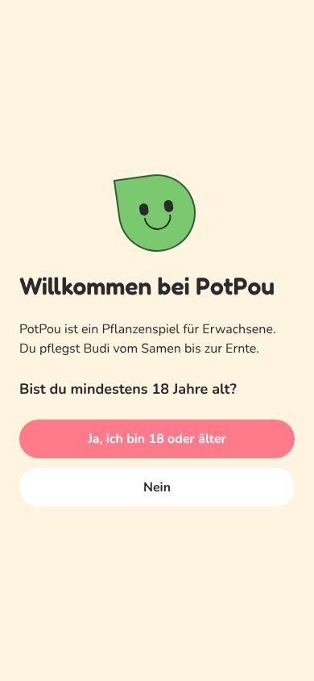 | 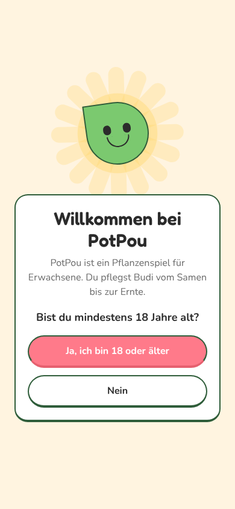 |
| Shop | 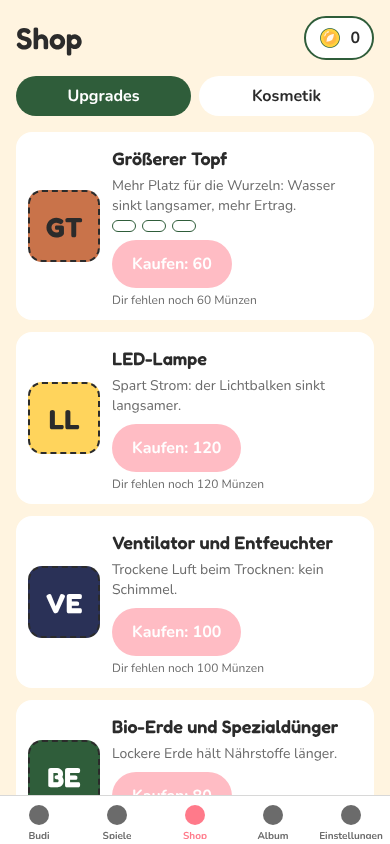 | 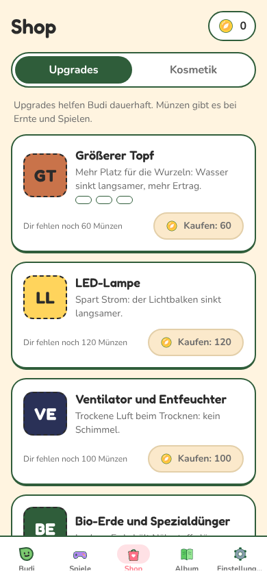 |
| Album | 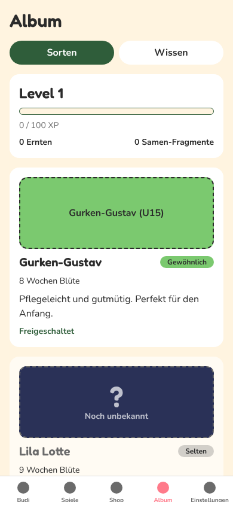 | 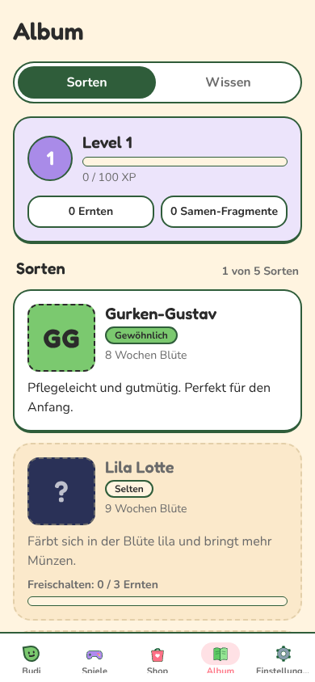 |
| Samenwahl | 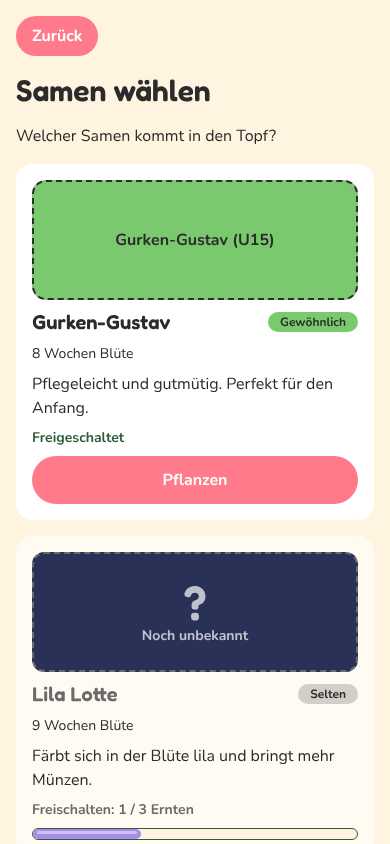 | 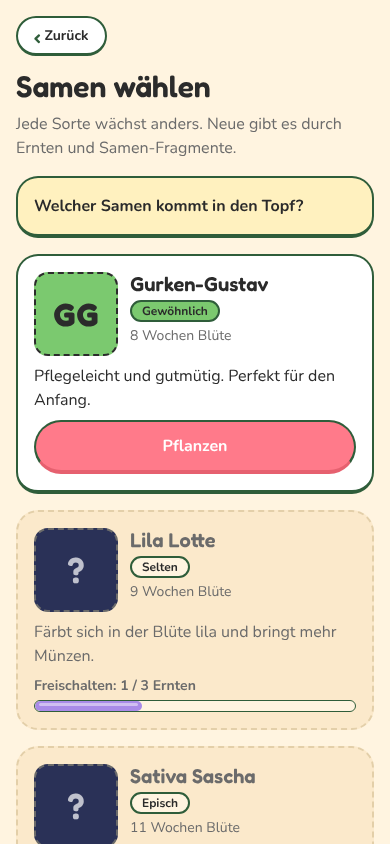 |
| Ernte: Lupe | 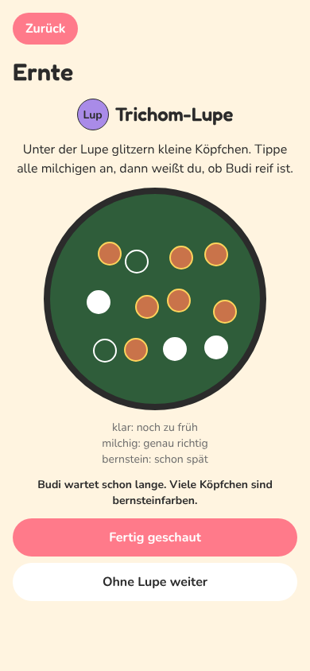 | 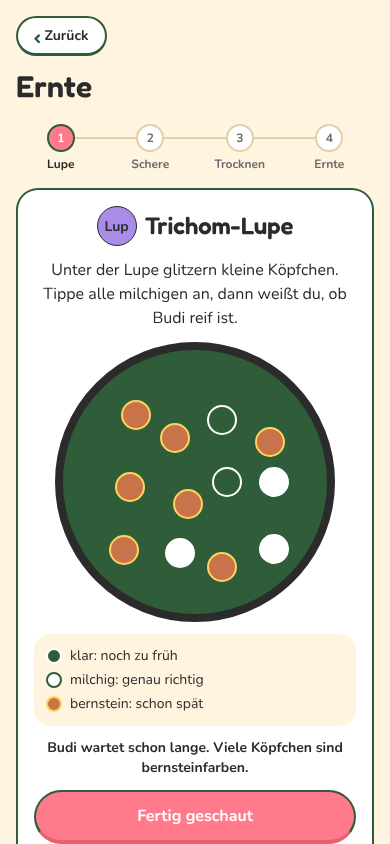 |
| Ernte: Ergebnis | 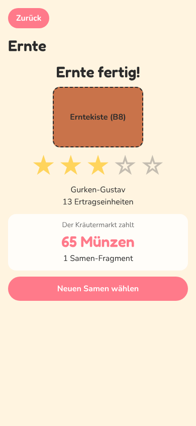 | 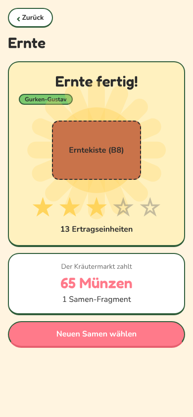 |
| Einstellungen | 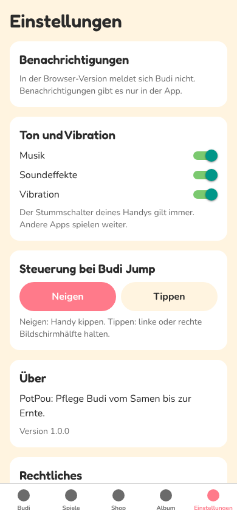 | 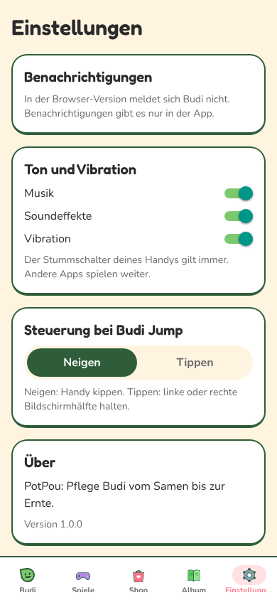 |
| Rechner | 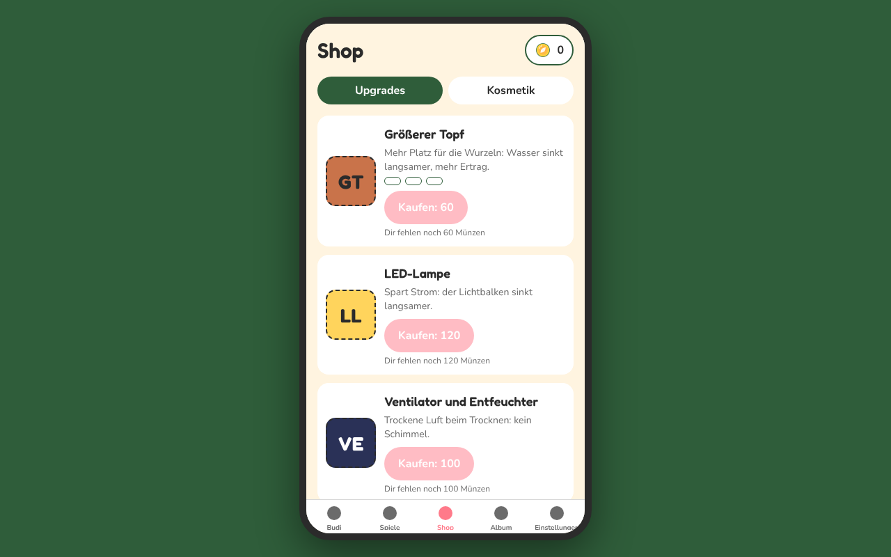 | 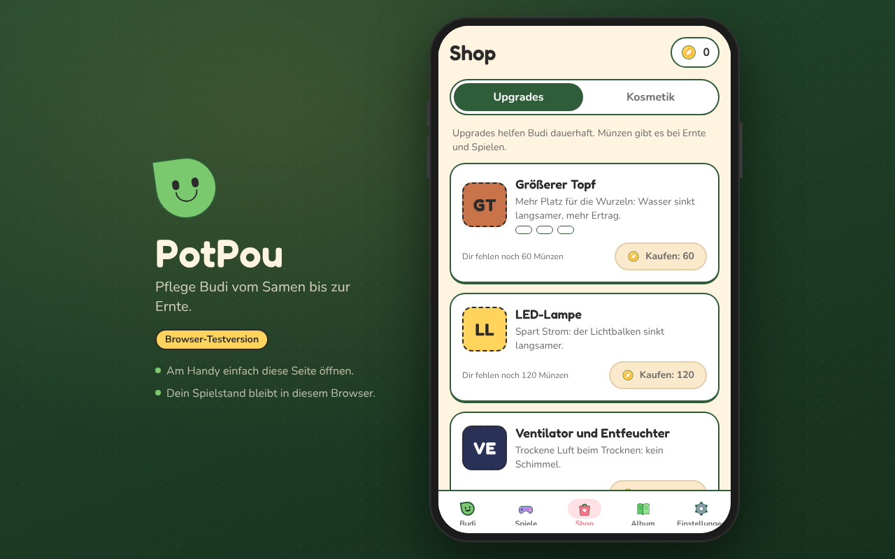 |

Ernte am Rechner und die wackelnde Kiste: 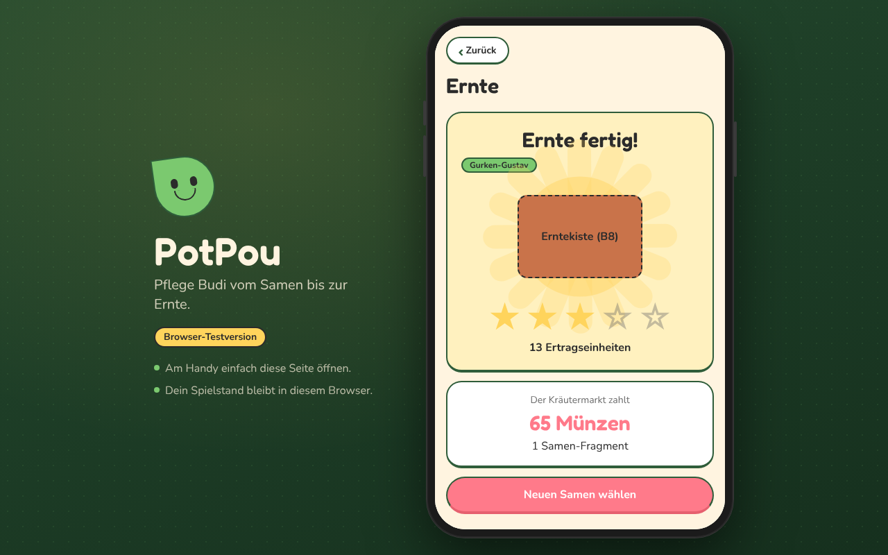 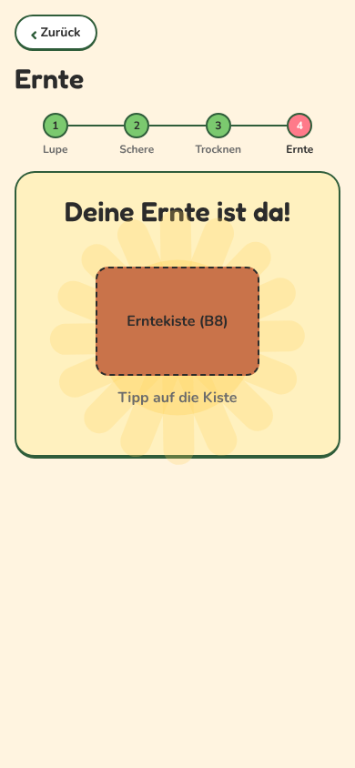

## Fertig

### Visuelles System (`src/components/ui/`, `theme.ts` Abschnitt `surface`, `strings.ts` Objekt `screenUi`)

- `Card`: weiß, runde Ecken, dunkelgrüne Kontur, Kante unten wie ein Sticker. Töne `plain`, `muted` (gesperrt/leer, gestrichelt), `success`, `rare`, `highlight`, `night`. Mit `onPress` sinkt sie ein.
- `Screen`: gemeinsamer Kopf (Zurück, Titel, rechts z. B. Münzen, Untertitel) und feste Abstände (16) für alle Screens außerhalb des Zimmers.
- `Button`: Kontur und Kante jetzt wirklich sichtbar (nur `style`, kein `className` auf dem `Pressable`), neue Variante `success`, Größe `sm`, Bild davor (`leading`). Gesperrt: stumpfes Creme statt blass.
- `Badge`, `SectionTitle`, `EmptyState` (Budi schaukelt), `Appear` (Karten gleiten versetzt herein), `BackButton` als Pille mit Kontur, `NavLink` als Zeile mit Pfeil.
- Tab-Leiste (`app/_layout.tsx`, `ui/TabIcon.tsx`): gezeichnete Icons, aktiver Tab mit korallener Pille, Kontur oben. Die Icons laden erst beim Rendern, weil ein Skia-Modul im Browser nicht vor CanvasKit ausgewertet werden darf.
- Album-/Shop-Umschalter als Schalter mit Kontur, Inhalt blendet über.

### Screens

- Shop: Karten mit Plaketten, Preis-Knopf mit Münze, "Dir fehlen noch" neben dem Knopf, alles gekauft: grüner Hinweis. Kosmetik: Vorschau in gelber Karte mit Schein, Zähler "1/4", Plaketten "Trägt Budi" und "Im Besitz".
- Album: Level als lila Karte mit Level-Plakette und Zählern, Sorten kompakt mit Porträt-Kachel links, gesperrte Sorten als stumpfe Rätselkarte. Wissen: leerer Zustand mit Budi, gesammelte Karten oben.
- Samenwahl: Kopf mit Untertitel, Hinweis als gelbe Karte, gleiche Sortenkarten.
- Ernte: Schrittanzeige Lupe, Schere, Trocknen, Ernte (`harvest/HarvestSteps.tsx`). Jeder Schritt als Karte, Lupe mit Legende als Punkte. Leerer Topf und "noch nicht reif" als leerer Zustand mit Knopf. Kiste und Ergebnis mit kreisenden Lichtstrahlen (`feedback/GlowRays.tsx`), neue Sorte mit "Neu"-Plakette.
- Einstellungen, Debug-Menü: gleiche Karten und Kopf, Steuerung als Schalter.
- Altersfrage: Budi vor Lichtstrahlen, Text zentriert in einer Karte.
- Popups (Modal, Fakten-Popup, Budis Sprechblase): Kontur und Kante, Fakten-Popup springt herein und zeigt Budi.
- Rechner (`frame/AppFrame.web.tsx`, `FrameBrand.tsx`): Handy-Gehäuse mit Seitentasten, grüner Verlauf mit Punktraster, links Titel, Satz, "Browser-Testversion" und zwei Hinweise. Unter 1000 px Breite steht der Titel klein oben links (`brandBeside`, getestet).

### Geprüft

- 390 x 844 und 1280 x 800: alle Screens der Tour ohne Layoutfehler, keine Konsolenfehler.
- `bash scripts/check.sh` grün, Web-Export und Android-Export (`expo export --platform android`) bauen.

## Offen

- Spiele-Auswahl gehört WEB-7 (`minigames/`), nicht angefasst. Sie hat schon Karten, aber ohne Kontur; mit `ui/Card` wäre sie einheitlich.
- Zimmer-Leisten (`room/`) gehören WEB-4, nicht angefasst. Deren Knöpfe nutzen `ui/Button` und bekommen dadurch jetzt auch die Kontur.

## Fehlende Assets

- Keine neuen. Sorten-Porträts (U15), Erntekiste (B8), Trockenraum (H3), Zweige (B7) und Upgrades bleiben Platzhalter, jetzt als Kachel mit Initialen.

## Bekannte Bugs

- Keine neuen.

## Handy-Test (3 bis 5 Punkte für den Chef)

1. Am Rechner https://neinkob12.github.io/pou/ öffnen: Handy-Gehäuse vor grünem Verlauf, links "PotPou" mit Budi.
2. Privates Fenster am Handy: Altersfrage mit Budi vor Lichtstrahlen, Knöpfe mit dunkler Kontur, die beim Tippen einsinken.
3. Shop öffnen: Karten gleiten nacheinander herein, Preis mit Münze; ohne Münzen ist der Knopf stumpf creme.
4. Tab-Leiste unten: echte Icons, der aktive Tab hat eine rosa Pille.
5. Debug: +30 Tage zweimal, Licht 12/12, +30 Tage dreimal, Ernte öffnen: Schrittanzeige oben, am Ende die Kiste vor kreisenden Strahlen.

## Entscheidungen

- Neue Screens nutzen `ui/Screen` und `ui/Card`, keine eigenen Karten mehr.
- Auf `Pressable` nie `className` und Style-Funktion zusammen: NativeWind verwirft im Web die Funktion.
- Kein Modul, das Skia importiert, darf statisch an `app/_layout.tsx` hängen (CanvasKit lädt dort erst).

## Gefunden, nicht gemacht

- `room/BottomNav.tsx` und die Spiele-Auswahl könnten `ui/Card` übernehmen (WEB-4, WEB-7).
