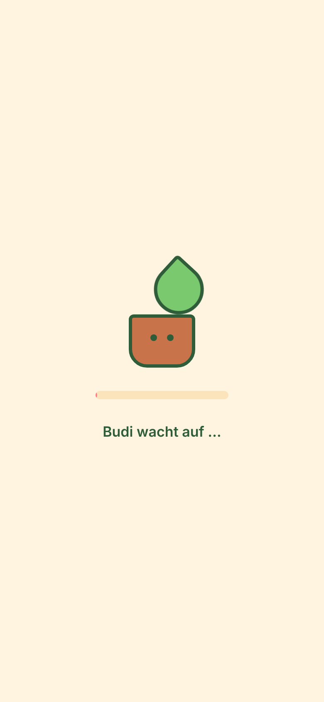
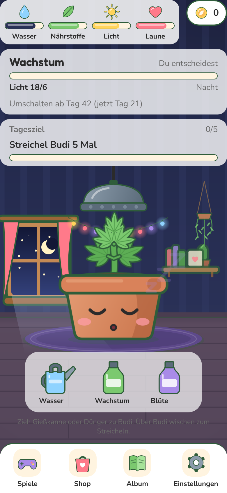
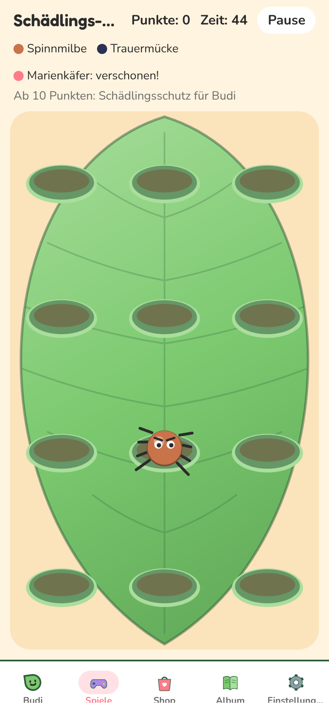

# WEB-6: Performance der Web-Version, Ladezeit und flüssiges Spiel

Branch: `claude/auftrag-44-web-6-performance-der-web-version-ladeze` · PR: siehe Auftrag a44 · Kollege: Session a44

## Messwerte vorher und nachher

Gemessen mit `node scripts/perf/measure.mjs` (Playwright, Chromium, 390 x 844, Spielstand mit Pflanze im Wachstum). Vorher = `main` mit WEB-4, WEB-5 und WEB-7 (Stand 0854b3f), nachher = dieser Branch mit demselben `main`.

### Laden (kalter Cache, 4G = 9 Mbit/s und 150 ms RTT, Median aus 3)

| Profil | Erste Anzeige vorher | nachher | Spielbar vorher | nachher |
| --- | --- | --- | --- | --- |
| 4G | weiße Seite bis spielbar | **0,44 s** | 4,63 s | **4,13 s** (-11 %) |
| 4G + CPU 4x (schwaches Handy) | weiße Seite bis spielbar | **0,48 s** | 6,97 s | **4,70 s** (-33 %) |
| 4G + CPU 4x, Wiederbesuch (HTTP-Cache abgelaufen) | weiße Seite bis spielbar | **0,17 s** | 6,69 s | **2,22 s** (-67 %) |

"Spielbar" = Zimmer mit Navigation und gezeichnetem Budi. Übertragen beim ersten Besuch: 4,1 MB (gzip), davon 3,2 MB CanvasKit. Beim Wiederbesuch: 0 KB.

### Bundle (unverändert, Export für Pages)

| Datei | roh | gzip |
| --- | --- | --- |
| CanvasKit `canvaskit.wasm` | 8,1 MB | 3,2 MB |
| `__common` (Reanimated, Gesture Handler, Skia, Spiel) | 1,8 MB | 0,4 MB |
| `entry` (Expo Router, React DOM, RN Web) | 1,1 MB | 0,3 MB |
| `_layout` (CanvasKit-JS, Fonts) | 0,16 MB | |
| Routen (Zimmer, Shop, Minigames ...) | je 1 bis 60 KB | |

Routen sind schon getrennt (Expo Router lädt sie einzeln). Kleiner wird es nur mit kleinerem CanvasKit, siehe "Gefunden, nicht gemacht".

### fps bei 4-facher CPU-Drosselung (8 s mit Eingaben: Tippen, Pfeiltasten, Streicheln)

| Szene | Dichte 1 vorher | nachher | Dichte 3 vorher | nachher |
| --- | --- | --- | --- | --- |
| Zimmer | 10,7 (Hänger bis 3,6 s) | **54,9** | 2,8 | **59,1** |
| Tipp den Kreis | 29,7 | 33,5 | 5,5 | 11,4 |
| Schädlinge | 9,3 | 11,8 | 4,7 | 7,0 |
| Tropfen | 29,3 | 30,7 | 9,3 | 16,8 |
| Budi Jump | 19,8 | 20,2 | 4,7 | 11,0 |
| Quiz | 56,3 | 57,0 | 56,6 | 53,8 |

Wichtig zum Lesen: Der Mess-Container hat keine Grafikkarte, Chromium rechnet WebGL dort in Software (SwiftShader) und die CPU-Drosselung bremst das mit. Die Minigame-Werte sind deshalb viel schlechter als auf einem echten Handy, und Dichte 3 heißt hier 9-fache Software-Arbeit. Vergleichbar sind nur vorher und nachher untereinander. Dichte 1 zeigt die reine Rechenlast (JavaScript und Skia).

## Fertig

- **Ladebildschirm** (`public/index.html`): HTML-Vorlage für den Export. Steht nach 0,2 bis 0,5 s statt weißer Seite: Topf mit Blatt, Laufbalken, "Budi wacht auf …". Geht weg, sobald die App Text zeigt (MutationObserver), nach 25 s erscheint "Dauert lange? Neu laden". Bewegung aus bei "Bewegung reduzieren". 
- **CanvasKit und Schriften früh laden** (`public/index.html`): Preload-Links, damit die 8 MB WebAssembly und die vier Schriften parallel zum JavaScript laden statt danach. Die Pfade tragen Metros Inhalts-Hash; `src/perf/__tests__/preload.test.ts` rechnet ihn aus den installierten Paketen nach und schlägt fehl, wenn ein Update ihn ändert (dann den Pfad aus der Fehlermeldung eintragen).
- **Gecacht laden** (`public/sw.js`): Service Worker. Alles unter `/_expo/static/` und `/assets/` (mit Hash im Namen) kommt beim zweiten Besuch aus dem Speicher, die Seite selbst immer zuerst übers Netz (neuer Stand von `main` kommt sofort an), ohne Netz die gespeicherte Seite. Beim ersten Besuch schickt die Seite dem Worker die schon geladenen Dateien, damit er sie ablegt. Höchstens 120 Einträge, alte fliegen raus. Nur im Export aktiv, nicht im Dev-Server.
- **Stille Skia-Leinwände ohne WebGL-Kontext** (`src/perf/stillCanvas.ts`, eingehängt in `src/lib/skiaWeb.web.ts`): Größte Bremse im Zimmer. Skia-Web baut für jede stille Leinwand (`ArtCanvas still`: Budi, Zimmer, Icons) bei jedem Neuzeichnen einen neuen WebGL-Kontext samt Shadern, beim Start 38 Stück, und das Zimmer zeichnet bei jedem Uhr-Tick neu. Jetzt rechnet CanvasKit diese Bilder auf der CPU (`MakeSurface`) und kopiert sie ins 2D-Canvas. Gleiches Bild, Zimmer von 3 bis 11 auf 55 bis 59 fps, keine Hänger mehr beim Streicheln. Bewegte Leinwände (Minigames) bleiben auf WebGL. Getestet mit Attrappen (`src/perf/__tests__/stillCanvas.test.ts`).
- **Pixeldichte höchstens 2** (`src/perf/pixelRatio.ts`, eingehängt in `skiaWeb.web.ts`): Skia-Leinwände richten sich nach `devicePixelRatio`; Handys mit 3 zeichnen 9 Pixel je Punkt. Gedeckelt auf 2 (4 Pixel), CSS, Text und Bilder bleiben scharf. Minigames bei Dichte 3 im Container etwa doppelt so schnell. Getestet.
- **Mess-Skript** (`scripts/perf/measure.mjs`, `scripts/perf/serve.mjs`): baut nichts selbst, misst einen vorhandenen Export. `serve.mjs` liefert ihn wie Pages aus (`/pou/`, gzip, SPA-Rückfall). Aufruf und Optionen stehen oben in der Datei. `PERF_DEBUG=<pfad>` gibt lange Frames und Bildschirmfotos aus.
- `app.json` (web): `lang: de`, `themeColor`, `description`.

| Zimmer nachher (gleiches Bild wie vorher) | Schädlinge nachher |
| --- | --- |
|  |  |

## Offen

- Minigames nicht nahe 60 fps (siehe Tabelle). Ursache liegt im Code der Spiele (WEB-7): Skia-Web spielt in jedem Frame die ganze Szene neu ab (`sksg/Recorder/Player.play`), die Kosten wachsen mit der Zahl der Skia-Knoten. Vorschläge sind beim CvD (siehe "Gefunden, nicht gemacht"). Gehört nicht zu meinen Dateien.
- Echte Messung auf einem Handy mit Grafikkarte fehlt (Container hat keine). Handy-Test unten.

## Fehlende Assets

- Keine.

## Bekannte Bugs

- Der Service Worker greift erst ab dem zweiten Besuch. Wer am ersten Tag nach einem Deploy kommt, lädt einmal alles neu (wie bisher).
- Lokal ohne die Routen-Kopien aus `pages.yml` meldet der Browser bei Direktaufruf einer Unterseite einmal 404 für das Dokument (wie schon in PWEB beschrieben). Auf Pages nicht.

## Handy-Test (3 bis 5 Punkte für den Chef)

1. https://neinkob12.github.io/pou/ im privaten Fenster öffnen: Sofort cremefarbener Ladebildschirm mit Topf und "Budi wacht auf …", keine weiße Seite. Danach das Zimmer.
2. Seite schließen, am nächsten Tag (oder nach 10 Minuten) wieder öffnen: Zimmer steht nach etwa 2 Sekunden.
3. Im Zimmer mehrmals über Budi wischen: Herzen und Wackeln laufen flüssig, kein Einfrieren.
4. Budi und Zimmer sehen aus wie vorher (Kanten, Farben, Nacht mit Mond).
5. Ein Minigame spielen und ehrlich sagen, ob es ruckelt. Das ist der nächste Hebel (WEB-7).

## Entscheidungen

- Stille Leinwände über CPU statt WebGL: Eingriff in CanvasKit-Funktionen (`GetWebGLContext`, `MakeWebGLContext`, `MakeOnScreenGLSurface`, `MakeRenderTarget`, `deleteContext`), nur für `OffscreenCanvas`-Ziele, nur im Web. Grund: der eine Weg ohne fremde Dateien und ohne Patch-Paket. Bei einem Skia-Update `stillCanvas.ts` gegenprüfen (Test deckt die Logik ab, nicht Skia-Interna).
- Preload-Pfade fest in `public/index.html`, abgesichert durch Test, statt `pages.yml` zu ändern (gehört nicht mir).
- Kleineres CanvasKit (`bin/canvaskit.wasm` statt `bin/full`, 2,9 statt 3,2 MB gzip) nicht genommen: Skia lädt `full` fest, Umbiegen per Metro wäre riskant für 0,3 s.

## Gefunden, nicht gemacht

- **WEB-7, Minigames** (Messung oben): (1) Statische Hintergründe (Blatt mit Adern bei Schädlinge, Himmel und Wolken bei Tropfen und Jump, Hintergrund bei Tipp den Kreis) in eine eigene `ArtCanvas still` hinter die Spiel-Leinwand legen; die ist im Web jetzt billig. Die Spiel-Leinwand spielt dann pro Frame nur noch die Figuren ab. (2) Viele kleine Formen zu wenigen Pfaden zusammenfassen, wie `FxLayer` es schon macht. (3) Keine React-State-Änderung pro Frame über dem Canvas: jede baut die Aufnahme neu (`Container.redraw`).
- **WEB-4, Zimmer**: `RoomBackground` zeichnet bei jedem Tick von `usePlantStatus` neu, obwohl sich nur `isDay` ändern kann. Ein `memo` auf (Breite, Höhe, isDay) spart die Arbeit ganz. Nach dem CPU-Weg kostet es nur noch wenig.
