# WEB-7: Minigames, mehr Spielspaß, Abwechslung und Wiederspielwert

Branch: `claude/auftrag-45-web-7-minigames-mehr-spielspass-abwechsl` · PR: siehe Auftrag a45 · Kollege: Session a45

## Vorher (gespielt mit Playwright und den Bots aus `difficulty/`, 390 x 844 und 1280 x 800)

- **Tipp den Kreis:** immer dieselbe lila Knospe, 30 Sekunden lang. Einzige Steigerung: Knospen werden kleiner und stehen kürzer. Nach zwei Runden kennt man alles.
- **Schädlinge:** solide, aber 45 Sekunden ohne Ereignis. Milbe und Mücke spielen sich gleich, nur das Tempo steigt.
- **Tropfen:** die ersten 20 Sekunden zäh (langsam, wenig Tropfen). Salz ist die einzige Gefahr und wird nie mehr. Wer es meidet, spielt ewig.
- **Budi Jump:** Lichtpunkte zählen nicht für die Punkte, keine Überraschung unterwegs. Steigerung nur über Abstände und brechende Blätter.
- **Quiz:** 45 Sekunden für 3 Fragen, also null Druck. Keine Entscheidung außer der Antwort.
- **Alle:** Ziel der Runde (nächster Stern) und Rekord sah man erst im Ergebnis, nicht beim Spielen.

## Fertig

Neue Werte in `src/game/config.ts`, Abschnitt `MINIGAME_FUN` (im Minigames-Abschnitt), Texte in `src/content/strings.ts` als `minigameFun`, Farben in `src/lib/theme.ts` als `funColors`.

- **Rahmen, alle Spiele:** Kopfzeile zeigt das nächste Sterne-Ziel („★★ bei 35“) und den Rekord (`ScoreHud.tsx`, `roundGoal.ts`). Wer den alten Rekord überholt, bekommt mitten im Spiel „Neuer Rekord!“ (`MinigameShell.tsx`). Ereignis-Banner für alle Spiele (`fx/EventBanner.tsx`). Tipps im Ergebnis erklären die neuen Elemente.
- **Tipp den Kreis:** goldene Knospe (8 %, ab 4 s): 3 Punkte, steht nur 65 % so lange, goldener Ring. **Endspurt** in den letzten 8 Sekunden mit Banner, Gold dann zu 20 % (`example/tapGolden.ts`, `TapScene.tsx`).
- **Schädlinge:** **Panzermilbe** (ab 8 s, 10 % der Schädlinge): braucht zwei Treffer, erst „Knack!“, dann platt; bleibt länger sitzen. **Schwarm** bei 15 und 30 Sekunden: drei Trauermücken auf einmal mit Banner (`pestSmash.ts`, `CritterSlot.tsx`, Legende in `SmashInfo.tsx`).
- **Tropfen:** **goldener Tropfen** (5 %, ab 8 s): 3 Punkte, zählt als Wasser. **Schutzblatt** (1,5 %, ab 20 s): grüne Blase um den Topf, hält das nächste Salz ab. **Regenschauer** alle 30 s für 3 s mit 2,5-fach so vielen Tropfen. **Salz-Anteil steigt** von 25 % auf 38 % in 90 s, damit die Runde ein Ende findet (`dropsLogic.ts`, `DropsCanvas.tsx`, `useDropsSpecial.ts`).
- **Budi Jump:** **Wander-Blätter** ab Höhe 500 (5 % bis 30 %, schneller je höher): hellgrün mit Pfeilen, gleiten und prallen am Rand ab. **Sonnenstrahl** ab Höhe 600 (2,5 % je Blatt): drehende Sonne, trägt Budi 1,3 s nach oben, Funkenspur (`jumpLevel.ts`, `jumpPhysics.ts`, `JumpBoosts.tsx`, `JumpScene.tsx`).
- **Quiz:** **Bedenkzeit je Frage** 16, 12, 9 Sekunden mit eigenem Balken; abgelaufen zählt als falsch („Zeit um!“). **50:50-Joker** einmal pro Runde, Knopf oder Taste J (`quiz/QuizGame.tsx`, `quiz/quizFun.ts`, `QuestionTimer.tsx`). Die Route `app/minigames/quiz.tsx` nutzt jetzt `QuizGame` statt `facts/FactQuizGame`.
- Tests: `roundGoal`, `tapGolden`, `smashFun`, `jumpFun`, `quizFun`, Bots mit Gold, Panzermilbe, Schwarm, Schutzblatt und Wander-Blättern.

## Messung mit dem Bot (Mittel über 20 Startwerte, Punkte und Münzen)

| Spiel | langsam | | | | schnell |
| --- | --- | --- | --- | --- | --- |
| Tipp vorher | 1100 ms: 15 (2) | 900: 29 (4) | 700: 42 (5) | 500: 59 (8) | 350: 83 (8) |
| Tipp jetzt | 1100 ms: 14 (1) | 900: 26 (3) | 700: 44 (6) | 500: 70 (8) | 350: 99 (8) |
| Smash vorher | 1100 ms: 22 (3) | 900: 42 (5) | 750: 58 (8) | 500: 74 (8) | 350: 75 (8) |
| Smash jetzt | 1100 ms: 26 (3) | 900: 50 (7) | 750: 73 (8) | 500: 97 (8) | 350: 101 (8) |
| Tropfen vorher | 900 ms: 36 (5) | 700: 48 (6) | 500: 59 (8) | 350: 69 (8) | 250: 114 (8) |
| Tropfen jetzt | 900 ms: 37 (5) | 700: 50 (7) | 500: 66 (8) | 350: 103 (8) | 250: 91 (8) |
| Jump vorher | 800 ms: 85 (8) | 600: 135 (8) | 450: 320 (8) | 300: 449 (8) | 200: 900 (8) |
| Jump jetzt | 800 ms: 94 (8) | 600: 140 (8) | 450: 196 (8) | 300: 507 (8) | 200: 1010 (8) |

- Münzen: Formel und `MINIGAME_REWARDS` unverändert. Pro Runde höchstens +1 bis +2 Münzen für geübte Spieler (Smash 900 ms: 5 auf 7), langsame Spieler bei Tipp −1 (goldene Knospen sind für sie zu schnell weg). Wer schnell ist, war schon vorher am Deckel von 8.
- Gegensteuer, damit die Münzen nicht wegziehen: Panzermilbe ohne Extrapunkte (sie kostet einen Tipp mehr), der Knack hält die Kombo nur am Leben, statt sie zu erhöhen; Schutzblatt selten; Salz-Anteil steigt.
- Sterne-Grenzen neu (`MINIGAME_FEEL.stars`): Tipp 12/35/55 (vorher 15/35/50), Smash 20/55/90 (20/50/70), Jump 80/180/600 (80/250/600; Wander-Blätter machen die Mitte schwerer). Tropfen und Quiz unverändert. Test `difficulty.test.ts` (gemütlich 1, geübt 2, sehr schnell 3) ist grün.

## Im Browser (Playwright, Bild-Bots)

Gespielt bei 390 x 844 (Touch) und 1280 x 800 (Maus und Tastatur): Tipp mit Klick und Touch, Smash mit Klick und Touch, Tropfen mit Pfeiltasten, Jump mit Pfeiltasten, Quiz mit 1 bis 3, J und Enter. Keine Fehler in der Konsole. Einzige Meldung: „Blocked call to navigator.vibrate“, wenn Salz trifft, bevor man je getippt hat (nur in der Tastatur-Runde ohne Berührung, Chrome-Regel; gab es vorher schon).

Gefunden und behoben: Banner mit `withSequence` blieb im Web bis Rundenende stehen (Abschluss-Callback kam nicht). Jetzt eine Animation über die ganze Dauer. Popups am Rand („Gold!“) wurden abgeschnitten, jetzt nach innen gezogen.

## Bilder

| | |
| --- | --- |
| Tipp: goldene Knospe, Ziel und Rekord in der Kopfzeile, „Neuer Rekord!“ | 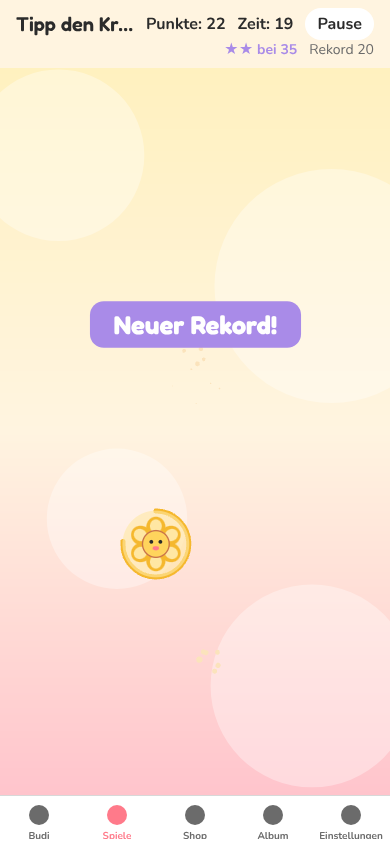 |
| Tipp: Endspurt | 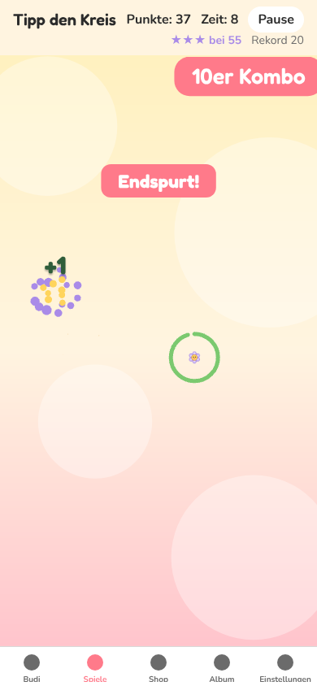 |
| Smash: Panzermilbe, Legende | 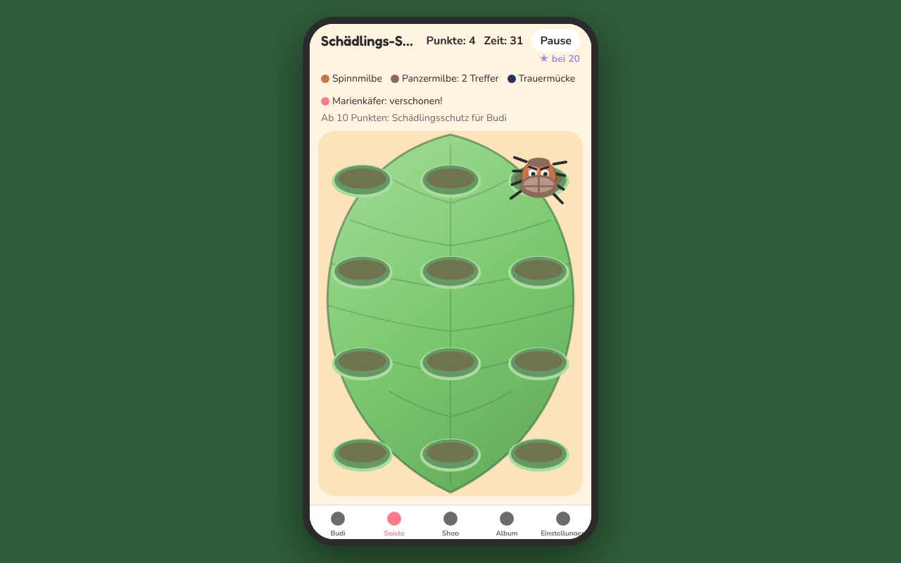 |
| Smash: Schwarm | 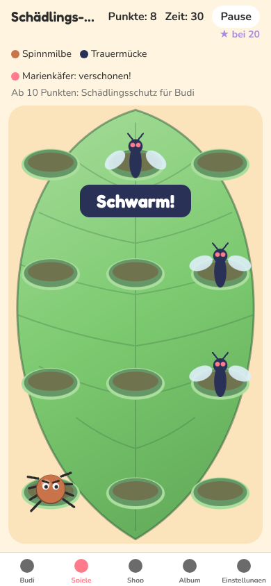 |
| Tropfen: Regenschauer am Rechner | 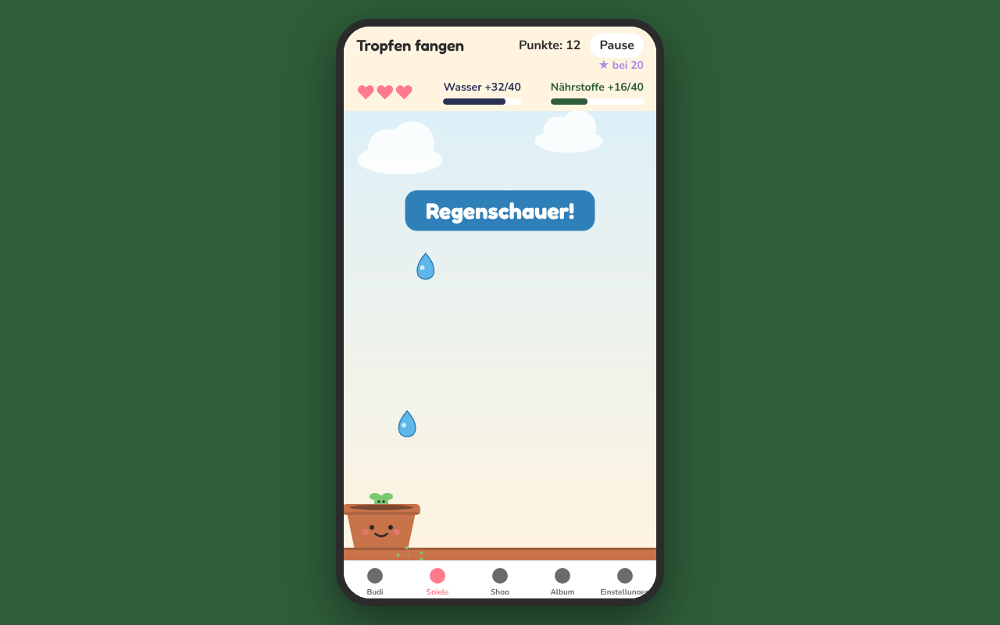 |
| Tropfen: goldener Tropfen und Schutzblatt (Vorschau mit hoher Chance) | 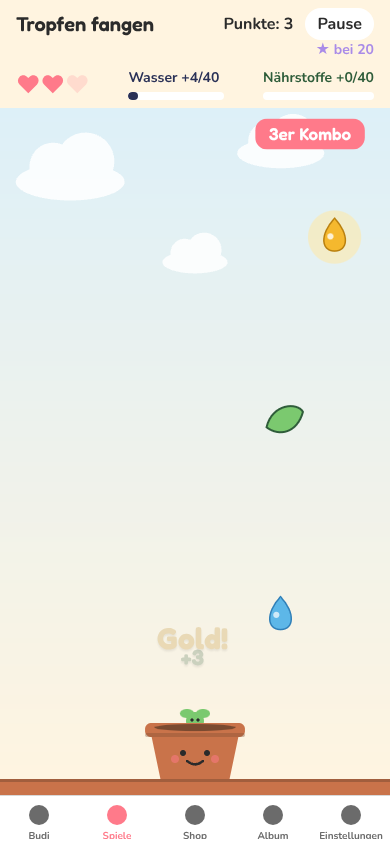 |
| Tropfen: Schutzblase um den Topf | 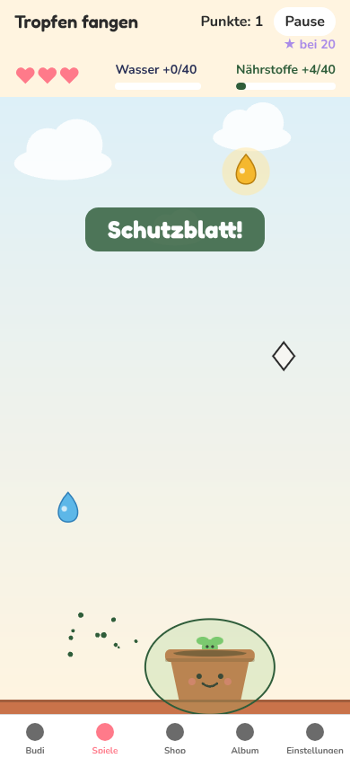 |
| Jump: Wander-Blätter mit Pfeilen, Sonnenstrahl (Vorschau ab Höhe 0) | 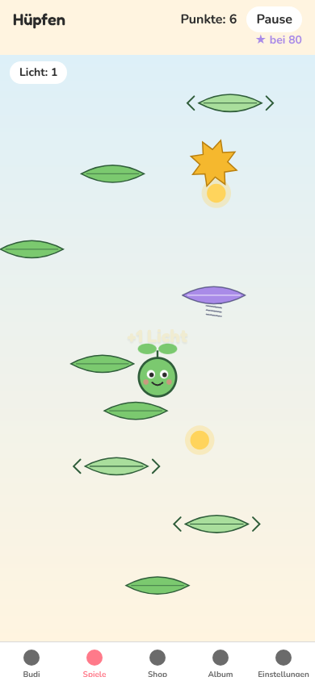 |
| Quiz: Joker hat eine Antwort weggenommen, Bedenkzeit | 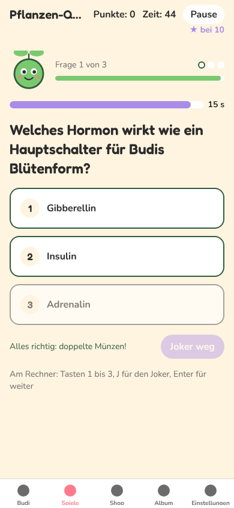 |
| Quiz: Zeit um | 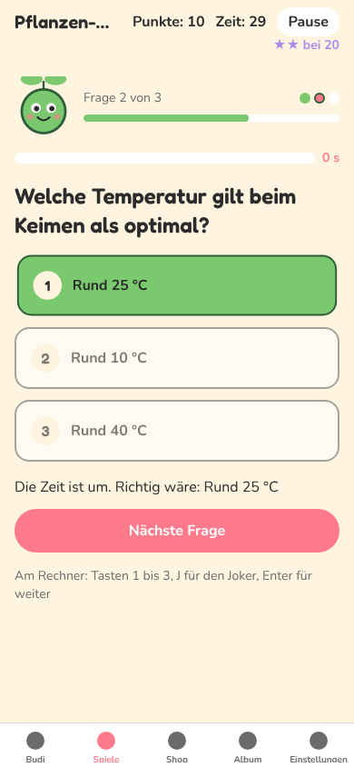 |
| Tropfen: Ergebnis mit Tipp zum Schutzblatt | 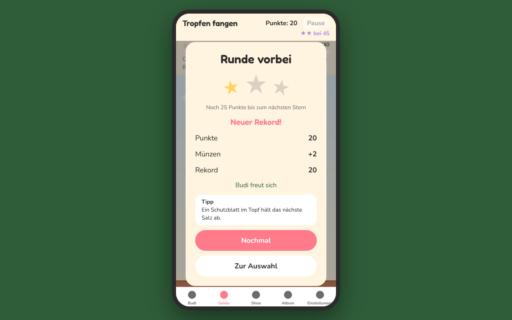 |

Die Vorschau-Bilder 06 und 08 sind mit hochgesetzten Chancen gebaut (nicht eingecheckt), damit alles auf einem Bild ist.

## Offen

- Kein sechstes Minigame: Es bräuchte eigene `MINIGAME_REWARDS`-Annahmen oder Tagesziele, das wäre Balancing.
- Keine eigenen Töne für Gold, Schwarm oder Joker: vorhandene Cues (`collect`, `hit`) genutzt. Neue Dateien in `assets/sounds/` wären Sache des Chefs.

## Fehlende Assets

- Keine. Alle neuen Figuren sind Skia-Formen.

## Bekannte Bugs

- Im Headless-Browser läuft die Spielzeit langsamer als die Uhr (Screenshots bremsen die Bilder). Auf dem Handy nicht zu erwarten, dort messen.
- Budi Jump: Partikel (Funkenspur) liegen im Bildschirm, nicht in der Welt (wie bei WEB-2 notiert).

## Handy-Test (3 bis 5 Punkte für den Chef)

1. Tipp den Kreis: ab und zu kommt eine goldene Knospe (+3, „Gold!“). Ab 8 Sekunden vor Schluss „Endspurt!“. Oben rechts steht „★★ bei 35“ und dein Rekord; überholst du ihn, kommt „Neuer Rekord!“.
2. Schädlinge: braune Milbe mit Panzer zweimal antippen („Knack!“, dann platt). Bei 15 und 30 Sekunden „Schwarm!“ mit drei Mücken.
3. Tropfen: goldener Tropfen gibt +3. Grünes Blatt fangen: Topf bekommt eine grüne Blase, nächstes Salz kostet kein Herz („Geschützt!“). Nach 30 Sekunden „Regenschauer!“.
4. Budi Jump: ab Punkte 50 hellgrüne Blätter mit Pfeilen, die wandern. Eine goldene Sonne trägt Budi nach oben.
5. Quiz: jede Frage hat einen eigenen Zeitbalken (16, 12, 9 s). „50:50“ nimmt eine falsche Antwort weg.

## Entscheidungen

- Neue Sonderpunkte sind selten und teils mit Gegengewicht (steigender Salz-Anteil, Panzermilbe ohne Bonus), damit die Münzen pro Runde nur leicht steigen. Formel und `MINIGAME_REWARDS` unverändert.
- Neue Felder in den Zuständen sind optional (`golden?`, `hitsLeft?`, `swarms?`, `shield?`, `vx?`, `boosts?`), damit alte Tests und Aufrufer unverändert gelten. `DropsStepEvents` bekommt neue Felder nur, wenn etwas passiert ist.
- Panzermilben sind ein Teil der Milben (gleiche Zufallszahl), Marienkäfer- und Mückenanteil bleiben.
- Budi Jump: neue Zufallszahlen erst ab `movingFromHeight`, damit die Strecke darunter je Startwert gleich bleibt.
- Quiz-Bedenkzeit läuft mit der Spielzeit, steht also in der Pause.

## Gefunden, nicht gemacht

- `src/components/facts/FactQuizGame.tsx` wird nicht mehr benutzt (Route nutzt `minigames/quiz/QuizGame.tsx`). Ich habe die Datei nicht gelöscht, weil sie zu P17 gehört. Kann weg.
- Bei 390 Breite wird der Spielname in der Kopfzeile abgeschnitten („Schädlings-…“), sobald Zeit zweistellig ist. War vorher schon so.
- `MINIGAME_REWARDS.typicalScores` passt weiter nicht zu den Messwerten (siehe WEB-2).
